# PADE - architecture map

One-read orientation for agents and humans: every module, its single
responsibility, and who it talks to. `docs/requirements.md` holds the product
spec; `CLAUDE.md` holds the engineering rules. Keep this file in sync when a
module is added, split, or renamed.

Two layers, one boundary: the Svelte frontend never talks to Tauri directly -
every IPC call funnels through `src/lib/ipc/` (`sendMessage` / `onMessage` in
`messaging.ts`), where every response and event payload is validated with zod.
Shared payload schemas live in `src/lib/types.ts`; argument shapes live in the
protocol maps beside the `Command` / `EventType` enums.

## How it works

PADE wraps an AI coding-agent CLI (Claude Code, Codex, opencode, …) running **unmodified in
a real terminal** and builds a comprehension-first GUI around it. The big idea:
the agent writes; you stay the owner. So the screen is a live terminal on the
left and glanceable review panels on the right.

Under the hood there are just **two layers with one door between them**. The
Svelte webview owns everything you see; the Rust core owns everything native
(processes, the filesystem, git). They only ever speak through Tauri IPC, and on
the frontend that traffic is squeezed through a single module -
`lib/ipc/messaging.ts` - which validates every payload with zod so bad data
fails loudly at the boundary instead of corrupting a panel.

The door is shaped like `@webext-core/messaging`. A `Command` enum names every
`#[tauri::command]` by its registered Rust name and an `EventType` enum every
event channel; `CommandProtocolMap` / `EventProtocolMap` say what each one
takes (the argument object the Rust command takes, camelCased by Tauri) and
answers, and `COMMAND_RESPONSE_SCHEMAS` / `EVENT_PAYLOAD_SCHEMAS` hold the zod
schema for each - type-checked against the maps, so the schema stays the single
source of truth. `defineTauriMessaging` (`ipc/define-tauri-messaging.ts`) turns
them into `sendMessage(Command.x, data)` (invoke, then parse the reply) and
`onMessage(EventType.x, ({ data }) => …)` (a listener scoped to this window's
label that parses each payload and resolves to its unlisten function). Callers
use those two directly; only helpers that add behaviour sit on top -
`sendSettingsMessage` / `addRoot` (`settings/settings-requests.ts`) queue a
settings-returning command and adopt its reply into the settings store, and
`ipc/platform.ts` carries the non-command Tauri APIs (this window's label,
title and close request; the clipboard plugin). A drift-guard test holds
`Command` equal to `lib.rs`'s `generate_handler!` list and every app
`EventType` to an emit in the Rust sources.

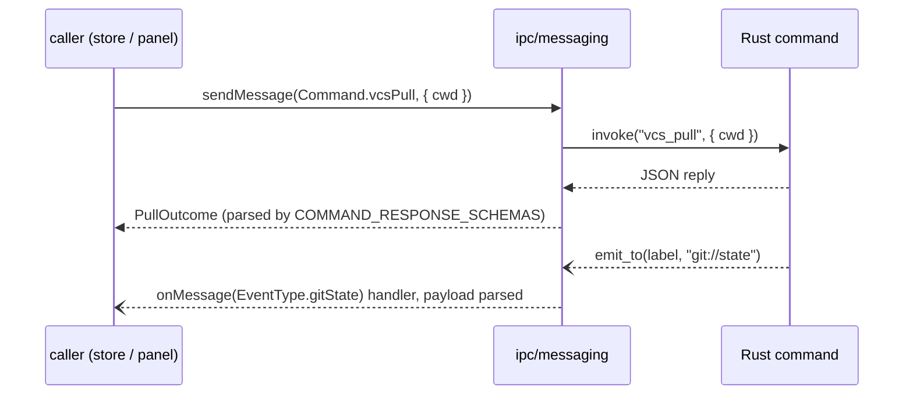

The webview is treated as untrusted input, not an authorization boundary. A
restrictive CSP blocks remote code/resources; native commands re-check paths,
object ids, URLs, sizes, and ownership. PTYs, task runners, config reads, and
watchers are bound to the calling window so one project window cannot inspect or
control another.

WebView2 browser arguments are resolved before Tauri creates any window. On
Windows, `lib.rs` reads the persisted passthrough `softwareRender` preference
(with `PADE_SOFTWARE_RENDER=1` as an override) and adds `--disable-gpu`; because
that switch is launch-only, Config persists the choice and sends
`Command.restart` only when the user explicitly asks to restart.

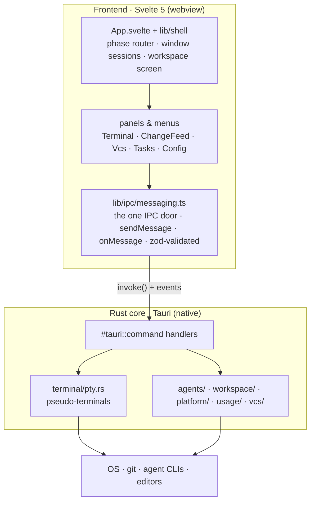

### Screens are phases

`App.svelte` is a small state machine. It boots into one of three full-window
phases and never shows two at once.

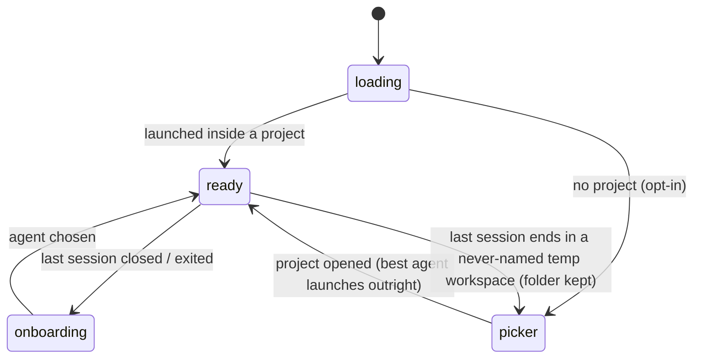

Opening a project never blocks on a chooser: the saved per-project/default
agent - else the first installed agent in registry order - launches straight
into the workspace. `onboarding` is the *afterwards* screen, shown when the
last session is hand-closed or exits without a respawn. A **temp workspace
that never earned a name** skips both the respawn and onboarding: ending its
last session (closing the tab, or the agent quitting) hands the window back to
the picker; one that was auto-named keeps the normal behavior. Leaving never
deletes a temp folder. Only the opt-in **unused-temp cleanup**
(`prefs.tempCleanupDays`) does: the backend stamps every project's last use in
`workspaceLastUsed` when a window opens it, leaves it (`window_register_project`
sees the previous path) or closes (`WindowEvent::Destroyed`) - the same stamp
the launcher's Recent list and the switcher show as "last accessed"
(`LastAccessed.svelte`) - and every picker
refresh's `workspace_prune` deletes the temps idle past the window, skipping
ones open in a live window or pinned. A temp seen with no stamp has its clock
started, so turning the setting on never deletes anything at once.

### Finding an installed agent

Detection cannot trust `PATH`. A process inherits its environment **once**, at
launch - and a GUI app inherits it from the Explorer session that started it,
itself born at login. An installer's `PATH` edit lands in the registry, so a
running ADE would never see a CLI the user just installed, and Reload would keep
insisting it isn't there. Nor can detection trust the *name*: winget's Codex
package unpacks OpenAI's release binary verbatim, so on that machine `codex` is
spelled `codex-x86_64-pc-windows-msvc.exe` and no `codex.exe` exists at all.

So `util::search_directories()` rebuilds the search path from its sources on every
detect - the inherited `PATH`, the **live** `PATH` read back out of the registry,
and the bin directories package managers use (npm, pnpm, cargo, bun, Homebrew,
and each winget package folder) - and `agents::program()` searches it for the
agent's canonical name first, then the `aliases` its installers are known to use.

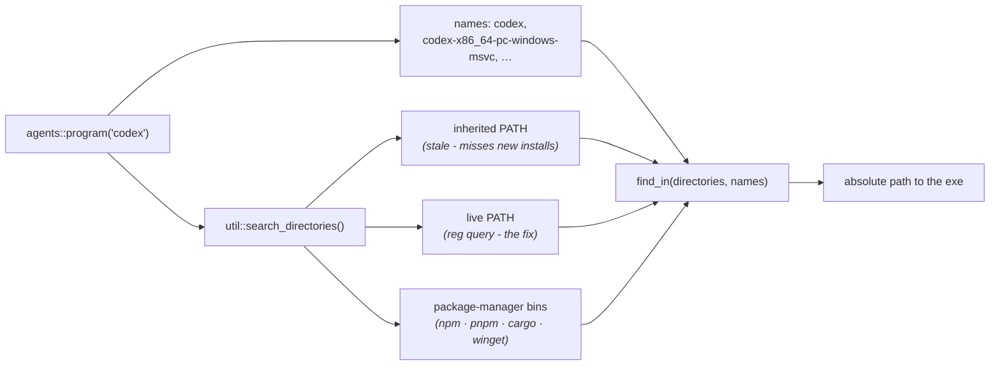

One resolver, three callers - **detection** (is it installed?), **`pty.rs`** (what
to exec for a session), **`naming.rs`** (what to exec headlessly) - so an agent ADE
can *see* is always one it can *run*. Sessions exec the **absolute path**, never a
bare name: a bare name would be re-resolved by the child against that same stale
`PATH`, and an agent ADE had just listed could fail to start. Per-agent knowledge
(`spawn_environment`, `oneshot_invocation`) stays keyed by the canonical command, never by
whichever file an installer happened to lay down.

### A terminal session is the unit of work

Each terminal tab is a **session** - an id, a launchable `{ id, label, command }`
record, and a cwd (optionally a worktree). There is no separate agent-kind field:
the same shape also launches the shell fallback and console editors, with extra
arguments where needed. `Terminal.svelte` mounts an xterm.js instance per session
and its `lib/terminal/session/terminalSession` asks the core to spawn a PTY; bytes then
stream both ways over Tauri events. All sessions stay mounted (`TerminalPanes`)
so scrollback survives tab switching.

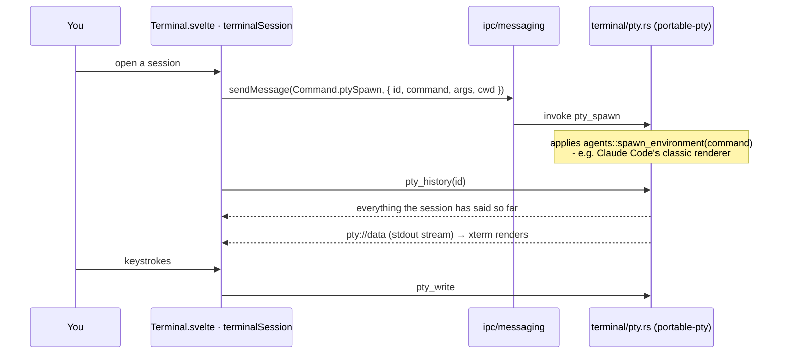

A spawn for a session that is already running is a no-op, so a terminal may be
mounting onto a conversation **in flight** - a hot-reloaded component, a reloaded
window. A PTY keeps no scrollback of its own, so without a replay that terminal has
nothing to paint and sits blank while the agent, quite happily, waits for input (it
reads as "the agent isn't starting"). `pty.rs` therefore keeps each session's raw
stream and hands it back through `pty_history`. Every chunk carries its position in
the stream, so a frontend already listening to the live feed while it asks for the
history can tell which chunks that history already contains from which are new.

That attach path is also what makes a whole-window reload survivable. The shell
persists its pane mapping (project + sessions + layout) under its window label
in localStorage (`session-restore`), and boots by intersecting it with the
backend's live roster (`pty_list`): whatever is still running is re-adopted pane
by pane and replayed - so an accidental reload (F5, a crash recovery) lands back
inside the project instead of orphaning invisible agents behind a picker.
Liveness is never persisted, only *read*: a **deliberate** leave (going back to
the picker, closing the window - the shell intercepts the
close via `onCloseRequested` and lets the window go only once its sessions are
dealt with) first waits for each session to go idle (`whenSessionIdle` - the
`ready` output-quiet signal, so nothing mid-flight is severed; the agent's own
auto-save plus `/resume` cover continuity) and then kills its PTYs, which is
exactly why nothing survives the next boot's intersection. The intersection is
the whole safety story, so the snapshot is free to outlive the webview: an app
restart kills every PTY, so a snapshot left behind by an earlier run matches
nothing live and is cleared instead of resurrecting agents the user meant to
end. It must outlive it, because a crashed window is rebuilt with a *fresh*
webview - sessionStorage went with the old one, and the record of which sessions
the window owned went with it.

The backend leans on that same seam for **`WebView2` crash auto-recovery**
(`platform/recovery.rs`): each window's frontend arms it on boot via `recovery_arm`
with its live `location.href` (the frontend is the one party that always
knows the real URL - a backend capture at window creation raced navigation
and once rebuilt a crashed window onto `about:blank`). When the webview's
browser process dies under load, the window is destroyed and rebuilt with the
same label and that URL; the fresh frontend re-adopts the label's
still-running sessions exactly as a manual reload would, and re-arms itself.

A **fullscreen** program's history is not a document, though - it is a stream of edits
to a framebuffer, and a trimmed one replays as a torn frame. So `pty.rs` also tracks
which screen the program is on, and for the alternate one the terminal replays what it
has and then asks the program to repaint (a one-row resize and back): the program's own
model of the screen is the only complete copy.

### A window holds sessions from several projects

Every session carries the **project** it belongs to (`AgentSession.project`, beside
its own `cwd`), so one window runs sessions from as many projects as the user
opens. Opening a project never stops anything: picking a project row (or its +
button) starts a new session in it beside the others, picking a persisted chat
relaunches just that chat, picking a recorded conversation resumes it, and
picking a live chat selects it (`project-entry` decides: `enterProjectChats` for
an empty window, which restores the project's persisted chats; `joinProjectChats`
for a window that already runs sessions).

The window's **project context follows the active session**: `windowSessions`
derives `activeProject` from the active session's project (`session-projects`'s
`frontProject`, falling back to the project the window was last pointed at), and
every project-scoped surface reads that one value - the top-bar project and
editor launcher, the Change Feed's watch root, the repository and branch pill,
the tasks, the usage pacing's per-project settings, the window title, the `w=`
address, crash-recovery arming and `window_register_project`. Selecting a session
of another project switches them all together without touching a session: every
terminal stays mounted (`TerminalPanes` keeps all of them, the tab strip shows
only the front project's), so nothing restarts and nothing reflows behind a view
transition. Closing a project's last session hands the front to another
project's session; only the window's very last session runs the emptied-window
policy (`session-exit`).

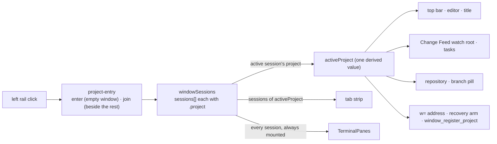

The chat registry is written the same way: the window's live sessions become
persisted chats each under its own project (`registryWithLiveChats` upserts them,
never dropping the project's other stored chats); a chat leaves the registry only
when it is retired for good - closed by hand, quit, replaced by a handoff
successor or re-keyed - or deleted from the rail. The rail (`sidebarProjects`)
lists, per project, its live sessions in this window, the sessions other PADE
windows report running (marked with the window glyph, their own status dot), its
persisted chats nothing runs, and the recorded conversations none of those holds.
Other windows' sessions come over the agents board (`lib/dashboard`): every
project window publishes its snapshot there, and a project window's rail listens
through `boardRoster` (a `rollCall` asks the others to publish without counting
as a watching dashboard); a window that says goodbye or leaves `window_list`
drops off at once. Clicking a session another window runs focuses that window and
asks it, over the same board, to bring the session forward
(`chat-click` holds the whole click decision).

**Multi-window.** A window registers only its *front* project with the backend.
A project another window has in front is still focused there rather than opened
twice (unless this window already runs it), so two windows may each run sessions
of one project only when one of them has it in the background.

**Moving live sessions between windows.** A PTY belongs to the window that owns
it, and its output pump reads that owner per chunk (`pty::SessionOwner`), so
handing a session to another window is an owner change - the process keeps
running untouched - followed by the receiving window re-attaching its terminal
the usual way (spawn is a no-op for a live session, `pty_history` replays it).
`platform/window_handoff.rs` moves the PTYs (`transfer_sessions`, all or nothing)
and parks a payload describing them for the receiving window (validated by zod
on arrival, `lib/shell/handoff/window-handoff`); `lib/shell/handoff/windowHandoffs` is the one
frontend path for every case:

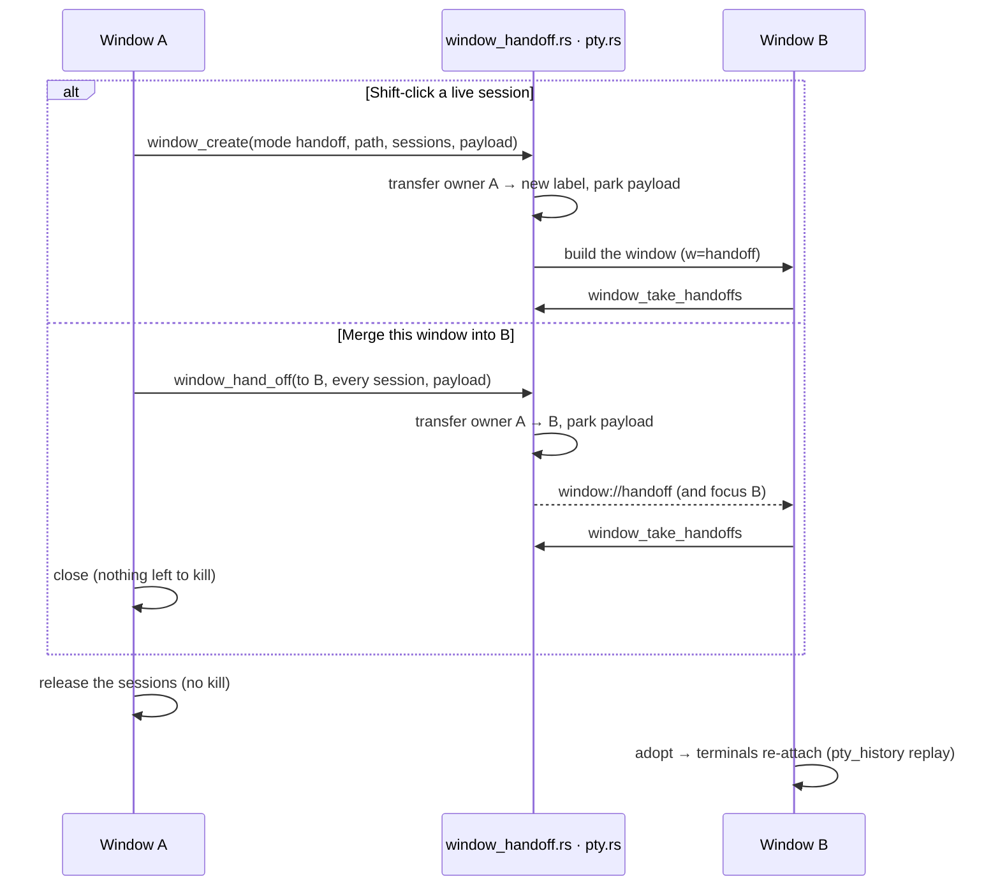

A shift-clicked persisted chat or recorded conversation goes the same way with no
PTYs: the new window enters its project and relaunches or resumes just that one.
Closing a window still ends every session it holds, of every project, moved-in ones
included: the frontend's graceful leave kills them, and `window.rs`
`on_destroyed` ends whatever PTYs the closed window still owned (unless the window
is being rebuilt after a webview crash), so no agent outlives its window.

### A terminal has two screens, and they invert every rule

How a resize must behave is a property of **which screen the program paints on**, not
of the emulator - and ADE hosts both, so the pane's terminal session watches
`buffer.onBufferChange` and `lib/terminal/fit/terminalFit` switches policy on it.

| | **Normal screen** (a shell, aider, or another line-oriented agent) | **Alternate screen** (Claude Code as ADE runs it, Codex, OpenCode, Copilot, a pager) |
| --- | --- | --- |
| What it holds | A real document, with real scrollback | A framebuffer the program owns and diffs against its own model of |
| Who paints a row | The terminal - so xterm can rewrap the text itself, continuously, like a web page | **Only the program** |
| Grid refit | Every frame, so the text tracks the drag | **Flow-controlled**: one resize in flight at a time, the next only once the program has finished painting the last (and never more often than `ALT_FIT_MINIMUM_INTERVAL_MS`). Resize it faster than it can follow and its model desyncs - measured, that stops it painting altogether and the pane goes blank for good. Freezing the grid instead would be safe, but then the TUI only updates when you let go |
| `SIGWINCH` | **Width only**, debounced; the height never. An inline document wraps to the width, but how much of it you can see is the terminal's business - and every `SIGWINCH` makes the agent re-lay-out (dropping a line, which steps the text above it) and reprint its whole static history (a per-frame drag left **52** orphaned conversations in the scrollback) | **Cols and rows, immediately.** A size the program has not heard is a row nobody paints |
| Grid anchor | Top while the conversation fits, bottom once it scrolls - pinning the end you are looking at, so the sub-cell remainder and the row xterm scrolls away cancel out | **Top.** The program's frame is rigid, so the unpinned edge is the one that jumps a row on every boundary: pinning the top nails the conversation (measured: not one pixel of movement across three row changes) and leaves the remainder as an invisible strip of terminal background at the bottom. While the program is catching up the grid can be taller than the pane, which would cut its status line off - so it is scaled to fit (~3% at worst), back to exactly 1 the moment it catches up |

ADE runs Claude Code **however the user's own `tui` setting says** - it sets no renderer
env, exactly as Windows Terminal sets none. It used to force `CLAUDE_CODE_NO_FLICKER=1`,
and that choice decides who owns the *scrollback*, which decides what a wheel tick costs:
measured in the live app, **31ms per notch on the alternate screen** (the tick has to
become a request - mouse report → IPC → PTY → whole agent repaint → IPC → DOM) against
**9ms on the normal screen** (a local xterm viewport scroll). Both columns are live: Codex,
pagers, and anyone choosing `tui: "fullscreen"` still get the alternate screen and every
rule in its column. Note `CLAUDE_CODE_NO_FLICKER` beats the `tui` setting and a
`settings.json` `env` block sets it globally - so check that before concluding which
renderer a session is on.

One xterm patch backs this (`patches/@xterm__xterm@…`; it also keeps a parser
exception from freezing the write queue for good, see `docs/terminal-rendering.md`), making a row resize a lossless
round trip. Stock, a **shrink** `pop()`s the line below the cursor - while its own
comment claims that line is blank - which destroyed the agent's `accept edits` hint;
and a **grow** refuses to reclaim the scrollback whenever anything sits below the
cursor, pushing blank lines under the conversation instead, so shrink→grow marched the
conversation off the top and left the pane full of dead space.

`docs/terminal-rendering.md` has the measurements and the approaches that were
tried and rejected.

### Right-to-left text sits on top of the grid, not inside it

A terminal cell holds one glyph and a grid is ordered left to right, so Arabic and
Hebrew break both halves of that: their letters *join* into different forms depending
on their neighbours, and they read the other way. xterm paints them cell by cell -
disconnected, and backwards (`מידע נוסף` comes out `ףסונ עדימ`).

ADE does not rewrite the stream to fix this, and does not reshape or reorder a single
character itself. The buffer keeps exactly what the agent wrote, and an **overlay**
(`TerminalRtl`) draws the right-to-left parts on top, handing each one to the browser
as a single string so its own bidi algorithm and OpenType shaping do the work.

Two decisions carry it:

- **Runs, not lines.** Only the columns that actually read right to left are covered
  (`terminal-rtl`), anchored to exactly those cells. A whole-line overlay would drag a
  TUI's box borders and aligned columns off the grid with it; a run leaves every other
  pixel as xterm painted it, and a frame glyph ends a run so a border is never swept
  into one. A run reaches as far as the bidi algorithm itself would - through a number
  that follows the phrase, since that number is reordered with it - and is laid out in
  the grid's own left-to-right base direction, so it starts at its first column instead
  of hanging off its last.
- **Only for agents that write logical order.** Claude Code runs the bidi algorithm
  over its own rows before writing them, so its output is already visual and
  reordering it again reads backwards. `reorders_bidi` in the `agents.rs` registry
  says which agents do this, and the terminal never turns the overlay on for them.
- **Nothing downstream sees it.** The overlay is `pointer-events: none` and
  `aria-hidden`, so selection, links, clicks, the copied text, the context parser and
  the accessibility tree all still read the agent's own logical order. Reordering the
  *stream* instead - the obvious approach, and the one a VS Code extension has to take -
  would corrupt every one of those, and cannot work on the alternate screen at all,
  which is where ADE's agents live.

Cost when there is no such text: one string and one regex per visible row, and not even
that until a session has printed a right-to-left character at least once.

### Opening a project in an editor

"Open in editor" forks on **how the editor runs**. A GUI editor (VS Code,
JetBrains, Zed…) is launched by the OS and detaches into its own window. A
**console editor** (Neovim, Vim, Helix) needs a real TTY, which the OS spawn
can't give it - so PADE opens it in a **new terminal tab** right beside the
agent, reusing the very same PTY machinery sessions use. The `ide.rs` `family()`
table is the single place that knows which editors are terminal-based, and it
also drives add-an-editor validation and jump-to-line launching (DRY).

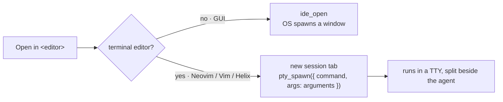

### The Change Feed groups by manifest, not by name

A directory called `frontend/` proves nothing - the ground truth of "what
owns this file" is on disk: a **manifest** makes a folder a package, a **`.git`**
makes it a checkout. `members.rs` finds both in one census walk and reports them
as a single list, each member flagged `repository` when it has git of its own.

The two are confirmed differently, and deliberately so. A package must be
*declared*: the root's workspace-defining files contribute the include/exclude
patterns, and a manifest-holding directory is a member IFF a pattern claims it.
A checkout declares itself: nobody lists nested repos anywhere, so the marker is
the whole test - which is why a checkout the workspace's own `exclude` array
rejects is still a member (Cargo's exclude speaks about a build, not about what
is in the folder).

That one list drives everything downstream. `change-groups.ts` assigns each
changed file to its deepest enclosing member by whole-segment longest-prefix -
`apps/web` never captures `apps/web-admin` - with the repo root as the
always-present fallback bucket. `workspace-members.ts` resolves the member a
group belongs to and the **enclosing checkout** whose branch it should show, so a
monorepo package reports the repo that contains it and a nested checkout reports
itself. `stores/workspace/workspaceMembers` holds the list, those branches, and which
member the workspace is pointed at - the top bar's switcher, the branch pill and
the working directory of a new agent or the editor. A workspace with no confirmed
members keeps the old `apps/`·`packages/`·`services/` folder-name convention and
no switcher at all, so single-repo behavior is unchanged.

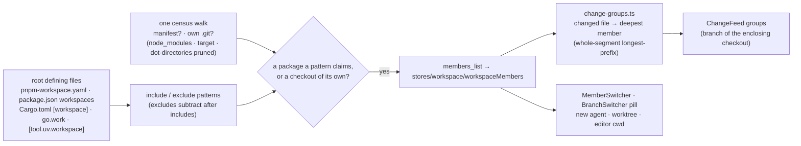

Everything below is the module-by-module map: each file, its single
responsibility, and who it collaborates with.

## Frontend - module map

`src/lib` is grouped by feature or concern; every module sits beside its
colocated `*.test.ts`. The core boundary stays at the root:

```
src/
  main.ts · App.svelte · theme.css      app shell
  lib/
    ipc/ · types.ts · validate.ts       the IPC door, payload schemas, input schemas
    Icon.svelte · icons/                the one icon renderer and its SVGs
    agent/ model/ terminal/ session/    a running agent: identity, model, terminal, tabs + panes
    feed/ code/ vcs/ usage/             what the review panels and the top bar show
    workspace/ dialogs/ ide/ runners/   project rows + window menu, prompts, launchers, the task dock
    settings/ shell/ ui/ util/          prefs, app-shell wiring + workspace screen + left rail, UI primitives, plain helpers
    stores/{agent,model,session,tasks,ui,usage,workspace}/   cross-component rune state
  panels/                               one component per side panel, plus picker/ vcs/ config/ feed/ tasks/
```

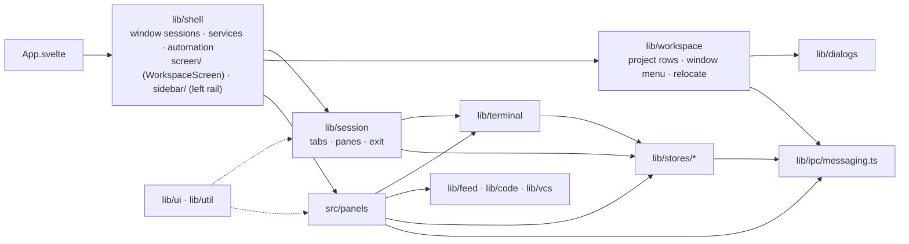

### App shell (`src/`)

| Module | Responsibility | Collaborators |
| --- | --- | --- |
| `src/main.ts` | Entry: loads the theme, then mounts `App` - or, for the `?w=dashboard` window (`window-route` `isDashboardAddress`), the lazily loaded `panels/dashboard/AgentsDashboard` in its place, so the dashboard runs none of a project window's machinery | `App.svelte`, `theme.css` |
| `src/theme.css` | M3 Expressive tokens, the Cyberpunk palette's two faces and the skin that reinterprets the app in them, global keyframes, base document styles, and the cross-cutting shells many components share by class name - the anchored `.popover-menu` with the `.menu-separator` / `.menu-divider` a menu puts between its rows, `[popover]`, the `.ck` checkbox, the `[data-tooltip]` bubble | everything |
| `src/App.svelte` | App-shell orchestrator: phase routing (loading → picker / onboarding / ready), agent detection, spawned-window boot (`window-route`), reload re-attach (a boot first re-adopts the backend's still-live sessions via `session-restore`, before any stale `w=` query routing - and `windowAddress` keeps that `w=` query rewritten to the project actually on screen, so even a snapshot-less reload lands right), what an emptied window does next (`session-exit`: respawn the same agent in the same project when the window's last session self-exits, e.g. Ctrl-C; a never-named temp workspace instead returns to the picker), opening projects beside the running sessions (never stopping one - see "A window holds sessions from several projects"), the rail's chat clicks (`sidebar/chat-click`), the window hand-offs (`windowHandoffs`, booting a `w=handoff` window from them), leave-to-picker and an intercepted window close (deliberate leaves - one at a time - gracefully kill every session of every project the window holds - idle-first via `whenSessionIdle`); adopts `settings://changed` (`EventType.settingsChanged`) so settings another window moved - a workspace it deleted, a pin it toggled - land here too instead of this window drifting until its own next mutation. Composes the extracted shell parts: the sessions and pane layout (`windowSessions`), the automatic recovery loops (`sessionAutomation`), the background services (`windowServices`), the top-bar repository (`activeRepository`), the keyboard (`session-shortcuts`, `WindowEvents`), and the screens (`BootSplash`, `WorkspaceScreen`, `ProjectPicker`, `Onboarding`) | `lib/shell/*`, `session-restore`, `session-exit`, `project-entry`, `workspace-relocate`, `settings.svelte`, `stores/ui/toast` |

### Core (`src/lib/`)

| Module | Responsibility | Collaborators |
| --- | --- | --- |
| `src/lib/ipc/messaging.ts` | The single UI ↔ Rust boundary: the `Command` / `EventType` enums, the protocol maps (argument and reply/payload types), the zod schema records checked against them, and the `sendMessage` / `onMessage` every caller uses | `types`, `define-tauri-messaging`, everywhere |
| `src/lib/ipc/define-tauri-messaging.ts` | Protocol-agnostic factory: `sendMessage` invokes a command and parses its reply, `onMessage` listens window-scoped and parses each payload | `ipc/platform`, `@tauri-apps/api` |
| `src/lib/ipc/platform.ts` | The Tauri APIs that are not app commands: this window's label, title, focus and close request, the clipboard plugin | `@tauri-apps/api`, `@tauri-apps/plugin-clipboard-manager` |
| `src/lib/types.ts` | Zod schemas + TS types for every IPC payload; shared enums | `ipc/messaging`, everywhere |
| `src/lib/validate.ts` | User-input schemas (trust boundary) + `parseInput` / `nameError`; owns the clone-URL shape knowledge - `CloneUrl` (https / ssh / scp-like), `GitUsername`, `GitSecret`, `isSshCloneUrl`, `repositoryFolderName` | form components |
| `src/lib/Icon.svelte` | The one icon renderer: every glyph is a `.svg` in a semantic subfolder of `src/lib/icons/` (agents, editors, languages, actions, ...), found by its base name (a duplicate name fails loudly) and named in `ICON_NAMES` | everything |

### Agents (`src/lib/agent/`)

| Module | Responsibility | Collaborators |
| --- | --- | --- |
| `src/lib/agent/agent-icon.ts` | The agent ids (`AgentId`, mirroring `agents.rs`) and each agent's brand mark | `tabs/TabStatusGlyph`, `tabs/LaunchMenu`, `usage-groups`, `usage/meter/*`, picker |
| `src/lib/agent/choice-prompt.ts` | Pure, conservative detector (`detectChoicePrompt`) for the agent's on-screen multiple-choice prompt in the PTY stream: strip ANSI (`ansi`), then require the `❯` selection cursor on a numbered option plus ≥2 numbered options, so ordinary numbered prose never trips it | `ansi`, `stores/session/sessionAttention` |
| `src/lib/agent/initial-prompt.ts` | Pure `trustGateKey` - reads a fresh agent's first-run "trust this folder?" gate off the rendered screen rows and names the key (Down/Up/Confirm) that walks its selection onto "Yes, I trust this folder", so the terminal can accept it before delivering a new session's first prompt (the option order is the CLI's to change - Claude 2.1.286 lists "No, exit" first). Plus `promptEchoed`, the delivery's echo check. A deliberate, documented coupling to the CLI's observable wording, scoped to that one always-safe gate | `choice-prompt`, `ansi`, `initial-prompt-delivery` |
| `src/lib/agent/submit-prompt.ts` | `submitPastedPrompt`: types a request into a running agent's composer the way every TUI accepts - a paste, a settle, then a separate Enter re-sent until the agent is seen working (never the pasted text again) | `terminal-input`, `stores/session/sessions`, `stores/agent/handoff`, `stores/usage/usagePacing` |
| `src/lib/agent/auto-name.ts` | Temp-workspace auto-naming: distinct-file counting, once-per-workspace naming call, saved as `LabelSource.auto` - so the backend never lets it replace a label already there (the user's own relabel included) | `ipc/messaging`, `paths` |
| `src/lib/agent/ai-naming-scope.ts` | Where "name session tabs with AI" is decided - the one pure resolution of project override (`prefs.aiSessionNamingProjects[path]`, set in the Config panel) → global default (`prefs.aiSessionNaming`, set in the project picker) → off. Absence is a state at both levels and the only way back up the chain, so the Config control writes `undefined` to revert rather than freezing the project at whatever the global read that day | `types`, `windowSessions`, `config/SessionTabsSettings`, `picker/OnLaunchSection` |

### Models (`src/lib/model/`)

| Module | Responsibility | Collaborators |
| --- | --- | --- |
| `src/lib/model/model-label.ts` | A model id as a person reads it (`claude-opus-5-5` reads "Opus 5.5"); an id that isn't Claude's shape shows as logged, minus its provider prefix. Also where an effort level sits on its ladder (`effortStep`) and the level below it (`lowerEffort`) | `ModelTag`, `ModelMenu`, `stores/agent/context`, `model-cost` |
| `src/lib/model/model-cost.ts` | `cheaperChoice`: one notch cheaper than a model at an effort - the next effort level down, else the dearest catalog model in a cheaper tier (tiers read from the family word in the id: Haiku/mini, Sonnet, Opus) | `stores/usage/usageAdapt` |
| `src/lib/model/agent-model-scope.ts` | Where a new session's starting model is decided: the workspace's pick (`prefs.agentModelProjects[project][agent]`, set in Config) or, with no entry, the agent's own saved default. Absence is the only way back, so clearing removes the key (`record-entry`) | `types`, `windowSessions`, `config/models/AgentModelDefaults` |
| `src/lib/model/ModelTag.svelte` | A tab's running model: its name tinted by where its effort sits on the model's own ladder (`EffortTint`), the exact words in the tooltip. A button that opens the strip's one `ModelMenu`, anchored through the exported `MODEL_MENU_ANCHOR` | `EffortTint`, `model-label`, `stores/agent/context`, `tabs/SessionTab`, `tabs/TabModelMenu` |
| `src/lib/model/ModelMenu.svelte` | The model and effort menu a tab's tag opens: the agent's own catalog (`ModelPicker`) and the shown model's effort ladder (`EffortPicker`); a pick goes to `stores/model/modelSwitch` | `ModelPicker`, `EffortPicker`, `stores/model/modelOptions`, `tabs/TabModelMenu` |
| `src/lib/model/ModelPicker.svelte` | An agent's models as a pick list, the one in use checked, each with the effort level the agent recommends for it | `ModelMenu` |
| `src/lib/model/EffortPicker.svelte` | A model's effort ladder as one row of chips, running cool to hot in the tones a tab tints its model name | `EffortTint`, `ModelMenu`, `config/models/AgentModelDefaultRow` |
| `src/lib/model/EffortTint.svelte` | Text coloured by how hard a model thinks, in one of the theme's five effort tones (blue, green, amber, red, purple) | `ModelTag`, `EffortPicker` |

### Terminal (`src/lib/terminal/`)

| Module | Responsibility | Collaborators |
| --- | --- | --- |
| `src/lib/terminal/output/ansi.ts` | `stripAnsi` - remove a terminal's ANSI/control sequences so text matchers see the glyphs the TUI wrote, not the colour/cursor codes interleaved with them | `choice-prompt`, `task-detect` |
| `src/lib/terminal/input/terminal-input.ts` | Terminal input shared by every agent: the bracketed-paste newline (`PROMPT_NEWLINE`), the paste-then-Enter wrapper for a programmatic prompt (`submittedPrompt`), and the Shift+Enter newline chord | `terminalSession`, `terminal-keys`, `initial-prompt-delivery`, `stores/agent/handoff` |
| `src/lib/terminal/input/terminal-scroll.ts` | Turns a stream of wheel deltas (pixels, lines or pages) into whole scroll notches, carrying the sub-notch remainder, so a trackpad flick forwarded to a fullscreen agent as PageUp/PageDown doesn't fly through the conversation | `terminal-keys` |
| `src/lib/terminal/output/terminal-output.ts` | Pure terminal-paint budget policy: a shown terminal in the focused window flushes on the next animation frame; hidden or unfocused terminals use the bounded background cadence; plus `wheelScrollsTerminalDocument`, whether a wheel tick scrolls xterm's own document (and so may defer writes) | `terminal-output-scheduler`, `terminal-keys` |
| `src/lib/terminal/links/terminal-links.ts` | Clickable-URL link provider for xterm: rejoins soft-wrapped (`isWrapped`), hard-wrapped (a full row → glyph at column 0), and **self-wrapped** (upper row ends mid-URL, lower row resumes it - a fullscreen agent wrapping at a content width narrower than a wide terminal) rows so a wrapped URL hovers/activates in full instead of truncating. **Promoted above xterm's built-in OSC-8 provider** (xterm picks the lowest-index provider under the cursor; an agent that emits a URL as an OSC-8 hyperlink - Claude, OpenCode - would otherwise get that provider's agent-tagged range: a single self-wrapped row, or the wrapping parens) so the regex-parsed range wins for URL-shaped links; labelled OSC-8 links fall through to the built-in provider. A wrapped URL is returned as **one link per row** (a tight single-row range hugging that row's glyphs, all carrying the full URL text and its full span list) - a single multi-row range would make xterm treat the blank padding a self-wrapping agent leaves before the wrap as part of the link (clickable, and edge-filled by the built-in underline). The built-in underline is turned off (`decorations.underline`); on hover the provider **paints its own underline** (`.terminal-link-underline` divs appended into the xterm screen, positioned from cell geometry) over **every** span, so hovering any part underlines the whole URL tightly - no edge padding, and consistent over an agent's own SGR link styling. The self-wrap continuation test is **shape-agnostic**: it joins the two rows and asks whether a URL match crosses the seam (never inspecting how the upper row ends, which the pattern's trailing-punctuation trim makes unreliable for hosts like `…greenhouse.`), so it holds for host-only / `localhost` / IPv6 `[::1]` / IP / port / fragment URLs. The seam test runs against the whole growing window (not just the adjacent row) and walks up through a URL's scheme-less inner rows, so a URL wrapped across **three or more** rows rejoins whole from a hover on any of them. Both behaviours are pinned by a property test that splits a URL-shape corpus (incl. `%XX` escapes, `?`/`&`) at every wrap position. URL pattern / validity / cell back-mapping ported from `@xterm/addon-web-links` | `create-terminal` |
| `src/lib/terminal/links/terminal-link-target.ts` | Classifies an OSC-8 hyperlink before an OS integration gets it: network links go to the browser, a local `file:` link (how Codex exposes workspace paths) to Explorer | `create-terminal` |
| `src/lib/terminal/theme/terminal-theme.ts` | Pure design-tokens → xterm mapping - the terminal's theme and the find bar's match/active-match highlights (`--terminal-find-*`, kept translucent because the addon paints the active one OVER the glyphs), plus the one DOM read both resolve their tokens through (`rootTokenReader`); every color converted to parse-safe hex (`xtermSafeColor`: modern `hsl()` → `#rrggbb[aa]` - xterm's own parser silently drops any non-opaque color outside `#hex`/legacy `rgb()`, which lost the alpha selection token). Keeps the terminal surface truthful to PADE's scheme - for the user's eyes. A running agent never follows this palette through the protocol on Windows: the OSC 11 answer that would carry it never crosses ConPTY in either direction, so the DECSET 2031 `?997` relay (`terminal-color-scheme`) stays (documented, harmless) but moves nothing. What moves a live Claude is its watched theme definition, rewritten by `theming.rs` | `create-terminal`, `TerminalFind`, `terminal-palette`, `config/appearance/TerminalSchemePicker` |
| `src/lib/terminal/theme/terminal-color-scheme.ts` | The DECSET 2031 colour-scheme report a TUI that opted in is sent when the palette flips (xterm repaints but never reports it on its own), and `createColorSchemeRelay` - one pane's channel: spots the agent's handshake in its output (or a replay), treats a known subscriber (Claude, opencode) as subscribed after a re-attach, and relays each flip | `terminalSession` |
| `src/lib/terminal/theme/terminal-palette.ts` | Pure mapping of a chosen Windows Terminal scheme onto the `--terminal-*` design tokens (plus the terminal surface and caret), and `schemeOfBackground` - light or dark as the scheme's OWN background answers it, which is what the agent is then told. Installing a scheme writes tokens rather than talking to xterm, so every ANSI surface (the terminal, the runner dock's SGR parser) stays on one palette; `TERMINAL_PALETTE_PROPERTIES` is the same list the uninstall clears | `prefs.svelte`, `stores/ui/terminalSchemes` |
| `src/lib/terminal/find/terminal-find.ts` | Pure find-bar vocabulary: the Ctrl+F chord matcher (plain Ctrl only, so an agent keeps Ctrl+Shift+F and Ctrl+Alt+F), the search direction enum, the match-rule set as one table (option key - the addon's own - plus glyph, label and Alt chord, so a button, its tooltip and the key that flips it cannot describe three different things), whether a term compiles as a pattern, and the result readout ("1 of 12", "No matches", or the total alone once the addon stops tracking which match is active) | `TerminalFind`, `terminal-keys`, `tab-shortcuts` (chord shape) |
| `src/lib/terminal/find/TerminalFind.svelte` | Find-in-terminal for one pane: the Ctrl+F bar that floats over the output (absolutely positioned, so the measured viewport - and with it the PTY's grid - never changes when it opens). Owns its open state (the pane calls `reveal()`), the search term as a validated field (`TerminalFindTerm`), the three match rules (case / whole word / regex, per pane, flipped by click or Alt+C/W/R), and xterm's search addon, imported on first open so a session that never searches never loads it. A rule change re-runs the search through `clearDecorations()` first - the addon stores the options it was handed and then compares the next call's options against that same object, so a changed rule alone never invalidates its highlighted set. Enter / Shift+Enter step, Escape closes and hands the keyboard back; highlight colours come from `terminal-theme` and are re-applied when the palette flips. Searches xterm's ACTIVE buffer - a shell's scrollback, or just the visible frame while a fullscreen agent holds the alternate screen | `terminal-find`, `terminal-theme`, `validate`, `Icon`, `Terminal` |
| `src/lib/terminal/rtl/terminal-rtl.ts` | Pure right-to-left segmentation: which COLUMNS of a row read right to left (Arabic, Hebrew, Syriac, Thaana, N'Ko, Adlam - matched by Unicode Script property, not a hand-kept range table), split into the styled spans and caret/selection boundaries the overlay draws. Runs end at a strong left-to-right letter and at a **frame glyph** (box drawing / geometric shapes / Powerline), so a TUI's borders are never swept into a reordered run; interior neutrals stay inside a run (prose) up to a padding-width gap (a table column); a digit continues a run (the bidi algorithm carries a number along with the phrase before it) but cannot open one. Reshapes and reorders nothing - the browser owns the bidi algorithm and the shaping | `TerminalRtl`, `terminalSession` |
| `src/lib/terminal/rtl/TerminalRtl.svelte` | The right-to-left overlay for one terminal: reads the runs `terminal-rtl` marks out of xterm's buffer and draws each one over exactly the cells it covers, as a single string the browser shapes and reorders itself. Cell-anchored, not line-anchored, so everything around a run stays pixel-identical to what xterm painted; colours resolve through the same ANSI tokens as xterm's palette, so it follows a scheme flip. Latched off until its session has actually printed right-to-left text, and `pointer-events: none` throughout - selection, links, clicks, copied text and every output parser still see xterm's own logical-order buffer | `terminal-rtl`, `terminal-theme`, `Terminal` |
| `src/lib/terminal/input/send-shortcut.ts` | Global send-from-IDE shortcut: clipboard → active agent input | `ipc/messaging`, `ipc/platform`, `stores/ui/toast`, `windowServices` |
| `src/lib/terminal/input/SendSelectionButton.svelte` | Highlight-to-agent bridge: text selected in the side panel shows this button, which types it into the active session's input (a selection inside one code snippet goes as a path:line reference), then hands the keyboard back to the pane | `ipc/messaging`, `focus`, `WorkspaceScreen` |
| `src/lib/terminal/session/terminalSession.svelte.ts` | One pane's live terminal session: the xterm instance, the agent's PTY behind it and everything between them - spawning or re-attaching, replaying history, streaming output, input, resizing and status. Composes the modules below; the pane component keeps only the view | `create-terminal`, `terminalFit`, `pty-stream`, `pty-writer`, `terminal-output-scheduler`, `screen-sampler`, `agent-output`, `session-readings`, `sessionActivity`, `terminal-keys`, `file-drop`, `initial-prompt-delivery`, `terminal-color-scheme`, `Terminal` |
| `src/lib/terminal/fit/terminalFit.svelte.ts` | Fitting xterm's grid to its pane and telling the agent about it - the two-screens policy (normal: debounce width, never send height; alternate: send both, one refit in flight at a time, ask for a repaint), the anchor and the alternate-screen squeeze; `isOnAlternateScreen` is the flag, `docs/terminal-rendering.md` the policy | `pane-grid`, `terminalSession` |
| `src/lib/terminal/fit/pane-grid.ts` | Pure geometry for fitting a whole-cell grid into a pane that is not a whole number of cells (`gridForPane`, `squeezeToFit`); a transient undersized measurement yields no grid, so a dock/panel change never resizes an agent to a broken tiny one | `terminalFit` |
| `src/lib/terminal/session/create-terminal.ts` | Builds a pane's xterm instance: its options, its theme (`currentXtermTheme`) and its links (plain-text URLs via `terminal-links`, OSC-8 links classified by `terminal-link-target`) | `terminal-theme`, `terminal-links`, `terminal-link-target`, `terminalSession`, `Terminal` |
| `src/lib/terminal/input/terminal-keys.ts` | The pane's keyboard and wheel overrides on top of xterm's own: Ctrl+F to the find bar, Ctrl+C / Ctrl+V clipboard (an image pastes as its saved path), Ctrl+Backspace as erase-word, the Shift+Enter newline, and wheel ticks forwarded to a fullscreen agent as PageUp/PageDown (`terminal-scroll`) | `terminal-find`, `terminal-input`, `terminal-scroll`, `terminal-output`, `terminal-sequences`, `terminalSession` |
| `src/lib/terminal/input/terminal-sequences.ts` | The control sequences the pane writes - to the agent or into xterm (CSI, the alternate screen, PageUp/PageDown, Enter, cursor keys, word erase) - composed from named parts, plus `isFocusReport` | `terminalSession`, `terminal-keys`, `terminal-input`, `terminal-color-scheme`, `sessionActivity`, `initial-prompt-delivery` |
| `src/lib/terminal/output/terminal-output-scheduler.ts` | Joins token-sized PTY chunks before xterm writes them: one write per display frame in front at the live bottom, every 250ms in the background and while the user reads scrollback, and held back while a wheel gesture scrolls xterm's own document (until 120ms of quiet, one-second ceiling) - never when the wheel is forwarded to the agent, whose repaint *is* the scroll. Every byte and its order survive | `terminal-output`, `terminalSession` |
| `src/lib/terminal/pty/pty-stream.ts` | Parks live PTY chunks until the session's history has been replayed, then drops the ones the history already holds (by `seq`) and writes the rest in order | `terminalSession` |
| `src/lib/terminal/pty/pty-writer.ts` | One PTY write in flight at a time: keystrokes start at once, while input arriving mid-invoke (a paste, a key repeat) is merged so bursts cost one IPC call and never overtake each other | `terminalSession` |
| `src/lib/terminal/output/screen-sampler.ts` | Samples the rendered screen rows after xterm has processed a write, so context and usage-limit readers see whole phrases a cursor-motion TUI never sends intact, and scroll renders stay presentation-only | `terminalSession` |
| `src/lib/terminal/output/agent-output.ts` | Hands an agent's PTY output (live or replayed) to every store that reads meaning out of it - activity, context, usage-limit stops, API-error retry, MCP reloads | `stores/agent/*`, `stores/usage/usageResume`, `terminalSession` |
| `src/lib/terminal/session/session-readings.ts` | What a session's agent records about itself on disk - its context fill (`session_context`) and running model (`running_model`) - re-read at idle and on `agent-model://changed` for the pane's gauges | `ipc/messaging`, `stores/agent/context`, `stores/model/modelOptions`, `coalesce`, `terminalSession` |
| `src/lib/terminal/activity/sessionActivity.svelte.ts` | A pane's session status read off its PTY: output flowing is working, a quiet gap while alive is ready, exit is done | `activity-timing`, `terminal-sequences`, `terminalSession` |
| `src/lib/terminal/activity/activity-timing.ts` | The status's idle window (`IDLE_MS`) and the submit verdict that must outlast it (`SUBMIT_VERIFY_MS`), so a typed prompt whose paste or swallowed Enter merely echoed is never taken for submitted | `sessionActivity`, `initial-prompt-delivery`, `agent/submit-prompt` |
| `src/lib/terminal/input/initial-prompt-delivery.ts` | Delivers a new session's first prompt: walks the trust gate's selection to "Yes, I trust this folder" and confirms it, then once the agent settles at its REPL pastes the prompt and submits it with a separate Enter (the screen reading lives in `initial-prompt`) | `initial-prompt`, `terminal-input`, `terminal-sequences`, `delay`, `terminalSession` |
| `src/lib/terminal/input/file-drop.ts` | Files dropped from Explorer or an IDE land in the composer as their paths; every pane hears every drop, so each claims only one over its own element (`drag-position`) | `ipc/messaging`, `drag-position`, `terminalSession` |
| `src/lib/terminal/session/TerminalSessionBar.svelte` | A split pane's header bar: the session's badge and label, an optional remove-from-split button, and the drag handle that reorders the split or pops the pane back to a tab | `SessionBadge`, `drag-reorder`, `Icon`, `Terminal` |

### Sessions, tabs and panes (`src/lib/session/`)

| Module | Responsibility | Collaborators |
| --- | --- | --- |
| `src/lib/session/SessionTabs.svelte` | Session tab strip: packs sessions into pill/dot/"+N" tiers (`tab-fit`) off an off-layout measurement row, owns each pill element, its drag (`tabs/tab-drag`) and collapse outro (`tabs/tab-collapse`), and a tab's red flash while its agent waits on a multiple-choice answer (steady red under reduced motion), until that tab is looked at or answered. Composes the parts in `tabs/` - the pill's contents (`SessionTab`), the dots (`SessionDot`), the overflow menu, the "+" launcher and the strip's one model menu. Pointer, close-button, and app-level Ctrl+W closes all route through `closeSession`, so the same pill-collapse outro runs before its marker is retired by `outroend` | `tab-fit`, `tabs/*`, `stores/session/sessionAttention`, `drag-reorder`, `WorkspaceScreen`, `session-shortcuts` |
| `src/lib/session/tabs/SessionTab.svelte` | One pill's contents: the status glyph and label (or the inline rename field), the model tag, the pacing badge, the AI-name toggle and the close button | `TabStatusGlyph`, `TabRenameField`, `ModelTag`, `PacingBadge`, `stores/session/sessionNaming`, `stores/session/sessionLabels`, `SessionTabs` |
| `src/lib/session/tabs/TabStatusGlyph.svelte` | The tab's leading glyph: the agent's brand mark tinted by its context-window fill (the `--context-*` gauge - colour only, no number) and carrying status - a working agent breathes, a ready one gets a soft halo | `agent-icon`, `context-level`, `context-tooltip`, `stores/agent/context`, `stores/session/sessions`, `SessionTab` |
| `src/lib/session/tabs/context-tooltip.ts` | The glyph's tooltip: an agent-reported percent reads as fact, the byte estimate is labelled the rough estimate it is | `TabStatusGlyph` |
| `src/lib/session/tabs/TabRenameField.svelte` | A tab's inline manual rename: Enter or blur commits the validated draft into `sessionLabels`, Escape drops it | `stores/session/sessionLabels`, `validate`, `SessionTab` |
| `src/lib/session/tabs/TabModelMenu.svelte` | The strip's one model menu (`ModelMenu`), opened by every tab's model tag through `MODEL_MENU_ID` | `ModelMenu`, `ModelTag`, `roving-menu`, `SessionTabs` |
| `src/lib/session/tabs/SessionDot.svelte` | A session's status dot, mirroring the `SessionBadge` states, for the collapsed tiers (the strip's dots and the "+N" menu's rows) | `stores/session/sessions`, `SessionTabs`, `OverflowSessionMenu` |
| `src/lib/session/tabs/OverflowSessionMenu.svelte` | The strip's "+N": a trigger counting the sessions that fit neither as pills nor dots, and a popover listing them to select or close | `SessionDot`, `stores/session/sessionLabels`, `SessionTabs` |
| `src/lib/session/tabs/AddSessionMenu.svelte` | The strip's trailing "+": a plain click launches another session of the last tab's agent; Ctrl/Cmd-click or right-click opens the launch menu | `LaunchMenu`, `tab-shortcuts`, `SessionTabs` |
| `src/lib/session/tabs/LaunchMenu.svelte` | The tab strip's launch dropdown of installed agents, opened by id (`ADD_SESSION_MENU_ID`) from the "+" or a shortcut | `agent-icon`, `roving-menu`, `AddSessionMenu`, `session-shortcuts` |
| `src/lib/session/tabs/tab-drag.ts` | `beginTabDrag`: starts a pill's pointer drag through the shared reorder engine, keyed by the session id each pill carries | `drag-reorder`, `SessionTabs` |
| `src/lib/session/tabs/tab-collapse.ts` | `collapseTab`: the closing pill's collapse, tucking under its neighbour as it goes | `motion`, `SessionTabs` |
| `src/lib/session/SessionBadge.svelte` | How a session's state looks and reads, as an `<output>` live region | `TerminalSessionBar` |
| `src/lib/session/tab-fit.ts` | Pure greedy packing of session tabs into pill/dot/overflow tiers | `SessionTabs` |
| `src/lib/session/tab-shortcuts.ts` | Tab keyboard shortcuts: one action registry owns matching and display vocabulary; `matchTabShortcut` resolves its chords, `matchTabSelection` handles Ctrl+1..8 → that tab and Ctrl+9 → the last, and the capture-phase registrar wires both to the app's handlers | `focus`, `session-shortcuts`, `tabs/AddSessionMenu`, `terminal-find` |
| `src/lib/session/panes/pane-layout.ts` | Pure tab and split-pane math: which sessions exist, which are shown side by side (`paneIds`, always a subset) and which is active, plus the shown pane under a point and which half of it. `windowSessions` holds the reactive state and assigns what these return | `reorder`, `windowSessions`, `TerminalPanes`, `pane-dom` |
| `src/lib/session/panes/pane-nav.ts` | Pure previous/next/nth pane lookup for the split-pane keyboard nav (`previousPaneId`/`nextPaneId` wrap; `paneIdAt` bounds-checks) | `pane-shortcuts` |
| `src/lib/session/panes/pane-shortcuts.ts` | Split-pane keyboard shortcuts - the sibling of `tab-shortcuts`: pure `matchPaneShortcut` (Ctrl+[ / Ctrl+] cycle, Ctrl+Alt+1..9 → nth pane, Ctrl+Alt+W → close the active pane) + a capture-phase registrar resolving the target pane through `pane-nav` | `pane-nav`, `focus`, `session-shortcuts` |
| `src/lib/session/panes/reorder.ts` | Pure, DOM-free order/index math for drag-to-reorder + drop-to-split (`reorderedIds`, `insertionIndex`, `paneInsertIndex`, `paneDropSide` - the one which-half-of-a-pane decision behind both the live highlight and the drop), the `DropSide` enum, and `committedOrderOnDrop` - the full-length order a drop commits (the unchanged list for a same-slot release, `null` only on cancel) so a no-op drop can never drop a pill | `drag-reorder`, `pane-layout`, `TerminalPanes` |
| `src/lib/session/lifecycle/session-exit.ts` | What an emptied workspace does next (`EmptyWorkspaceOutcome`): the picker for a never-named temp workspace, a respawn of the same agent for a real project, or the agent picker after a start that failed (`didFailToStart`, a self-exit too soon after launch) | `App`, `windowSessions` |
| `src/lib/session/lifecycle/session-restart.ts` | Pure logic shared by agent relaunch flows: `mcpRestartTargets` picks the governed sessions whose working dir IS the changed dir (a worktree keeps its own config), then `sessionAutomation` routes them through `stores/agent/handoff`; `rekeyLayout` re-keys sessions across the pane layout for spawn-time theme restarts (new id → terminal remounts and resumes; `initialPrompt` dropped) | `paths`, `types`, `sessionAutomation`, `windowSessions` |
| `src/lib/session/lifecycle/session-restore.ts` | Re-attach after an accidental reload: persists the window's pane mapping (project + sessions + panes, incl. each session's `conversationId`) in **sessionStorage** - survives a WebView reload, dies with the window, so an app restart never resurrects ended agents - and restores only the intersection with the backend's live roster (`pty_list`), the sole authority on liveness. A deliberate leave kills its PTYs first, so nothing survives the intersection - no separate leave flag | `ipc/messaging`, `types`, `App`, `windowAddress` |
| `src/lib/session/chats/chat-registry.ts` | The persisted chat registry behind the left rail: every project's chats (agent, conversation id, label, cwd, model choice) in localStorage, which chat each project last had in front, and the last project worked in. Pure transforms map live sessions to stored chats each under its own project (editor panes skipped), upsert them (`registryWithLiveChats` - never dropping a project's other chats) or forget one, and build the sidebar's grouped view - per project its live sessions here, the ones other windows run (`ElsewhereSession`, marked with their window), its stored chats nothing runs, and the recorded conversations none of those holds. App syncs it from the live sessions and restores from it on open/relaunch, resuming each conversation (`agent_resume_args`, Claude via its pinned id) | `stored-json`, `types`, `paths`, `ProjectSidebar`, `App` |
| `src/lib/session/chats/chat-restore.ts` | Restoring persisted chats as live sessions in their project through the shell's lent launch/select/label actions: each chat relaunches on its own conversation (resume args resolved per folder), its saved label is reapplied, and the picked (or last-active) chat ends in front; `restoreChat` relaunches a single one, and a chat already open is never relaunched. False when the project has no chats stored | `chat-registry`, `ipc/messaging`, `settled`, `App` |
| `src/lib/session/chats/project-entry.ts` | Which chats a project shows when it is entered, through a host the shell lends (its session actions + how it launches a fresh chat): an empty window restores the persisted chats (none for a just-created project), resumes a picked recorded conversation and starts a fresh chat only per `shouldStartFreshChat`; a window already running sessions - of any project - takes one `joinStep` beside them (resume a conversation, select or relaunch the picked chat, a fresh chat on a project click, else the project's own live session). A recorded conversation already running is selected, never relaunched | `chat-restore`, `chat-registry`, `session-projects`, `App` |
| `src/lib/session/chats/session-projects.ts` | Pure: which project is in front (`frontProject` - the active session's), which sessions belong to a project (path spelling aside), and which of a project's sessions to bring forward | `paths`, `windowSessions`, `chat-registry`, `project-entry`, `App` |

### App-shell wiring (`src/lib/shell/`)

| Module | Responsibility | Collaborators |
| --- | --- | --- |
| `src/lib/shell/side-panels.ts` | The side panels defined once (`Side`): each one's short label for the top bar's segmented control and full label for the shared header | `App`, `SidePanelSwitch`, `ShellChrome`, `WorkspaceScreen`, `SidePanel` |
| `src/lib/shell/shortcuts/window-shortcuts.ts` | Pure reading of the window-level chords the shell handles in the capture phase (`WindowShortcut`): the dev-only reload, Ctrl+Alt+[ / ] to cycle open windows, Ctrl+Shift+N for a fresh one, Ctrl+P to find a project | `WindowEvents`, `window-shortcut-actions` |
| `src/lib/shell/shortcuts/window-shortcut-actions.ts` | What each window-level chord does once read: reload the WebView, open a fresh empty window, focus the left rail's project search (`PROJECT_SEARCH_ID`, the one id the rail's field carries), or cycle to the previous / next PADE window | `window-shortcuts`, `ipc/messaging`, `stores/ui/toast`, `WindowEvents` |
| `src/lib/shell/window/WindowEvents.svelte` | Renders nothing: follows the window-level signals the shell reacts to - page visibility, window focus and the window-level key chords | `window-shortcuts`, `window-shortcut-actions`, `App` |
| `src/lib/shell/window/discord-presence.ts` | Maps app state (open project + prefs) → Discord rich-presence commands; the one seam `windowServices` drives so the presence concern stays out of the shell. Best-effort - IPC failures (Discord closed) are swallowed | `ipc/messaging`, `paths`, `windowServices` |
| `src/lib/shell/windowSessions.svelte.ts` | This window's agent sessions - from every project it holds - and how they are laid out - which exist, which are shown side by side, which is active - plus their whole lifecycle: launch (into a given project, else the front one), re-key on a restart or handoff, teardown, and the hand-off pair `release` (let go without a kill) / `adopt` (take in live sessions another window moved here). Derives the window's one project context, `activeProject` (the active session's project), and `projectSessions` (what the tab strip shows). Reports a session retired for good (`onRetired`) so its chat leaves the registry. One instance per shell; the layout math lives in `pane-layout`, the emptied-window policy stays with `App` (`onEmptied`) | `pane-layout`, `session-exit`, `session-restart`, `ai-naming-scope`, `agent-model-scope`, `stores/agent/*`, `stores/session/*`, `stores/usage/*`, `App` |
| `src/lib/shell/sessionAutomation.svelte.ts` | Everything that acts on the window's sessions without being asked - near-limit auto-handoff, the model switcher, usage-limit resume, usage pacing, API-error retry, MCP-change restarts (`mcpRestartTargets`) and multiple-choice tab attention. Each machine lives in its own store; this wires them to the sessions and to one another, so the shell only reads the notes they show | `stores/agent/*`, `stores/model/modelSwitch`, `stores/usage/*`, `stores/session/*`, `session-restart`, `windowSessions`, `App`, `WorkspaceScreen` |
| `src/lib/shell/window/windowServices.svelte.ts` | The background services a window runs for its lifetime, keyed on the open project: the backend streams, the project watch (`watch_start`), the workspace-member census, the branch pill's refresh, temp-workspace auto-naming, the send-from-IDE shortcut and Discord presence. Each service owns its store; this only starts them and follows the project | `auto-name`, `discord-presence`, `send-shortcut`, `activeRepository`, `stores/workspace/*`, `stores/tasks/*`, `App` |
| `src/lib/shell/activeRepository.svelte.ts` | The repository the top bar points at - the workspace root or the nested checkout the member switcher picked - and what its branch pill shows: local branches, remote-only branches, the checked-out branch and whether a remote exists | `ipc/messaging`, `stores/workspace/workspaceMembers`, `App`, `ShellChrome`, `WorkspaceScreen` |
| `src/lib/shell/window/windowAddress.svelte.ts` | Keeps what the window says about itself true as the user moves on, all following the front project (the active session's): the session snapshot a reload re-attaches from (`session-restore`, each session with its own project), the `w=` address (`window-route`) and the crash-recovery arming that follows it, the project it registers with the other windows (`window_register_project`) and the OS window title |
| `src/lib/shell/handoff/window-handoff.ts` | The one schema of what a window hands another - live sessions (with their labels and the one to bring forward), a recorded conversation, or a persisted chat - validated on arrival, plus the pure rules around it: the project a hand-off lands in, how a handed conversation or chat is entered, which windows this one can merge into, and the "Merge into …" item's label | `session-restore`, `types`, `paths`, `windowHandoffs`, `switcher/windows/MergeIntoButton`, `switcher/windows/MergeIntoItem` |
| `src/lib/shell/handoff/windowHandoffs.svelte.ts` | The one frontend path for sending sessions to other windows and taking them in: move a live session (still running) into a new window, reopen a conversation or chat in a new window, merge every session of this window into another and close this one, and take whatever another window parked here (on boot of a `w=handoff` window, or on `window://handoff`) | `window-handoff`, `windowSessions`, `session-restore`, `sessionLabels`, `ipc/messaging`, `ipc/platform`, `App` |
| `src/lib/shell/sidebar/chat-click.ts` | What a click on a rail chat row does, decided once (`chatClickAction`) and carried out through the shell (`runChatClick`): select a session live here, focus the window that runs it (even on a new-window click), move a live session to a new window, reopen a stored chat or conversation in a new window, or resume / relaunch it here | `window-handoff`, `agent-board`, `App` | `session-restore`, `window-route`, `windowSessions`, `ipc/platform`, `App` |
| `src/lib/shell/window/window-route.ts` | The window's address, `?w=<mode>[&path=<project>]`: what a spawned window boots into and what a reload re-routes off, read and written in one place | `validate`, `App`, `windowAddress` |
| `src/lib/shell/shortcuts/session-shortcuts.ts` | The keyboard reach into the window's sessions: hands the tab chords (`tab-shortcuts`) and the split-pane chords (`pane-shortcuts`) the window's sessions to act on, incl. opening the launch menu | `tab-shortcuts`, `pane-shortcuts`, `windowSessions`, `SessionTabs`, `App` |
| `src/lib/shell/screen/WorkspaceScreen.svelte` | The ready-phase screen: the left rail (`ProjectSidebar`) beside the workspace column (top bar, terminal panes, resizable side panel, runner dock, transient overlays); keeps only the in-flight drag state, while the shell owns sessions, project and the side-panel choice. Exports `closeSession` | `sidebar/ProjectSidebar`, `ShellChrome`, `SessionTabs`, `TerminalPanes`, `SidePanel`, `SidePanelResizer`, `RunnerDock`, `RecoveryNotes`, `ShellToast`, `SendSelectionButton`, `save-temp-workspace`, `App` |
| `src/lib/shell/sidebar/ProjectSidebar.svelte` | The vertical left rail and **the one place for projects** (it absorbed the old top-bar switcher's search, rows and actions): a head with the project actions menu (`SidebarHeader`), the search (`switcher/SwitcherFilter`, focused from anywhere by Ctrl P through the `findProject` window shortcut; Enter opens the first match), then every project - pins first in their saved order, then the project in front, the recents and any other holding chats - as the switcher's rich row with its chats grouped under it (`SidebarProjectList`). Every project's live sessions - this window's and the ones other windows run (`boardRoster`) - then its persisted chats, and below them the conversations each project's agents recorded (the GUI take on each CLI's `/resume` list, from `recordedConversations`), minus any a running or stored chat already holds. Picking a project focuses the window that has it in front, opens a new window on Ctrl/Shift-click, or starts a new session in it here beside the others (as its + button does); a chat click goes to the shell (`chat-click`). Owns the open-window list (for the "open in another window" mark), the row prompts (`switcher/dialogs/SwitcherDialogs`), the folder watch that prunes vanished projects (`switcher/FolderWatch`) and the pin / remove / reorder / clear settings requests. Mounted by `WorkspaceScreen` and beside the picker on the home screen | `sidebar-sections`, `chat-registry`, `recordedConversations`, `sessionLabels`, `settings`, `settings-requests`, `open-windows`, `window-shortcut-actions`, `switcher/*`, `WorkspaceScreen`, `App` |
| `src/lib/shell/sidebar/SidebarHeader.svelte` | The rail's head: its title and the project actions popover (`switcher/SwitcherActions`) - open the full picker, rename this window's folder, spawn an empty window, a throwaway workspace or the agents dashboard | `SwitcherActions`, `roving-menu`, `ipc/messaging`, `ProjectSidebar` |
| `src/lib/shell/sidebar/SidebarProjectList.svelte` | The rail's scrolling list: the Pinned and Recent sections (`switcher/projects/ProjectSection`), one `SidebarProjectGroup` per project, the empty and no-match states, and the skin's thin primary-tinted scrollbar. Rows shrink to the rail's width, never overflow it | `ProjectSection`, `SidebarProjectGroup`, `open-windows`, `ProjectSidebar` |
| `src/lib/shell/sidebar/SidebarProjectGroup.svelte` | One project in the rail: a drag grip while pins can be reordered, the switcher's rich row (`switcher/projects/ProjectRowMain`) with the chat count, a + new-chat button and the options kebab (`switcher/projects/ProjectRowMenu`), then its chats indented under it | `ProjectRowMain`, `ProjectRowMenu`, `ReorderGrip`, `ProjectChatRow`, `SidebarProjectList` |
| `src/lib/shell/sidebar/sidebar-sections.ts` | Pure: the order the rail lists projects in, the search's split into Pinned and Recent (name or path, through `matchesProjectFilter`), and the first listed project Enter opens | `chat-registry`, `switcher-rows`, `paths`, `ProjectSidebar` |
| `src/lib/stores/session/recordedConversations.svelte.ts` | Each project's recorded conversations (`agent_conversations`), keyed by normalized path, and the one owner of when they are re-read: the left rail hands it the listed projects (again when they change or a live chat is swapped for another - its key is the live sessions' conversation ids, so a handoff's successor at the same chat count still re-reads), and it re-reads on its own on `agent-conversations://changed` - the named project when the change names one, else every listed one (`conversation-reread`). A read that lands after a newer one for the same project is dropped | `ipc/messaging`, `conversation-reread`, `paths`, `settled`, `ProjectSidebar` |
| `src/lib/stores/session/conversation-reread.ts` | Which listed projects re-read for one `agent-conversations://changed`: the one it names (path-normalized), or all of them for a change that names none | `paths`, `recordedConversations` |
| `src/lib/shell/sidebar/ProjectChatRow.svelte` | One chat row in the left rail: agent glyph, live status dot and label (its full label in a truncation-only tooltip). A click brings a PADE chat forward or resumes a recorded conversation; Ctrl/Cmd/Shift asks for it in a new window. A session another window runs wears the window glyph and that window's status, and only that window can stop or delete it. A live chat of this window gets a sibling stop button (shown on hover/focus, always on the active row) that reports `onstopchat` up through `SidebarProjectGroup` / `SidebarProjectList` / `ProjectSidebar` to `App`, which closes the session through its tab exactly like the tab's close; the chat then lives on as a recorded conversation to resume. A right-click on either button opens `ProjectChatMenu` | `chat-registry`, `agent-icon`, `sessions`, `open-windows`, `truncation-tooltip`, `ProjectChatMenu`, `SidebarProjectGroup` |
| `src/lib/shell/sidebar/ProjectChatMenu.svelte` | A chat row's right-click popover menu, positioned at the pointer (`openAt`): open (Ctrl/Shift for a new window), new chat in this project, stop session (this window's live chats only), delete chat (never for a recorded conversation or another window's session) | `chat-registry`, `roving-menu`, `ProjectChatRow` |
| `src/lib/shell/screen/ShellChrome.svelte` | The top bar's chrome row: the project chip and its window menu, workspace member and branch pill on the left; usage, the editor launcher and the side-panel switch pushed right. Switching projects lives in the left rail; anything touching the window's sessions goes back to the shell | `AppMenu`, `MemberSwitcher`, `BranchSwitcher`, `UsageMeter`, `IdeMenu`, `SidePanelSwitch`, `activeRepository`, `settings-requests` |
| `src/lib/shell/screen/SidePanelSwitch.svelte` | The top bar's segmented control, one tab per side panel; picking the open one again closes it | `side-panels`, `ShellChrome` |
| `src/lib/shell/screen/TerminalPanes.svelte` | The terminal area: every session's terminal stays mounted (hidden slots keep their real size), the current split's panes are laid out side by side, and a tab dragged over the panes previews where it lands | `Terminal`, `pane-layout`, `reorder`, `pane-dom`, `SplitMenu`, `drag-reorder`, `WorkspaceScreen` |
| `src/lib/shell/screen/pane-dom.ts` | The DOM side of the split panes: hit-testing a pointer against the shown panes (`paneDropAt`) and springing a newly added pane in (`animatePaneIn`) | `pane-layout`, `TerminalPanes`, `WorkspaceScreen`, `App` |
| `src/lib/shell/screen/SplitMenu.svelte` | The thin strip at the right of the terminal row that opens the split menu: add a session not shown yet, or launch a new instance beside the panes | `TerminalPanes` |
| `src/lib/shell/screen/RecoveryNotes.svelte` | The status pill an automatic recovery (handoff, usage resume, API-error retry) shows while it works; otherwise one `PacingNote` per agent usage pacing has paused | `StatusPill`, `PacingNote`, `stores/usage/usagePacing`, `WorkspaceScreen` |
| `src/lib/shell/screen/PacingNote.svelte` | One agent usage pacing has paused: its status line and the ways to pick it back up | `StatusPill`, `stores/usage/usagePacing`, `RecoveryNotes` |
| `src/lib/shell/screen/StatusPill.svelte` | A calm status pill with a pulsing dot | `RecoveryNotes`, `PacingNote` |
| `src/lib/shell/screen/ShellToast.svelte` | The transient bottom toast, an `<output>` that auto-dismisses on the `showToast` timer | `stores/ui/toast`, `WorkspaceScreen` |
| `src/lib/shell/screen/BootSplash.svelte` | The loading phase: a calm branded ground so a booting window is never a blank void | `Logo`, `App` |

### Change Feed (`src/lib/feed/`)

| Module | Responsibility | Collaborators |
| --- | --- | --- |
| `src/lib/feed/change-groups.ts` | Pure grouping of Change Feed events into project buckets, summing each group's line deltas. Ground truth first: with manifest-confirmed workspace members (`members_list` ← `members.rs`) a change buckets under its **deepest enclosing member** (whole-segment longest-prefix, so `apps/web` never captures `apps/web-admin`; outside every member → the repo). Only a workspace with no confirmed members falls back to the folder-name convention - a change under an `apps/`·`packages/`·`services/` container groups by its member **folder** (an `@scope/name` kept whole) - a loose file sitting in the container itself (`app/WindowChrome.cs`) is the repo's, not its own one-file project - else the repo itself. Each group also carries its **cards**: a run of consecutive changes to one file collapses into one entry (`repeats`, with the run's summed deltas), so an agent saving a file four times reads as one card saying `×4` instead of four identical ones - only a RUN folds; a file changed again later is its own card | `ChangeFeed`, `feed/FeedCards`, `feed/GroupHeader`, `feed/toolbar/GroupChips`, `stores/workspace/workspaceMembers` |
| `src/lib/feed/watch/feed-status.ts` | Pure `WatchStatus` → the sentence the Change Feed's empty panel shows: nothing has changed yet (naming the watched root and how long it has been armed, plus how many changes the project's ignore rules hid), the watch is armed on a *different* project, or there is no watch at all - the last two flagged `isStalled` so the panel offers to arm it. An empty list is otherwise ambiguous, and the panel used to word all three the same | `ChangeFeed`, `feed/FeedEmptyState` |
| `src/lib/feed/watch/feed-snapshot.ts` | Carry the Change Feed across a window reload: the accumulated events are saved per window label in localStorage under the watch that produced them (`root` + `armedAt`), and handed back only when the backend's `watch_status` still reports that same watch on the project being opened - so a later app run or a re-armed watch never inherits stale changes | `ipc/platform`, `types`, `stores/workspace/feed` |
| `src/lib/feed/filter/file-type.ts` | Pure extension → file-type badge (short label + colour tone) for a Change Feed card's language chip, plus `fileExtension` - the dotted type key the feed's file-type filter counts and filters by | `type-filter`, `feed/card/FileTypeBadge`, `preview` |
| `src/lib/feed/preview/preview.ts` | Which Change Feed changes are previewable, and as what, by extension: images, videos, markdown and HTML, from one set of extension lists; `isMediaPath` (a picture or clip rather than text) and `isRenderablePath` (a document with a rendered Preview) | `card-view`, `feed-previews`, `open-change`, `feed/FeedCards`, `feed/card/ChangeDetail`, `config/files/ConfigFileViewer` |
| `src/lib/feed/filter/type-filter.ts` | The feed's opt-in file-type filter: the per-extension tally its popover lists, the label its chip reads, and the narrowing it applies (an empty selection means every type) | `file-type`, `ChangeFeed`, `feed/toolbar/FeedToolbar`, `feed/toolbar/TypeFilterMenu` |
| `src/lib/feed/preview/feed-previews.ts` | The feed's lazily fetched card previews - diff (`feed_diff`), picture (`feed_image`), clip (`feed_video`) or rendered document (`feed_text`) - fetched on a card's first open only and cached per event id (not path), so repeated edits to one file each render their own | `diff`, `markdown`, `preview`, `preview-lines`, `ipc/messaging`, `ChangeFeed`, `feed/*` |
| `src/lib/feed/preview/preview-lines.ts` | Turns the backend's baseline/current pair into diff lines; a file the watcher first saw after it was written (baseline equal to current) previews its whole content instead of an empty diff, while a deletion keeps its removal diff | `diff`, `feed-previews` |
| `src/lib/feed/preview/card-view.ts` | Pure: what an open card shows below its bar - the picture, the clip, the rendered document or the diff, or the one line saying why there is none yet | `feed-previews`, `preview`, `feed/preview/ChangePreview`, `feed/preview/MediaPreview` |
| `src/lib/feed/open-change.ts` | Opening a card's file: a binary is shown selected in its folder, every other file opens in the project's ranked editor at a line | `preview`, `ipc/messaging`, `feed/card/ChangeDetail`, `feed/preview/DiffPreview` |

### Code rendering (`src/lib/code/`)

| Module | Responsibility | Collaborators |
| --- | --- | --- |
| `src/lib/code/diff.ts` | Pure unified-diff pipeline: parser + side-by-side rows, and `unifiedDiff` - a git-free LCS line-diff generator (shared prefix/suffix trim → LCS on the changed middle → context-bounded hunks) that turns the Change Feed's baseline-vs-current texts into the same unified-diff string the parser reads | `DiffView`, `feed-previews`, `preview-lines`, `feed/*`, `vcs/ChangesSection`, `CommitModal` |
| `src/lib/code/DiffView.svelte` | The one renderer for a parsed diff, unified or split - line washes, hunk headers, a per-side old/new line-number gutter (tabular, unselectable), `data-newline` hooks; every line prints in full (long lines wrap, never clip or side-scroll); callers own the scroll container and interactivity | `diff`, `ColorText`; used by `feed/preview/DiffPreview`, `vcs/ChangesSection`, `commitModal/DiffPane` |
| `src/lib/code/highlight.ts` | Dependency-free syntax highlighting for code/config/diff viewers | viewers |
| `src/lib/code/colors.ts` | Color-token detection + `var()` tracing for swatches | `ColorText`, viewers |
| `src/lib/code/ColorText.svelte` | A snippet with lightweight syntax colouring (`highlight`) and a colour swatch after every colour value | `highlight`, `colors` |
| `src/lib/code/markdown.ts` | A focused CommonMark-subset renderer (markdown to a safe HTML fragment) plus `markdownDocument`, the sandbox-ready document a Preview iframe shows | `feed-previews`, `config/files/ConfigFileViewer` |
| `src/lib/code/SandboxedPreview.svelte` | The one Preview iframe: a rendered markdown/HTML document in a sandbox with no scripts and an opaque origin, inline through `srcdoc`, `--preview-height` tall | `feed/preview/ChangePreview`, `config/files/ConfigFileViewer` |

### Version control (`src/lib/vcs/`)

| Module | Responsibility | Collaborators |
| --- | --- | --- |
| `src/lib/vcs/CommitModal.svelte` | Commit-dialog orchestrator: native `<dialog>` plumbing, header, selection + diff-load state machine | `commitModal/FileList`, `commitModal/DiffPane`, `CommitStats`, `ipc/messaging`, `diff` |
| `src/lib/vcs/commitModal/FileList.svelte` | The commit's changed-files tablist: kind badges, stats, roving-tabindex keys | `paths` |
| `src/lib/vcs/commitModal/DiffPane.svelte` | Path bar + the selected file's diff with loading / failed / large-file states (presentation only) | `DiffView` |
| `src/lib/vcs/CommitStats.svelte` | A commit's size (file count, +additions, -deletions) as sibling spans, so the log row and the modal header lay them out with their own gap | `format`, `CommitModal`, `vcs/CommitLog` |
| `src/lib/vcs/BranchSwitcher.svelte` | The top bar's branch pill **and the one control that moves HEAD**: it names the branch the pointed-at member is on and drops a menu of every branch the repo can switch to - the local ones (checked), then the ones only a remote has yet, which `vcs_switch_branch` reaches by letting git create the local tracking branch. Git's own refusal (uncommitted work in the way, a branch already held by another worktree) is what the toast says, because that sentence names the obstacle; the shell re-reads the branch state after a switch, and `git://state` keeps the pill honest when HEAD moves outside the app. Ctrl-click still opens the branch on its remote, and a repo with a remote wears a launch glyph in the pill to say so - the menu's last two rows spell that out, and the Git panel | `ipc/messaging`, `repository-links` (via `ShellChrome`), `roving-menu`, `stores/ui/toast`, `Icon` |
| `src/lib/vcs/repository-links.ts` | Opens a project's backend-normalized remote in the system browser and surfaces missing remotes or opener failures through the shared toast. A central provider registry maps branch and commit URLs for GitHub, GitLab, Bitbucket, Codeberg/Gitea, and Azure DevOps; the remote's locally tracked default branch opens the repository root, with `main`/`master` as metadata-free fallbacks, and unknown branch hosts also fall back safely to the root. Its `openRepositoryOnModifiedClick` attachment preserves the project menu's plain click while Ctrl/Cmd-click opens the repository | `ShellChrome`, `switcher/SwitcherTrigger`, `CommitLog`, `CommitModal`, `ipc/messaging`, `stores/ui/toast` |

### Usage (`src/lib/usage/`)

| Module | Responsibility | Collaborators |
| --- | --- | --- |
| `src/lib/usage/UsageMeter.svelte` | Usage/quota meter in the top bar, grouped **per running agent** (each agent's real limits where its vendor exposes them - Claude/Codex/Copilot - an honest "unknown" otherwise): polls each agent's account (keeping its last good reading while an endpoint refuses), ticks the reset countdowns, refreshes at a window's reset and flashes limits that just started over, then composes the trigger (`meter/UsageTrigger`), the details popover (`meter/UsagePanel`) and the free-reset confirmation | `ipc/messaging`, `usage-groups`, `meter/*`, `LimitResetConfirm`, `ShellChrome` |
| `src/lib/usage/meter/usage-meter.ts` | The meter's pure view logic, read by the trigger, the panel and the meter alike: severity classes, which agents get a pill and the "+N" count, the aria label, which limits just reset and when to refresh next, and `withLastGoodReadings` (an agent's last reading stands in for up to an hour) | `usage-groups`, `agent-icon`, `UsageMeter`, `meter/*` |
| `src/lib/usage/meter/UsageTrigger.svelte` | The meter's always-visible face: one pill per agent and a "+N" chip for the rest, opening the details panel | `UsageAgentPill`, `UsageOverflowChip`, `usage-meter`, `UsageMeter` |
| `src/lib/usage/meter/UsageAgentPill.svelte` | One agent in the trigger: icon and short name, then a stack per limit (the mono kind letter over its percent) | `usage-meter`, `agent-icon`, `motion`, `UsageTrigger` |
| `src/lib/usage/meter/UsageOverflowChip.svelte` | The trigger's "+N" for the agents past its pills, with a severity dot when any of them is hot | `usage-meter`, `UsageTrigger` |
| `src/lib/usage/meter/UsagePanel.svelte` | The details popover: the summary, the limit closest to its cap, and a card per running agent under a legend of the kind codes | `UsageSummary`, `UsageSpotlight`, `UsageAgentCard`, `UsageKindLegend`, `UsageMeter` |
| `src/lib/usage/meter/UsageSummary.svelte` | The panel's head: a title with the running count, a tally of agents per severity, and one bar split by how they bucket | `usage-meter`, `UsagePanel` |
| `src/lib/usage/meter/UsageSpotlight.svelte` | The single limit closest to its cap across all agents, as a big number over a full-width track with its countdown | `usage-meter`, `UsagePanel` |
| `src/lib/usage/meter/UsageAgentCard.svelte` | One agent in the panel: its name and plan, then a bar row per active limit (and Claude's free-reset offer) | `UsageLimitRow`, `LimitResetOffer`, `usage-meter`, `UsagePanel` |
| `src/lib/usage/meter/UsageLimitRow.svelte` | One limit in an agent card: kind badge, bar, percent and countdown - or the credits balance on the extra-usage row - on the card's shared grid so columns line up | `usage-meter`, `UsageAgentCard` |
| `src/lib/usage/meter/UsageKindLegend.svelte` | Decodes the mono kind codes ("S" Session, "W" Weekly, …) actually in play | `usage-groups`, `UsagePanel` |
| `src/lib/usage/pacing/usage-pace.ts` | Pure usage-pacing formula: one rule - how far ahead of pace a window spends (when it would be back on pace if its agents stopped now) - measured per window: the session by its burn rate from working readings (runway = what's left / burn rate, to 10 minutes ahead of the reset), the week against an even spend from its start to its reset. `assessPace` (past 60% used, over pace when ahead by more than the window's margin, `marginOf`, null for a window switched off; a paused session is ready once back on pace), `paceForecasts` / `isForecastOverPace` for the Config panel's live lines, `isRestEnough`, `hasRoomToSpare` (to step a cheaper choice back up), `slowRestUntil`, and the pause request's wording | `stores/usage/usagePacing`, `pacing-policy` |
| `src/lib/usage/pacing/pacing-policy.ts` | Usage pacing's policy: the four steps in climbing order with their wording, the Off / Gentle / Balanced / Strict presets (any other step set reads as Custom), each window's default settings and margin choices (minutes for a session, hours and days for a week), `pacingMargins`, `pacingPreview` (a window's live line in Config) and `pacingFacts` (a paced tab's popover lines) | `config/pacing/*`, `PacingDetails`, `pacing-scope`, `stores/usage/usagePacing` |
| `src/lib/usage/pacing/pacing-scope.ts` | Which pacing settings apply, per window: a workspace override (`prefs.pacingProjects[project][window]`) → the global (`prefs.pacing[window]`) → the built-in defaults; plus the record updates that set or drop either. The Config card and the pacing loop both resolve through it | `UsagePacingSettings`, `shell/sessionAutomation` |
| `src/lib/usage/pacing/PacingBadge.svelte` | A tab's PACED n/m badge while pacing holds its session, opening `PacingDetails` (why, what it runs now, when it reverts, history) and `PacingActions` (Ease one step / Skip this window / Resume now) | `tabs/SessionTab` |
| `src/lib/usage/pacing/PacingDetails.svelte` | The inside of a tab's pacing popover: why pacing holds the session back, which steps are active, what it runs now, when it all reverts, the overrides and what pacing did | `pacing-policy`, `stores/usage/usagePacing`, `stores/usage/usageAdapt`, `PacingActions`, `PacingBadge` |
| `src/lib/usage/pacing/PacingActions.svelte` | The overrides on a paced session: undo pacing's latest step, leave it alone for the rest of its window, or continue a stopped or resting one now | `stores/usage/usagePacing`, `PacingDetails` |
| `src/lib/usage/usage-groups.ts` | Pure per-agent usage model: running sessions → deduped, worst-first `AgentGroup`s (per-agent limits when its account resolves, else "unknown"), the severity/spotlight/legend view-model (incl. the formatted credits balance on the extra-usage row), and the agent→icon map | `UsageMeter`, `meter/*` |
| `src/lib/usage/limit-reset/LimitResetOffer.svelte` | claude.ai's "Reset for free" as a row in the usage menu's Claude card: the free usage-limit reset the account holds, how many are left and when it expires | `stores/usage/limitReset`, `meter/UsageAgentCard` |
| `src/lib/usage/limit-reset/LimitResetConfirm.svelte` | The one confirmation for spending that reset, opened from the menu row or the collapsed meter's chip - a nested `ConfirmDialog` popover, so an open usage menu stays visible behind it, since a spent reset can't be undone | `ConfirmDialog`, `stores/usage/limitReset` |
| `src/lib/usage/context-level.ts` | Pure context-window severity: the shared auto-handoff threshold + `contextLevel({ pct: percentage, threshold })` → ok/warning/critical gauge step | `tabs/TabStatusGlyph`, `config/appearance/HandoffThreshold`, `stores/agent/handoff` |

### Workspace (`src/lib/workspace/`)

| Module | Responsibility | Collaborators |
| --- | --- | --- |
| `src/lib/workspace/AppMenu.svelte` | The top bar's project chip (`switcher/SwitcherTrigger`, naming this window's project) and its window menu - only what has no other home now that the left rail owns switching: the Save card for a temp project (its relabel prompt nested inside) and the Open-windows list (focus any window; drag into the Ctrl+Alt+[ / ] cycle order). Up/Down walk the window rows (`arrowFocus` over `[data-arrow-stop]`); a reorder another window made morphs in through `switcher/windows/list-transition` | `switcher/windows/OpenWindowList`, `switcher/SwitcherTrigger`, `SaveWorkspaceCard`, `RelabelDialog`, `roving-menu`, `ShellChrome` |
| `src/lib/workspace/switcher/SwitcherTrigger.svelte` | The top bar's "Project" pill that names this window's project and opens the window menu; when the repository the top bar points at has a remote, Ctrl-click opens it instead (and only then does the tooltip offer it) | `Logo`, `TempBadge`, `repository-links`, `AppMenu` |
| `src/lib/workspace/switcher/windows/OpenWindowList.svelte` | The "Open windows" section: every PADE window in creation order (also the Ctrl+Alt+[ / ] cycle order); click one to focus it, drag a grip to reorder, or merge this window into another (`MergeIntoButton` on each other window's row, `MergeIntoItem` below the list when there is exactly one other) - its sessions move there still running and this window closes | `ReorderGrip`, `ProjectKindIcon`, `TempBadge`, `MergeIntoButton`, `MergeIntoItem`, `switcher-rows`, `AppMenu` |
| `src/lib/workspace/switcher/windows/MergeIntoButton.svelte` | An other window's row action "Merge into", revealed on hover or focus and always in the arrow-key walk | `window-handoff`, `OpenWindowList` |
| `src/lib/workspace/switcher/windows/MergeIntoItem.svelte` | The "Merge into {window}" item below the open-window list, only while exactly one other window is open | `window-handoff`, `OpenWindowList` |
| `src/lib/workspace/switcher/SwitcherFilter.svelte` | The left rail's filter / quick-switch field: typing narrows the project rows, Enter jumps to the first one left | `keys`, `ProjectSidebar` |
| `src/lib/workspace/switcher/projects/ProjectSection.svelte` | One titled section of the rail's project list (Pinned or Recent), generic over its items: a sticky head (with an optional Clear) over its rows; nothing renders when empty | `SidebarProjectList` |
| `src/lib/workspace/switcher/projects/ProjectRowMain.svelte` | A project row's main button in the left rail: kind icon, name (wrapping to a two-line clamp rather than an ellipsis), temp badge, branch chip, path, last-accessed age and language bar, the chat count, and a check on this window's project or a window mark on one another window holds. Its `data-tooltip` carries the full name and the path on lines of their own | `ProjectKindIcon`, `LastAccessed`, `LanguageBar`, `TempBadge`, `stores/workspace/projectBranches`, `SidebarProjectGroup` |
| `src/lib/workspace/switcher/projects/ProjectRowMenu.svelte` | A row's kebab and its options popover (pin/unpin, relabel a temp, rename the folder, remove from the list, delete the directory); each action only reports back | `roving-menu`, `switcher-rows`, `SidebarProjectGroup` |
| `src/lib/workspace/switcher/ReorderGrip.svelte` | The drag handle a reorderable row leads with - a span, so grabbing it never clicks the row; its tooltip comes from the shared top-layer bubble, since the open-window row's view-transition name would trap a `[data-tooltip]` pseudo | `drag-reorder`, `truncation-tooltip`, `OpenWindowList`, `SidebarProjectGroup` |
| `src/lib/workspace/switcher/SwitcherActions.svelte` | The project actions in the rail's head menu: open the full picker, rename this window's folder (both only where they apply - the home screen offers neither), spawn a new empty or throwaway window or the agents dashboard | `SidebarHeader` |
| `src/lib/workspace/switcher/dialogs/SwitcherDialogs.svelte` | The prompts a row opens - delete its directory, relabel a temp workspace, rename a folder - each a nested top-layer popover; setting a target opens its dialog, closing clears it | `DeleteDirectoryPrompt`, `RelabelDialog`, `RenameFolderDialog`, `workspace-relocate`, `ProjectSidebar` |
| `src/lib/workspace/switcher/dialogs/DeleteDirectoryPrompt.svelte` | The destructive delete-directory confirmation for one row: busy while the removal runs, its failure shown in place | `WorkspaceDeleteDialog`, `SwitcherDialogs` |
| `src/lib/workspace/switcher/switcher-rows.ts` | Pure row bookkeeping: which projects a filter keeps, the row-menu ids and open-window view-transition names, the current-project check, and the window rows in the order a drag left them | `paths`, `AppMenu`, `OpenWindowList`, `ProjectSidebar`, `ProjectRowMenu`, `sidebar-sections` |
| `src/lib/workspace/switcher/FolderWatch.svelte` | Headless: while active (the left rail keeps it on) it watches the *parents* of the listed projects (`watch_dirs`, the picker's own watch - never the projects, whose handle would block their deletion) and, on `directories://changed` settled 250ms, has the rail prune vanished folders (`workspace_prune`), so a folder deleted or renamed outside PADE leaves the list | `project-roots`, `ProjectSidebar` |
| `src/lib/workspace/switcher/windows/list-transition.ts` | `runListTransition`: a list mutation inside a view transition scoped to just the rows container, so a reordered open-window row glides instead of snapping; reduced motion, or no scoped API, runs it directly | `motion`, `AppMenu` |
| `src/lib/workspace/save/SaveWorkspaceCard.svelte` | The switcher's "Save this workspace" card for a temp project: prefills a friendly name as the menu opens, gates each destination on the name's live collision check, and saves into the picked root (Enter saves into the primary one), or, with no roots yet, adds a folder as the first root and saves into it | `save-workspace-form`, `SaveDestinations`, `validate`, `TempBadge`, `AppMenu` |
| `src/lib/workspace/save/SaveDestinations.svelte` | The save card's destinations: a Save row per saved root, or with no roots a single row that picks a folder to become the first root; the card owns every gate | `SaveWorkspaceCard` |
| `src/lib/workspace/save/save-workspace-form.ts` | The save card's form logic: which label is worth prefilling as the name, and whether `<root>/<name>` is already taken in each root (`probeSaveTargets`) | `ipc/messaging`, `paths`, `validate`, `SaveWorkspaceCard` |
| `src/lib/workspace/save/save-temp-workspace.ts` | Saving a temp workspace as a real project without a dead gap in its tab: the flow lives here and the shell's `WorkspaceScreen` lends it the session actions it owns | `workspace-relocate`, `stores/tasks/runners`, `stores/agent/handoff`, `WorkspaceScreen` |
| `src/lib/workspace/display/TempBadge.svelte` | The small "temp" pill that marks a throwaway workspace wherever the switcher names one | - |
| `src/lib/workspace/members/MemberSwitcher.svelte` | The top bar's "which part of this workspace?" control, shown only when the workspace has more than one member. Lists every member with its branch when it is a checkout; picking one is what the branch pill reports and where a new agent tab, a worktree launch and the editor open. Reads the shared store, so it can never disagree with the Change Feed's grouping | `stores/workspace/workspaceMembers`, `workspace-members`, `Icon` |
| `src/lib/workspace/members/workspace-members.ts` | Pure reading of a workspace member: where it lives on disk (the backend reports root-relative paths), what to call it (manifest name → own folder → the workspace's folder), which member a Change Feed group belongs to, and the **enclosing checkout** whose branch that group should show - a monorepo package reports the repo that contains it, a nested checkout reports itself | `stores/workspace/workspaceMembers`, `MemberSwitcher`, `ChangeFeed`, `paths` |
| `src/lib/workspace/relocate/workspace-relocate.ts` | Move/rename/**rename-folder**/delete/**save-migrate** with cwd-lock handling: stop the window's runners and kill locking sessions → backend op → resume each live session's own conversation on the remapped path (same `conversationId`, plus `agent_resume_args`; only a session that was mid-turn is told to continue), or on the old path when the op fails (delete has nothing to resume and drops the project). After a move of the open workspace it re-registers the window's project and re-arms crash recovery on the new URL. `renameFolder` (`workspace_rename_folder`) renames any project's folder where it stands, from the switcher's row menu through `RenameFolderDialog`. `saveMigrate` is the temp→real-project save: same lock release, then `workspace_save_migrate` copies the files, the agents resume on the new dir, and the emptied temp is deleted (best-effort); it hands the detected install command back to `save-temp-workspace` to run in a runner pane | `ipc/messaging`, `stores/session/sessions`, `stores/agent/context` |
| `src/lib/workspace/open-windows.ts` | Questions about the other open PADE windows: `otherWindowWith` / `isOpenInAnotherWindow`, so a pick focuses the window that holds a project and nothing moves a folder another window's agents hold; `isNewWindowClick` reads a Ctrl/Cmd/Shift-click as "open in a new window" | `ProjectSidebar`, `SidebarProjectList`, `picker/lifecycle` |
| `src/lib/workspace/display/LastAccessed.svelte` | When a project was last opened or left, as a compact age with the exact time on hover; reads the one backend stamp | `switcher/projects/ProjectRowMain`, `picker/RecentSection`, `format` |
| `src/lib/workspace/display/ProjectKindIcon.svelte` | A project row's language icon: the logo of the language most of its source is in (`stores/workspace/projectLanguages`, `language-icon` `languageIconOf`), with the project files' kind standing in until that count lands, then a plain folder. Joins both shared lazy batches only once the row is on screen | `stores/workspace/projectKinds`, `stores/workspace/projectLanguages`, `language-icon.ts` |
| `src/lib/workspace/display/LanguageBar.svelte` | A project row's GitHub-style language bar - the switcher's pinned/recent rows and the picker's Recent and per-root rows alike: a 4px bar along the row's foot, one segment per Linguist language (TypeScript, Svelte, CSS… not PADE's families) in proportion to its share of the source, each naming its language and share on hover. Drawn only when two or more languages are major (`language-bar` `isLanguageMix`, 10% each); the smaller ones still show inside it. Colours come from `language-bar` `segmentColors` - each language's own, swapped for its alternate when two in one bar would look alike. Absolutely positioned, so it never moves the row; segments grow in when a language appears and slide when a share changes | `stores/workspace/projectLanguages`, `language-bar.ts` |
| `src/lib/workspace/display/language-icon.ts` | Pure project-kind → language-logo map; an unknown kind falls back to the generic code glyph (the kind registry itself lives in Rust - the picker derives its rows from `ide_kinds`) | `ProjectKindIcon`, picker `EditorsSection` |

### Dialogs (`src/lib/dialogs/`)

| Module | Responsibility | Collaborators |
| --- | --- | --- |
| `src/lib/dialogs/ConfirmDialog.svelte` | Shared in-app confirmation prompt (native `<dialog>`): destructive prompt with caller-owned busy + error states - replaces the OS popup. Two shells around one card: the default modal `showModal()`, or - with `nested` - a `<dialog>`-as-popover opened inside an already-open menu popover, so that menu stays visible (dimmed) behind it instead of being force-closed (`showModal()` closes every open popover). The nested shell lands focus on the body's `[data-initial-focus]` field when it has one (a prompt that asks for text), else on Cancel | `Icon` |
| `src/lib/dialogs/NameDialog.svelte` | The save flow both workspace-naming prompts share: seeds the field once, validates it live against the caller's schema, parses on confirm, holds busy while the caller's `onsave` runs and keeps a rejected save open with its reason. Each prompt supplies only its schema, copy and what saving means | `ConfirmDialog`, `NameField`, `validate`, `errors` |
| `src/lib/dialogs/NameField.svelte` | The one-field naming form both workspace-naming prompts share: what the name changes, the field (focused and selected on open) and the folder it applies to | - |
| `src/lib/dialogs/RelabelDialog.svelte` | Relabel a temp workspace inside PADE - the name the top bar, switcher, picker and Discord presence show (all through `paths.displayName` over `settings.labels`) - without renaming its folder, which a live agent holds as its cwd. Validates through `validate.WorkspaceLabel` (any single line ≤ 60 chars, non-Latin script and path characters welcome) and saves with `workspace_set_label` as `LabelSource.manual`, which always wins over auto-naming. One prompt for both entry points: the switcher (`switcher/dialogs/SwitcherDialogs`) opens it `nested`, the picker's `WorkspaceDialogs` as a modal | `settings-requests`, `NameDialog`, `validate` |
| `src/lib/dialogs/RenameFolderDialog.svelte` | Rename a project's folder on disk where it stands (validated by `validate.ProjectName`); calls the relocator's `renameFolder`, so agents, settings and IDE recents follow. Hidden for a project another window has open, whose agents this window can't stop | `NameDialog`, `validate` |
| `src/lib/dialogs/WorkspaceDeleteDialog.svelte` | The one confirmation before a project folder is deleted from disk, shared by the picker's row menus (a modal, with the Shift-click skip tip) and the switcher's kebab (`isNested`, inside its popover). The caller owns the removal and passes its busy and error states | `ConfirmDialog`, `paths` |

### Launchers (`src/lib/ide/`)

| Module | Responsibility | Collaborators |
| --- | --- | --- |
| `src/lib/ide/IdeMenu.svelte` | Split launcher for the project: opens the project's editor - resolved through the shared `stores/workspace/editors` ranking (SSOT with the Change Feed's reveal), GUI editors via the OS, console editors handed back to the shell for a terminal tab - and always exposes a drop-down whose final action reveals the project in the file explorer; picking from the list persists an explicit per-project choice (`ide_choose_editor`) that then leads the ranking everywhere | `stores/workspace/editors`, `ipc/messaging`, `settings-requests` |
| `src/lib/ide/ide-icon.ts` | The editors PADE detects (`IdeId`, mirroring `ide.rs`) and each one's brand mark | `IdeMenu`, `picker/EditorSelect` |

### Task runners (`src/lib/runners/`)

| Module | Responsibility | Collaborators |
| --- | --- | --- |
| `src/lib/runners/RunnerDock.svelte` | Task-runner dock: the resizable shell (drag grip, clamped to the viewport) that lays out one `RunnerCard` per runner, and shrinks to a compact height when every runner is attached | `stores/tasks/runners`, `RunnerCard` |
| `src/lib/runners/RunnerCard.svelte` | One runner: its bar (kind, status dot, pipe-to-agent, re-run, stop), which doubles as the `drag-reorder` handle once a second card exists, over its `RunnerOutput`. An **attached** row (a task the agent ran itself) renders a muted "runs in the agent's terminal" note in place of the output pane and hides pipe/re-run - there's nothing to stream or re-run - while keeping the Stop that kills the agent's process | `stores/tasks/runners`, `drag-reorder`, `RunnerOutput` |
| `src/lib/runners/RunnerOutput.svelte` | A spawned runner's streamed output, pinned to its newest line: each line's ANSI/SGR codes parsed by `lib/terminal/output/ansi` `parseAnsi` into coloured spans from the shared terminal palette (`runner.rs` pipes the child's raw output, colours and all, so a dev server's banner renders in colour instead of raw escapes), stderr tinted | `ansi` |
| `src/lib/runners/task-detect.ts` | Pure `isTaskInvocation` - conservative proof that a known task was launched: a shell-prompt command or an agent `PowerShell(command)`/`Bash(command)` tool call, after stripping ANSI (`ansi`). The command is matched as a separator-bounded token run *inside* the invocation, so it fires the way an agent actually runs a task - `Bash(cd app && pnpm dev 2>&1)` - yet never mistakes `pnpm dev` for `pnpm dev:prod`; summaries merely mentioning a command never set it running | `stores/tasks/taskRuns` |

### Settings (`src/lib/settings/`)

| Module | Responsibility | Collaborators |
| --- | --- | --- |
| `src/lib/settings/settings-requests.ts` | The settings-returning commands, built on `sendMessage`: `sendSettingsMessage` (typed to the commands whose reply is the whole `Settings`) and `addRoot` run in one serial queue and adopt each reply into `settings.svelte` in request order | `ipc/messaging`, `settings.svelte`, `settings-state` |
| `src/lib/settings/settings.svelte.ts` | One DOM-free reactive frontend authority for the full backend `Settings` value and its stable `prefs` view. Every settings-bearing command reply (through `settings-requests`) is versioned and adopted by replacement here, so App and ProjectPicker only read this store | `App`, `ProjectPicker`, `settings-requests`, `prefs.svelte` |
| `src/lib/settings/settings-state.ts` | Pure replacement and monotonic-version primitives behind settings adoption; replacement removes optional keys absent from a fresh backend value and versions reject superseded responses | `settings.svelte`, tests |
| `src/lib/settings/prefs.svelte.ts` | Effective preference defaults and browser appearance application; preference writes are queued field patches through `sendSettingsMessage` and every adopted settings response triggers appearance reapplication | `App`, panels, `settings.svelte` |
| `src/lib/settings/prefs-bounds.ts` | The one home for preference numeric bounds (side-panel width min/max/default/max-fraction, UI-scale min/max/step). A plain leaf module so the `Prefs` zod schema (`types`), the Config stepper, and the side-panel clamp all validate against the same numbers instead of re-spelling them | `types`, `prefs.svelte`, `ui-scale`, `config/appearance/FontSizeStepper` |
| `src/lib/settings/ui-scale.ts` | `steppedUiScale`: one A− / A+ step of the UI scale within its bounds, kept on a hundredths grid (1.05, never 1.0500000000000003) | `prefs-bounds`, `config/appearance/FontSizeStepper` |
| `src/lib/settings/theme-mode.ts` | Pure resolution of the theme the user picked into the two things the document root wears: the light/dark `scheme` (`data-theme`) and the token set over it (`data-palette`). "Light"/"Dark" name a scheme, "Auto" takes the OS's, and "Cyberpunk" names a palette and takes its scheme from the OS too - which is why the picker's four options are not four schemes | `prefs.svelte` |

### UI primitives (`src/lib/ui/`)

| Module | Responsibility | Collaborators |
| --- | --- | --- |
| `src/lib/ui/keyboard/keys.ts` | `Key`: the one vocabulary of `KeyboardEvent.key` values the app reacts to (arrows, Home/End, Enter, Escape, Tab, Space, Backspace, F4), so every key handler compares against a member | `roving-menu`, `roving-tabs`, `drag-reorder`, `tab-shortcuts`, `terminal-input`, component key handlers |
| `src/lib/ui/keyboard/focus.ts` | `isEditingText` - whether focus sits in a real editable field (not xterm's helper textarea); the shared guard both shortcut registrars check before swallowing a chord. `focusTerminalPane` hands the keyboard back to a pane after an out-of-pane action | `tab-shortcuts`, `pane-shortcuts`, `Terminal`, `SendSelectionButton` |
| `src/lib/ui/controls/toggle-state.ts` | `ToggleState`: the two `newState` values a popover's `toggle` event reports, so menus compare against a member rather than a bare string | `ConfirmDialog`, `BranchSwitcher`, `AppMenu` |
| `src/lib/ui/keyboard/roving-menu.ts` | The vertical sibling of `roving-tabs`: Up/Down (wrapping) and Home/End move focus between a menu's items - never activating; the click/Enter does that. One keydown wiring behind two attachments - `rovingMenu` (items are the menu's `<button>`s, which carry a roving tabindex so one Tab leaves, and focus lands on the first item when the popover opens) and `arrowFocus(selector)` (items keep their natural tabindex, for a menu whose rows sit among other controls). Both stand down while a nested popover is open - that menu owns the keys - and leave Home/End to a focused text field's caret, so a filter input can be one of the stops. `nextIndex` is the pure, unit-tested index math. A third attachment, `arrowLists`, serves a popover holding several lists among other controls, wired by data attributes alone: `data-arrow-list="<name>"` items walk with Up/Down/Home/End under one roving Tab stop per list, `data-arrow-enters="<name>"` lets Down/Up from outside (a tab) step into a list, and the first displayed `data-arrow-open-focus` candidate takes focus on open (`arrowListTarget`, `openFocusIndex` are the tested math) | `tabs/LaunchMenu`, `tabs/TabModelMenu`, `AppMenu`, `switcher/ProjectRowMenu`, `BranchSwitcher`, picker `HomeProjectMenu` |
| `src/lib/ui/keyboard/roving-tabs.ts` | `rovingTablist` Svelte action - the ARIA tabs keyboard pattern for pill tablists: arrows move **and activate** with wrap, Home/End jump to the ends, Tab leaves the list (markup keeps the roving tabindex) | picker `ChoiceRow`, `HomeMenuFooter` |
| `src/lib/ui/motion.ts` | JS exit/reveal transitions CSS can't own (the node leaves the DOM before a CSS transition could run), reduced-motion aware through `prefersReducedMotion` and `motionDuration` (the one home for that query, which every JS-driven animation reads): `revealBlock`, `collapseRow`/`expandRow` (block axis), and `collapsePane` (inline axis - a closing split pane collapses its width so the surviving panes glide across to fill) | picker lists, `TerminalPanes`, `tabs/tab-collapse`, `switcher/list-transition`, `feed/*`, `meter/UsageAgentPill`, `drag-reorder` |
| `src/lib/ui/controls/Checkbox.svelte` | The shared checkbox control - a native input behind the box and its drawn tick (styled once as `.checkbox` in `theme.css`), placed inside the label that names it | `config/DiscordSettings`, `config/PerformanceSettings`, `config/pacing/PacingSteps` |
| `src/lib/ui/controls/Segmented.svelte` | The shared single-select row (buttons + `aria-pressed`): one row of equal options, or the layout a parent sets through `--segmented-columns` / `--segmented-flow` | `config/appearance/AppearanceSettings`, `config/SessionTabsSettings`, `config/files/ConfigFileViewer`, `config/pacing/*` |
| `src/lib/ui/controls/Select.svelte` | The shared dropdown: a customizable select (`appearance: base-select`) whose open list wears the theme, `--select-width` wide so pickers down a card line up | `AgentModelDefaultRow`, `UsagePacingSettings` |
| `src/lib/ui/drag/drag-reorder.ts` | Pointer-drag reorder engine (DOM + geometry), reproducing the design mockup's: lifts a tile, slides its siblings, and on drop **springs the lifted tile from the release point to its slot** (`cubic-bezier(.34,1.35,.5,1)` + shadow fade, committing the order ~300ms later - the engine owns the whole drop animation, so the lists carry no `animate:flip`). Supports drop-outside (a tab onto the panes → split; a pane header onto the tab strip → pop back to a tab). Raises a transparent **drag shield** so the grabbing cursor shows over every surface (xterm canvases included) and hit-tests through it with `elementFromPoint`; **unclips** overflow ancestors so a tile dragged out of a scroll strip isn't cut off; delegates the pure order/index math to `reorder` | `SessionTabs`, `tabs/tab-drag`, `TerminalPanes`, `WorkspaceScreen`, `TerminalSessionBar`, `switcher/ReorderGrip`, `RunnerCard`, `reorder` |
| `src/lib/ui/drag/drag-position.ts` | `isDragOverElement` - does a native OS file drag (Tauri's `dragDrop` events, physical pixels) sit over an element's CSS-pixel box. The one hit test behind the picker's folder drop and a terminal pane's file drop (each pane hears every drop in its window and claims only its own) | `picker/OpenLocalPanel`, `terminal/file-drop` |
| `src/lib/ui/tooltip/truncation-tooltip.ts` | Two Svelte attachments over one shared bubble: `tooltip(text)` always surfaces its text on hover/focus, and `truncationTooltip` surfaces it only while an element's text is actually clipped - measured with the DOM's own `scrollWidth > clientWidth` on `pointerenter` (settled layout, exact). Instead of a local `title` or `::after`, it tags the trigger with a unique `anchor-name` and reports its text to the shared overflow-tooltip state on hover/focus, so the one top-level bubble positions itself back onto the trigger. Use it wherever a `[data-tooltip]` pseudo would be clipped or occluded - inside a scroller, a `content-visibility` subtree, or an element carrying a `view-transition-name` | `overflow-tooltip`, `switcher/*`, `feed/*`, `SaveWorkspaceCard`, `LastAccessed`, picker `RecentSection` |
| `src/lib/ui/tooltip/overflow-tooltip.svelte.ts` | The single active-truncation-tooltip target (`{ anchorName, text }`) plus show/clear helpers; a stale trigger only clears the bubble if it still owns it | `truncation-tooltip`, `OverflowTooltipLayer` |
| `src/lib/ui/tooltip/OverflowTooltipLayer.svelte` | Renders that one bubble as a `popover="manual"` element (the TOP LAYER, above the switcher's own popover - a plain fixed div would paint behind it), anchored back to the active trigger by `anchor-name`. Mounted once at the App root so it escapes any panel/popover clipping or scroll-width inflation. Solves the reason clipped paths used a native `title` | `overflow-tooltip`, `App` |
| `src/lib/ui/LazyPanel.svelte` | A side panel loaded the first time it opens, so an unopened panel never reaches the bundle; the caller renders the loaded component, keeping its props typed | `SidePanel` |
| `src/lib/ui/brand/Logo.svelte` | The PADE brand mark, a three-blade fan on a dark badge | `BootSplash`, `switcher/SwitcherTrigger`, `BrandMark` |
| `src/lib/ui/brand/BrandMark.svelte` | The PADE wordmark lockup (logo badge beside "PADE") every surface renders the same | `Logo`, `Onboarding`, `ProjectPicker` |

### Agents dashboard (`src/lib/dashboard/`)

Each project window owns its sessions, so the backend can't say what they are doing. Instead every window publishes a snapshot of its agents on one `BroadcastChannel` (the windows share an origin) and the single dashboard window listens.

| Module | Responsibility |
| --- | --- |
| `dashboard/agent-board.ts` | The wire and its rules: the channel name, the zod-validated messages (a window's snapshot - each agent with its project and conversation - its goodbye, the dashboard's open/closed announcements, a project window's roll call, a focus request), the board's window bookkeeping (`windowsAfterMessage`, `windowsStillOpen`) and the other windows' sessions for a rail (`elsewhereSessions`), what an agent amounts to at a glance (`agentState` - a pending choice outranks its status), window order and the state tally, a card's facts line, and when a summary is due (`isSummaryDue`: first once it works, again when it stops, every couple of minutes while it works, never faster than 30s) |
| `dashboard/boardPublisher.svelte.ts` | A project window's side, started by `App.svelte`: publishes a fresh snapshot whenever its sessions, statuses, labels, choice prompts, models or feed change; stamps when each status changed; answers a roll call; brings a session's tab forward on the dashboard's (or another window's rail's) request; and only while a dashboard announces itself asks `session_summarize` for each agent's summary, so no model call is spent unwatched |
| `dashboard/boardWindows.svelte.ts` | The shared listening side: keeps each window's latest snapshot, drops one on its goodbye or once it is no longer in `window_list` after `windows://changed`, and focuses a window (and its session) on a click |
| `dashboard/boardReader.svelte.ts` | The dashboard's side, on `boardWindows`: announces itself (and heartbeats) so windows publish and summarize |
| `dashboard/boardRoster.svelte.ts` | A project window's side, on `boardWindows`: a roll call (no summaries), then the sessions every other window runs, for the left rail |

### Plain helpers (`src/lib/util/`)

| Module | Responsibility | Collaborators |
| --- | --- | --- |
| `src/lib/util/paths.ts` | Path helpers: `baseName`, `parentDirectory`, `displayName`, `isTemporaryWorkspace`, `normalizePath` | many |
| `src/lib/util/format.ts` | Locale-aware number formatting (`formatQuantity` is the one count-plus-noun label: "1 file", "6 projects"), plus `formatAge` - the one home for the relative ages the UI prints (a feed card's "3m ago", the empty panel's "watching for 12m") | UI counts/stats |
| `src/lib/util/errors/errors.ts` | `errorMessage` - one reading of a thrown IPC rejection into user-facing text | any catch block |
| `src/lib/util/errors/error-text.ts` | One reading of a failed backend call for a status toast: git's multi-line stderr becomes its first, obstacle-naming line without the `fatal:` prefix | `BranchSwitcher`, `feed/toolbar/FeedToolbar` |
| `src/lib/util/async/settled.ts` | `settledValue({ promise, fallback })`: a best-effort read whose stated fallback is the recovery, in place of a `.catch` chain | stores, `App`, `UsageMeter` |
| `src/lib/util/async/delay.ts` | `delay(milliseconds)`: a deliberate, awaitable pause (letting a bracketed paste settle before its submitting Enter) | `initial-prompt-delivery`, stores |
| `src/lib/util/async/coalesce.ts` | One run at a time for an async refresh without losing a request: a call landing mid-run queues exactly one more pass | `session-readings` |
| `src/lib/util/data/record-entry.ts` | A copy of a record with one key set, or dropped when the value is `undefined`; the per-project prefs maps read absence as "follow the default" | `agent-model-scope`, `ai-naming-scope` |
| `src/lib/util/data/stored-json.ts` | A JSON value kept in localStorage across a reload of its window, every read parsed through a zod schema so a stale or hand-edited payload reads as nothing stored | `session-restore`, `feed-snapshot` |

## Frontend - stores (cross-component state)

Shared rune state, grouped like the modules that read it.

### `src/lib/stores/agent/`

| Module | Responsibility |
| --- | --- |
| `src/lib/stores/agent/agentActivity.svelte.ts` | What the agent itself reports about its work, read from its terminal title in the PTY stream (and the history replayed on attach): Claude Code's `◐`/`◑` glyph while a turn, background agent or dynamic workflow runs, `✳` once none does - rewritten on every change even when its unfocused spinner stops ticking. A title split across chunks is carried to the next one. `agentReportsBusy` (reactive) and `whenAgentSettled` (event-driven, settles on the idle glyph or when the shell drops the session) are the gate session-ending flows wait behind; an agent that announces no glyph reports nothing, leaving every gate open |
| `src/lib/stores/agent/context.svelte.ts` | Per-session context-window fill from three signals, strongest first: the agent's own session log (`observeSessionLog`, fed by `session_context`), else its parsed on-screen readout, else a rough PTY-byte estimate. `contextPercentage` (any of the three) tints the soft tab gauge; `measuredContextPercentage` (log or parsed, never the estimate) is what auto-handoff / usage-resume / API-error retry gate on - the byte estimate over-counts a fullscreen agent's repaints, so it must never end a session. The log outranks the screen because the screen is mostly silent: Claude Code paints no percentage until the last ~3% of the window, and the screen-scraped tokens counter that fills the gap counts what *streamed*, not what the prompt *occupies* (a 47%-full session read 32%). The pane's `lib/terminal/session/session-readings` re-reads the log at every idle - the fill grows all session long, and a fresh session's log carries neither model nor usage until its first turn is written - and again on each tick of Claude's compaction countdown, since one turn can run for an hour. That countdown ("N% until auto-compact") is kept apart as `compactionHeadroom`, never read as a share of the window: it counts down to Claude's own compaction point, which can sit far below it. It also holds each session's running model and effort (`observeRunningModel`, fed by `running_model` for every agent, never from the screen); `sessionModel` hands them to the tab strip, whose `ModelTag` shows the model name tinted by `EffortTint` (one of five theme tones, blue → green → amber → red → purple, by its step on the model's own ladder from `stores/model/modelOptions` - the agent's catalog - else its family's, via `lib/model/model-label`). `session-readings` reads it at mount, at every idle and on every `agent-model://changed`, through `lib/util/async/coalesce` so a switch reported mid-read still lands |
| `src/lib/stores/agent/handoff.svelte.ts` | Document handoff orchestration: near-limit scan, handoff-doc wait, successor launch, consumed-doc deletion (via the narrow `handoff_doc_delete` command, and only once the successor's own `stores/agent/agentActivity` report shows its first turn ran and finished - a successor that reports no turn keeps its doc rather than lose it unread), a `force()` entry for usage recovery, and an MCP configuration path that pins the successor to the same governed agent so its fresh process loads the changed config before continuing. Every path holds while `stores/agent/agentActivity` says the agent still has work running - the scan skips such a session (with a status note) and re-runs when the report clears, and a started handoff waits both before typing its request and before ending the session - so no handoff severs a dynamic workflow or background agent that a quiet, `ready`-looking session is still waiting on. A near-limit session whose turn is still running shows the same note. The one exception is an agent about to compact (`compactionHeadroom` ≤ 5%): the request goes in mid-turn and the session ends once the doc lands, since waiting would let the compaction run first. The successor stays the same agent while `hasUsageHeadroom` says it can work - a headline quota that is not fully spent, or usage credits (`CreditsState.available`) carrying it past that cap - and crosses over to another installed agent only when it truly cannot. Ends the predecessor through the shell's `endSession` rather than `pty_kill` - the shell respawns a replacement for an *unannounced* last-session exit, so an unflagged handoff kill raced its own exit event into a bare extra tab that also stole the active pane from the successor being seeded behind it |
| `src/lib/stores/agent/agentRetheme.svelte.ts` | Follows a terminal-scheme flip into the agents already running: Claude Code repaints in place from its rewritten theme definition (`agent_theme_publish`); Codex and opencode fix their scheme at spawn, so their idle sessions are respawned onto their own conversation. The shell lends the session actions |
| `src/lib/stores/agent/apiErrorRetry.svelte.ts` | Auto-retry on a transient API error (529, an overloaded error, a 5xx, a dropped connection): types "continue" into the stuck session while its context has room, hands off to a successor once it is nearly full, and stops when the session works again or its tab closes |
| `src/lib/stores/agent/recoveryLoop.svelte.ts` | The bookkeeping the automatic-recovery loops share (usage-limit resume, API-error retry): one pending timer per session, the status note, the scan that starts a freshly flagged session and forgets a closed one, the shared "context still has room" check (`hasContextRoom`, below the handoff threshold) that decides continue versus hand off, and teardown - each loop supplies its own detection state and what one tick does |
| `src/lib/stores/agent/mcpReload.svelte.ts` | Bounded PTY-output recovery detector for same-name MCP definition edits: only sessions armed by a config edit are scanned; a reported MCP reload failure escalates through the shell's `sessionAutomation` to the safe same-agent document handoff, while a successful reload clears the pending state |

### `src/lib/stores/model/`

| Module | Responsibility |
| --- | --- |
| `src/lib/stores/model/modelOptions.svelte.ts` | Each agent's switchable models from its own local catalog (names, effort levels, the recommended level), loaded once per agent and refreshed whenever a model menu opens |
| `src/lib/stores/model/modelSwitch.svelte.ts` | Applies a model or effort picked from a tab to its session: Claude switches in place through `agent_apply_model`, every other agent is relaunched on its own conversation with the choice as launch flags once it is quiet (`SwitchWait`). Never collides with a handoff: the scan holds back while a switch applies, and a pick made mid-handoff is kept for the successor |

### `src/lib/stores/session/`

| Module | Responsibility |
| --- | --- |
| `src/lib/stores/session/sessions.svelte.ts` | Per-session status (working/ready/exited), plus the graceful-leave gate: `whenSessionIdle` resolves the moment a session turns idle (`ready` - the pane's output-quiet signal, `lib/terminal/activity/sessionActivity` - or exited/dropped), event-driven with a timeout cap, so a deliberate leave can wait before killing |
| `src/lib/stores/session/settle-waiters.ts` | `createSettleWaiters` - the per-session promise resolvers behind `whenSessionIdle` and `whenAgentSettled`: add a waiter, drop one that timed out, settle every waiter on a session at once. Plain, non-reactive bookkeeping |
| `src/lib/stores/session/sessionAttention.svelte.ts` | Per-session "awaiting a multiple-choice pick" flag: watches the PTY stream once (`choice-prompt`) and reconciles the flag against status + focus (cleared when the tab is active or the agent goes back to working); drives SessionTabs' red flash |
| `src/lib/stores/session/sessionNaming.svelte.ts` | AI session-naming state machine: which sessions are being named, the 30s refresh while the agent works, one final name when it stops, and a throttle so no status flicker can rename faster than that. Turned on per session by the tab's ✦ (`toggleNaming`) or in bulk by the window's setting (`applyNamingToAll`, from the scope `ai-naming-scope` resolves) - a setting change is an explicit "these tabs", so it also overrules a tab flipped by hand. `transferNaming` carries the toggle across a restart re-key or a handoff, whose successor may be a different agent |
| `src/lib/stores/session/sessionLabels.svelte.ts` | Per-session display-label overrides an AI or manual rename sets; dropped when the tab closes |

### `src/lib/stores/usage/`

| Module | Responsibility |
| --- | --- |
| `src/lib/stores/usage/limitReset.svelte.ts` | Claude's free usage-limit reset, shared by the collapsed meter and its menu: the offer (re-read on every Claude usage reading, and after a claim; a toast announces each grant the first time it shows up), the confirmation's state, and the claim itself (`limit_reset_claim`). `UsageMeter` also shows the offer as a "Reset" chip in Claude's collapsed pill - the trigger is a button and can't hold another, so the pill keeps an invisible slot the chip is anchor-positioned over |
| `src/lib/stores/update/appUpdate.svelte.ts` | PADE's self-update as a window sees it: reads `update_status` once and follows `update://ready` (announcing a ready release with a toast), and offers `checkForUpdate` / `restartToUpdate`. Started by `shell/window/windowServices` | `config/UpdateSettings`, `windowServices` |
| `src/lib/stores/usage/usageAdapt.svelte.ts` | Usage pacing's effort and model steps: one effort level down or one cheaper model per step (`lib/model/model-cost`), through the shell's model switch (`modelSwitch`), back up the way it came, and back to the user's own choice as the window is about to reset. Remembers each session's steps per window label in localStorage, and drops them once the user picks something else | `usagePacing`, `PacingDetails`, `windowSessions` |
| `src/lib/stores/usage/usagePacing.svelte.ts` | Usage pacing: every minute, reads the account of each working, paused or stepped-down session (`readAccount`, shared with auto-resume), measures each account window's burn rate from those readings while its agents work, and judges it with `lib/usage/pacing/usage-pace` against the workspace's settings per window (`lib/usage/pacing/pacing-scope`, supplied by the shell). A session over pace climbs the steps the holding window allows, one at a time (`lib/usage/pacing/pacing-policy`): effort and model through `usageAdapt`, then a rest sized by `slowRestUntil`, then a stop - each typed as a pause request through `lib/agent/submit-prompt` and kept per window label in localStorage so a reload remembers it. A stopped session continues once its runway reaches the reset (asking first when the settings say so) and always 10 minutes before its window resets. Exposes `pacingStatus` and the overrides `easePacing` / `skipPacing` / `resumePacing` for the tab badge, and `agentForecast` for the Config panel. Stands aside for sessions the usage-limit wait or a handoff owns |
| `src/lib/stores/usage/usageResume.svelte.ts` | Usage-limit auto-resume: sniffs the CLI's usage-limit stop from the PTY stream and the rendered screen, confirms it against the agent's account usage, then waits (never nudges) - re-reading the account each minute until the window resets or usage credits can carry the session - and continues it once: "continue" in place, or `handoff.force()` when the context is nearly full; nothing is typed if the screen already shows a turn running. Owns the usage-limit classifier (`isUsageLimitStop`) and `CONTINUE_PROMPT` that the API-error retry defers to |

### `src/lib/stores/workspace/`

| Module | Responsibility |
| --- | --- |
| `src/lib/stores/workspace/workspaceMembers.svelte.ts` | What the open workspace is made of (SSOT): one `members_list` per project, the HEAD branch of every member that is a checkout (`vcs_branch_of`, refreshed on `git://state`), and **which member the workspace is pointed at** - the directory a new agent tab, a worktree launch and the editor open in. The switcher, the branch pill and the feed's grouping all read this one list, so a workspace can never be two shapes at once |
| `src/lib/stores/workspace/editors.svelte.ts` | The project's ranked editors (SSOT): one cached `ide_suggest` per project, coalescing simultaneous resolves (IdeMenu + Change Feed mounting together run one census, not two) and reused across panel remounts; `chooseEditor` writes an explicit pick through `ide_choose_editor` and re-resolves so the choice wins on every surface at once |
| `src/lib/stores/workspace/feed.svelte.ts` | Persistent Change Feed events: owns the single live `feed://change` subscription (started once, never torn down) so events accumulate while the panel is unmounted and survive its remount - the `ChangeFeed` panel switches in/out of the DOM on every side-panel change, so component-local state emptied the feed. Holds the newest-first cap + scratch-file filter; `retargetFeed(project)` clears on a workspace switch, then learns the window's live watch (`watch_status`) and restores the events a reload would have lost (see `feed-snapshot`), saved on `pagehide`. Also subscribes to `feed://ignore-changed` (a `.gitignore` touched, a `git init`): it re-asks the backend (`feed_ignored`) which of its shown paths the fresh rules exclude and drops those events, so the feed re-filters live instead of only filtering what arrives next |
| `src/lib/stores/workspace/visiblePathBatch.svelte.ts` | `createVisiblePathBatch` - the one home for lazy, per-project row lookups: one `IntersectionObserver` per lookup queues only the rows on screen into a single backend batch, normalized paths deduplicate callers, one reactive cache feeds every surface, `refresh` probes one path immediately and `invalidate` re-asks the visible rows. A list of any length only ever asks about what is on screen |
| `src/lib/stores/workspace/projectKinds.svelte.ts` | Project-kind (language icon) lookup on `visiblePathBatch`, batched through `ide_project_kinds`; its immediate `refreshProjectKind` probe publishes into the same cache used by the switcher and Discord presence |
| `src/lib/stores/workspace/projectLanguages.svelte.ts` | Language-share lookup for the rows' language bar on `visiblePathBatch`, batched through `ide_project_languages` - only rows on or near the screen pay for the source census (the shared row observer looks half a list past the scroll edges through a `scrollMargin`, so the rows a scroll is about to reveal arrive counted; a second, marginless observer tells a bar when it is really on screen, and its segments grow in only for a count that lands in view). Kept live while rows are on screen: it hands their paths, plus the projects the window follows (`followProjects`, a list; `followOwnProject` for today's one project), to `watch_languages` (settled 300ms, so a scroll doesn't re-arm per row; de-duplicated by `followed-projects`) and re-counts a project once `languages://changed` has been quiet about it for 1.5s, keeping the old bar until the new count lands so segments re-flow in place; a followed project whose mix moved calls the window back. The switcher revalidates on open, which the backend answers from its stamped cache |
| `src/lib/stores/workspace/followed-projects.ts` | Pure: which projects the language watch covers (`watchedProjectPaths` - the followed ones first, then the rows on screen, each once however it was spelled) and whether a path is a followed one (`isFollowedProject`) |
| `src/lib/stores/workspace/projectBranches.svelte.ts` | The switcher's branch chip on `visiblePathBatch`, batched through `vcs_branch_of` (one git run per path), so opening an unbounded recent list only asks git about the rows on screen; `AppMenu` invalidates it on every open and on `git://state` |
| `src/lib/stores/workspace/new-project-detection.ts` | One-shot coordination for newly created workspaces: listens to the existing `feed://change` stream, debounces created-file bursts, asks the shared project-kind store whether a registry marker now exists, refreshes the editor ranking once, then permanently retires that workspace's detector |

### `src/lib/stores/tasks/`

| Module | Responsibility |
| --- | --- |
| `src/lib/stores/tasks/runners.svelte.ts` | Task-runner rows + backend stream subscription. Also **attached** runners - cards for a task the agent started itself: no captured output (PADE never owned the process), but Stop kills it via `session_task_stop`, and a liveness poll (`session_task_running`) drops the card once the process exits, so a dev server's card outlives the agent's turn |
| `src/lib/stores/tasks/taskRuns.svelte.ts` | Reflects a known task an agent runs (conservatively spotted in its PTY output via `task-detect`) or a live runner dock launches as "running" in the Tasks panel; agent status clears when its session goes idle/exits, while runner status follows the process lifecycle. On the same detection it opens an **attached** dock runner (`stores/tasks/runners` `attachRunner`) - process-lifetime, not turn-lifetime - so the run gets a stoppable card |
| `src/lib/stores/tasks/taskCatalog.svelte.ts` | The window's one task-catalog snapshot: backend discovery, a re-scan when a manifest changes (an exact file name or a manifest extension, compared through `ManifestMatch`), stale-request rejection and errors, so every consumer reads the same `TaskGroup[]` |

### `src/lib/stores/ui/`

| Module | Responsibility |
| --- | --- |
| `src/lib/stores/ui/sidePanel.svelte.ts` | Active side-panel header (count + refresh action) |
| `src/lib/stores/ui/terminalSchemes.svelte.ts` | The Windows Terminal colour-scheme catalogue (`terminal_schemes`), loaded once per window before the first appearance apply, plus `chosenTerminalScheme` - the one resolution from a persisted NAME to the scheme itself, so the list the picker renders and the palette actually painted can never be two different answers. A name that no longer exists resolves to "follow the app theme" rather than a ghost |
| `src/lib/stores/ui/toast.svelte.ts` | Transient status toast (single reset-on-show timer) |

## Frontend - panels

| Module | Responsibility |
| --- | --- |
| `src/panels/Terminal.svelte` | The view of one PTY session: an xterm.js DOM terminal (deliberately without xterm's optional WebGL addon, so terminals allocate no dedicated GPU contexts or vRAM) whose live session - spawn or re-attach, replay, coalesced output, input, resize policy, status and first-prompt delivery - lives in `lib/terminal/session/terminalSession` and the modules it composes. The component keeps the reactive glue: it mounts the session bar (`TerminalSessionBar`), the find bar (`TerminalFind`) and the right-to-left overlay (`TerminalRtl`); publishes status to `stores/session/sessions`; re-reads the session log when the agent settles or its compaction countdown ticks (`session-readings`); re-themes xterm from the design tokens on every scheme flip without replacing the live PTY (an agent subscribed to DECSET 2031 also gets the report relayed - on Windows Claude treats it only as a prompt to re-probe OSC 11, a query that never arrives, so a live session keeps the scheme it was spawned with); follows the terminal-font pref; hands the keyboard to the pane in front; and pins xterm's rows left to right so the browser never reorders a grid row's cells (see `docs/terminal-rendering.md`) |
| `src/panels/ChangeFeed.svelte` | Live file-change feed orchestrator: reads the persistent feed store, groups it by project (`change-groups`, fed the manifest-confirmed members `windowServices` loads into the shared store - convention fallback without them), applies the per-project chip filter (`feed/toolbar/GroupChips`) and the opt-in file-type filter (`type-filter`, tallied once from the feed, SSOT), keeps the one open card following the newest revision of its file, ticks the relative ages, and loads the workspace's remote, watch status and editors on mount and on a project switch (the branch subtitle live on `git://state`). Composes `feed/toolbar/FeedToolbar`, `feed/toolbar/GroupChips`, `feed/FeedCards` and `feed/FeedEmptyState`, with the card previews cached per event id by `feed-previews`. What the parts render: expanding a card fetches the git-free session-baseline preview (`feed_diff`) and renders it through the shared `unifiedDiff` → `parseDiff` → `DiffView` path. An **image change** (png/jpg/gif/webp/avif/bmp/ico/svg - `lib/feed/preview/preview` `isImagePath`) instead renders an inline preview: the file's bytes fetched as a base64 data URL (`feed_image`) and shown via `` on a theme-aware checkerboard, only on expand - SVG goes through the same `` data URL, never inlined as markup, so it runs no scripts. A **video change** (mp4/mov/webm/mkv/avi/… - `lib/feed/preview/preview` `isVideoPath`) expands at once into a "Transcoding preview…" state while `feed_video` has the user's ffmpeg transcode its opening seconds, then plays the clip in a muted, looping `<video controls>` on the same checkerboard - or says "Install ffmpeg to preview videos" when ffmpeg is missing (the payload's `noTranscoder` kind). Every preview kind shares one lazy per-card fetch (`feed-previews`). A **markdown or HTML change** (`lib/feed/preview/preview` `isMarkdownPath`/`isHtmlPath`) gets a **Code | Preview** toggle: Code is the diff (default), Preview renders the file's current text (`feed_text`) inside a **sandboxed `<iframe>`** (no `allow-scripts`/`allow-same-origin`, plus a `default-src 'none'` srcdoc CSP) - markdown is turned to HTML by the hand-rolled `lib/code/markdown` (no parser dependency; the PowerToys approach translated to the web) wrapped in a vendored M3 stylesheet, an HTML file is shown as-is; both inert, so untrusted project content runs no scripts and loads no external refs. With no events the panel (`feed/FeedEmptyState`) states its own condition rather than a generic wait: `watch_status` is read on mount, on a project switch, and again whenever the window is looked at again while the list is still empty, and `lib/feed/watch/feed-status` turns it into the headline + evidence - including a **Watch this project** button when nothing is armed on the open workspace (the backend's refusal, which names the path and the reason, surfaces as a toast). The toolbar's (`feed/toolbar/FeedToolbar`) **Sync all** button (shown only for a repo with a remote, re-checked live on `git://state`) fast-forwards the workspace from `origin` (`vcs_pull`) with an in-flight spinner and a status toast |
| `src/panels/VcsPanel.svelte` | Git-panel orchestrator: fetch + watcher-debounced refresh (on `feed://change` and `git://state`, so a branch switch or remote change refreshes the panel even when no watched file moved) + panel header; composes the sections below |
| `src/panels/TasksPanel.svelte` | Detected project tasks (`stores/tasks/taskCatalog`), run as dock runners; a task the agent is running trails a `tasks/RunningMarker` |
| `src/panels/ConfigPanel.svelte` | The Config panel's layout: the app's own preference cards, each a `config/SettingsCard` - **Appearance** (`config/appearance/AppearanceSettings`), **Usage pacing** (`config/pacing/UsagePacingSettings`), **Session tabs** (`config/SessionTabsSettings`), **Starting model** (`config/models/AgentModelDefaults`), **Performance** (`config/PerformanceSettings`) and **Discord** (`config/DiscordSettings`) and **Updates** (`config/UpdateSettings`) - then the active agent's config files (`config/files/ProjectFiles`). Every card reads its default from `prefs.svelte`'s `effective` and writes through `updatePrefs`, so a card and the consumer (e.g. `windowServices`' presence) can never disagree about what "unset" means |
| `src/panels/SidePanel.svelte` | The open side panel under its shared header: the Change Feed loads with the app, the others through `LazyPanel` the first time they open |
| `src/panels/SidePanelHeader.svelte` | The one header every side panel shares: title plus the count and refresh the open panel publishes through `stores/ui/sidePanel` |
| `src/panels/SidePanelResizer.svelte` | The draggable divider between the terminal and the side panel: the persisted width lives in prefs, the drag moves a local mirror without a backend write per frame, arrows and Home nudge or reset it from the keyboard |
| `src/panels/Onboarding.svelte` | Agent picker shown after the last session is closed or exits - never on the way into a project |
| `src/panels/dashboard/AgentsDashboard.svelte` | The agents dashboard window (opened from the app menu's **Agents dashboard**, one instance): a tally of agents by state and a card per project window (`dashboard/ProjectCard` - its agents, changed-file count and latest files) holding a row per agent (`dashboard/AgentRow` - tab name, state and for how long, model, AI summary, its inline Markdown rendered by `dashboard/SummaryText` - never as HTML - a summary links the branch's open PR itself, see `agents/summary.rs`). Links open in the browser (`lib/dashboard/open-link`), above the card's stretched open-window button, so a click on one never just focuses the window. The window needing the user sorts first; a click on a card or row brings that window, and that tab, forward. Reads `lib/dashboard/boardReader` |
| `src/panels/ProjectPicker.svelte` | Picker orchestrator: reads the shared settings authority, owns project-list refresh + the shared workspace lifecycle, hosts its prompts (`WorkspaceDialogs`), and keeps the page live - it watches the parents of its rows (`dirs`) and re-prunes on any change, so a folder deleted outside PADE leaves the list on its own (`picker/project-roots` names those parents and the create form's default root); loads the machine's editors once (`picker/editorCatalog`); composes the sections below |

### Config-panel parts (`src/panels/config/`)

| Module | Responsibility |
| --- | --- |
| `SettingsCard.svelte` | One titled settings card, and the one home of the field vocabulary its sections write in (`.field`, `.field-row`, `.field-hint`, `.check`, …) |
| `SectionLabel.svelte` | The small uppercase heading over each section - a card's title and the project-files list's alike - keeping the `card-label` class the Cyberpunk skin draws its accent stub under |
| `SessionTabsSettings.svelte` | The project scope of "name session tabs with AI": follow the global default, on, or off for this workspace (`ai-naming-scope`) |
| `PerformanceSettings.svelte` | Software rendering, persisted through the shared prefs store, with an explicit restart beside it because WebView2's `--disable-gpu` switch is launch-only |
| `DiscordSettings.svelte` | Rich-presence opt-in, and the project-name row it gates (disabled until the first is on) |
| `UpdateSettings.svelte` | PADE's version, the **Check for updates** switch (`prefs.autoUpdate`) and **Check now** / **Restart to update** (`stores/update/appUpdate`); a development build says it never updates itself |
| `appearance/AppearanceSettings.svelte` | The Appearance card's fields: theme mode (the four-option picker `theme-mode` resolves), terminal font and colours, UI zoom and the handoff threshold, each bound to a persisted pref via `updatePrefs` |
| `appearance/FontSizeStepper.svelte` | The UI + terminal zoom, stepped A− / A+ within its persisted bounds (`ui-scale`, `prefs-bounds`) |
| `appearance/HandoffThreshold.svelte` | The context fill that hands a session off to a fresh agent: a slider and a validated number box over the one pref |
| `appearance/TerminalFontPicker.svelte` | The terminal font, picked from two-column cards that each preview their face |
| `appearance/TerminalColours.svelte` | Which Windows Terminal scheme paints the terminal, stored per app scheme; whether the user edits the two separately is read off the picks, never stored |
| `appearance/TerminalSchemePicker.svelte` | One "which colour scheme paints the terminal" control: a trigger carrying the pick's preview strip, and a native popover of the whole catalogue. Rendered once when a single pick covers both schemes, twice (Light / Dark) when the user asks the terminal to match the app theme - that switch is view state derived from whether the two persisted picks differ, never a third preference that could disagree with them |
| `appearance/SchemeMismatchNote.svelte` | Says when a face's terminal-scheme pick fights the app scheme it paints (a dark scheme parked on Light, a light one on Dark) |
| `models/AgentModelDefaults.svelte` | The workspace's starting model and effort per installed agent whose catalog PADE can read (`agent-model-scope`) |
| `models/AgentModelDefaultRow.svelte` | One agent's starting model for the workspace: a pick from its catalog (`Select`), then that model's effort ladder (`EffortPicker`) |
| `pacing/UsagePacingSettings.svelte` | Usage pacing's card: a **This workspace / Global** scope switch (`pacing-scope`) over one `PacingWindowSettings` per paced window |
| `pacing/PacingWindowSettings.svelte` | One window's settings: its heading, a strength preset that sets every step at once (editing a step turns it into Custom), its live line and the Fine-tune fold |
| `pacing/PacingWindowHeader.svelte` | A window's name and how it is judged; in the workspace scope a **Global** tag while it follows the global settings, or **Use global** once it doesn't |
| `pacing/PacingFineTune.svelte` | A window's Fine-tune fold: when to act (in the window's own scale) and the steps |
| `pacing/PacingSteps.svelte` | Pacing's steps, numbered in climbing order, each allowed or not; what follows a stop lives inside the Stop row |
| `pacing/PacingForecast.svelte` | One window's live line for the active agent: where its usage is heading (weekly: with an even-spend tick) and what pacing would do about it now (`stores/usage/usagePacing` `agentForecast`) |
| `files/ProjectFiles.svelte` | The config files relevant to the active agent and the viewer for the one picked, both kept live as the files change (`feed://change`, matched by `config-files`) |
| `files/ConfigFileViewer.svelte` | A read-only view of the selected config file: highlighted source (`ColorText`), or for markdown a rendered preview on request (`SandboxedPreview`) |
| `files/config-files.ts` | Pure `isListedConfigFile`: whether a changed path is one of the listed config files, compared separator- and case-insensitively |

### Change Feed parts (`src/panels/feed/`)

| Module | Responsibility |
| --- | --- |
| `toolbar/FeedToolbar.svelte` | The toolbar: the opt-in file-type filter pill (reads the current selection, drops `TypeFilterMenu`) and **Sync all**, which fast-forwards the workspace from its remote (`vcs_pull`) with a status toast |
| `toolbar/TypeFilterMenu.svelte` | The file-type filter's native popover: one checkbox per extension in the feed with its live count, plus Select all (`type-filter`) |
| `toolbar/GroupChips.svelte` | The project chip row: "All" plus one chip per group, narrowing the feed to one project |
| `FeedCards.svelte` | The scrolling list of cards grouped by project under each `GroupHeader`; only one card is open at a time |
| `GroupHeader.svelte` | One project group's header: role badge, name, the git branch of its enclosing checkout (`workspace-members`) and line totals |
| `card/ChangeCard.svelte` | One card: the whole summary (file-type chip, path, age, line deltas, `×N` repeats) is a toggle button, and the open card reveals its viewer below it |
| `card/FileTypeBadge.svelte` | A changed file's type chip: a brand logo when the language has one, else a short label, tinted by the language tone (`file-type`) |
| `card/LineCounts.svelte` | A change's "+12 −3" line deltas, each shown only when non-zero |
| `card/ChangeDetail.svelte` | The open card's viewer: a bar (open in the ranked editor via `open-change`, the view toggles, close) above the card's preview |
| `card/ViewToggles.svelte` | An open card's view choices, stacked - Code / Preview over Unified / Split |
| `card/RadioPills.svelte` | A single-choice control as a native radio group in a `<fieldset>`, each option a label lit through `:has` |
| `preview/ChangePreview.svelte` | An open card's body as `card-view` decides it: the picture or clip (`MediaPreview`), the rendered document (`SandboxedPreview`), the diff (`DiffPreview`), or the line saying why there is none yet |
| `preview/MediaPreview.svelte` | An image or video card's picture or clip on the theme-aware checkerboard, in place of a text diff |
| `preview/DiffPreview.svelte` | An open card's diff (`DiffView`); clicking it (or Enter) opens the file in the editor at the clicked - else the first changed - line |
| `FeedEmptyState.svelte` | The empty panel's self-description (`feed-status`): nothing changed yet, the watch is on another project, or there is no watch - with a **Watch this project** button for the last two |

### Tasks-panel parts (`src/panels/tasks/`)

| Module | Responsibility |
| --- | --- |
| `RunningMarker.svelte` | The marker a task row's name trails while the agent runs that task: a pulsing dot and a "running" tag that springs out of it |

### Git-panel sections (`src/panels/vcs/`)

| Module | Responsibility |
| --- | --- |
| `chrome.css` | Shared panel chrome (group headers, sha/author line, empty state), selector-scoped under `.vcs` |
| `RestoreSection.svelte` | Restore a version: natural-language query → ranked candidates → checkout |
| `ChangesSection.svelte` | Unreviewed/staged groups + the selected file's inline diff (unified + split) |
| `CommitLog.svelte` | Recent commits with keyboard navigation, provider-aware remote links (the backing remote URL re-read live on `git://state`, so a `remote add`/`remove` flips the links in place) and the detail modal |

### Project-picker sections (`src/panels/picker/`)

| Module | Responsibility |
| --- | --- |
| `chrome.css` | Shared picker chrome (base fields/buttons, the `.field-trigger` bordered look of a dropdown that reads as a field, the `.path-input` monospace path field, kebab + popover menus, rows, eyebrows, the `.pill-tabs`/`.pill-tab` tablist), selector-scoped under `.picker` so all sections inherit one copy |
| `PathCombobox.svelte` | Shared folder-path field with directory autocomplete: owns the debounced `workspace_probe_path` call, the child-folder listbox as a top-layer anchored popover (arrow/Enter to accept, Tab to accept-and-drill a sub-folder, Ctrl+Space to fill the next path segment as far as the folders on disk agree - the probe's `completion`, adopted through `path-completion` - and re-open, Escape to dismiss without closing an enclosing popover), and hands its full probe result back via `bind:probe` so each host builds its own validation. Used by `OpenLocalPanel` (Local) and `AddRootForm` (add root) - one home for the completion behaviour |
| `path-completion.ts` | `nextSegmentCompletion`: whether Ctrl+Space adopts the probe's `completion` - only for a probe of the text as typed, and only when it reaches further |
| `HomeSection.svelte` | Home composer card: the first-prompt field over a row with the project menu (left), the LLM menu (right) and Start. The project menu lists recents, then scanned projects, then a New / Open / Clone foot: "New project in {root}/" turns the trigger into that root and the name as typed (`projectTrigger`), focuses the inline `ProjectLocationField` name field, and starting there creates (saves) the project via `new-project`; a project row, a folder chosen in Open, or a repository cloned in Clone becomes the composer's project, which Start opens through `onopen` with the typed prompt and agent (history records it). Start resolves through `home-composer` |
| `HomeProjectMenu.svelte` | The composer's project popover, laid out as a column: the recent and scanned projects (`HomeProjectOption`) in a list that scrolls but never shrinks below 30px, then `HomeMenuFooter` as a non-scrolling foot; within chrome.css's room-to-the-viewport cap, only a foot taller than the whole menu leaves the menu itself to scroll. One width whatever tab the foot shows. Keyboard via `arrowLists` plus markup: the rows are one Tab stop walked by Up/Down, then the selected tab (Left/Right switch, `rovingTablist`), then the open panel's first field; Down from the New tab steps into its items; opening focuses the first row, or the selected tab when the list is empty; Escape closes and the popover returns focus to the trigger |
| `HomeMenuFooter.svelte` | The menu's foot: a pill tablist (`rovingTablist`) over three always-mounted panels (`HomeMenuTabPanel`) - **New** (`HomeNewSection`), **Open** (`OpenLocalPanel`) and **Clone** (`ClonePanel`). Open and Clone end like a project row: the folder becomes the composer's project and the menu closes (unless a long clone outlived it) |
| `HomeMenuTabPanel.svelte` | One `tabpanel` of the foot and the slide between them: the panels share one grid cell, the selected one slides in from the side the selection moved toward (`@starting-style`) while the old one slides out and fades, its `display: none` held back by `allow-discrete` - pure CSS, an instant swap under reduced motion; an unselected panel is `inert` at once |
| `home-menu-tabs.ts` | The foot's closed tab set (`HomeMenuTab`, `HOME_MENU_TABS` in reading order), the menu's arrow-key list names (`HomeMenuList`), the tab/panel id pairing behind `aria-controls`/`aria-labelledby`, and `tabSlideDirection` - which way a switch slides |
| `HomeNewSection.svelte` | The New tab: "New project in {root}/" per root (four or more scroll in 3.5 rows) and the throwaway workspace |
| `home-composer.ts` | The home composer's pure logic: the start resolution (an existing pick opens with prompt + agent, a valid name + root creates, anything else is nothing actionable), the trigger's "root/name" reading (`projectTrigger` - a new project shows its root and typed name, a muted placeholder name until one is typed) and why a new name can't be created (`newProjectNameProblem`) |
| `project-form.css` | Shared chrome for the picker's project forms (the composer's location row, the Open and Clone panels): plain CSS prefixed with `.picker`, imported once by `ProjectPicker`, so one copy reaches every form component |
| `ProjectLocationField.svelte` | The composer's new-project name field, with the inline reason the name can't be created; the root was picked in the menu, so a `RootSelect` shows only while none is chosen. Takes focus on every New pick (a `focusRequest` counter read by an effect, so it lands after the closing menu returns focus to its trigger) |
| `new-project.ts` | The New tab's submit logic: probe what the disk holds at the would-be path (tagged with that path, so an out-of-order answer never gates newer text), create the project or start a temp workspace (`submitNewProject`, `startTempWorkspace`) |
| `RootSelect.svelte` | The root select - trigger + anchored menu incl. the jump-to-add action; the composer's location row and the Clone form each mount one, so the menu id is a parameter |
| `OpenLocalPanel.svelte` | The composer menu's Open tab: choose an existing folder ("Use this folder") - a shared `PathCombobox` whose monospace path is existence-gated through the `workspace_probe_path` debounce with the same directory autocomplete as the add-root field, the OS dialog, or a folder dragged from Explorer/an IDE via the `EventType.dragOver` / `dragDrop` / `dragLeave` channels over Tauri's native DnD events (`drag-position`), with a hover affordance |
| `ClonePanel.svelte` | The composer menu's Clone tab, gated on `vcs_git_installed` with an install-git fallback card and a re-check |
| `CloneForm.svelte` | The Clone form once git is installed: the typed URL is probed live (`vcs_probe_remote`, a debounced `git ls-remote`) and only a repository that answers auto-fills the folder name via `repositoryFolderName`, until edited; target root (`RootSelect`) + folder name; submits through `clone-repository` |
| `CloneUrlField.svelte` | The repository URL field with its live reachability verdict under it (the probe lives in `CloneForm`) |
| `CloneCredentials.svelte` | The SSH→HTTPS fallback: an SSH-style URL with no key on disk (`vcs_has_ssh_key`) asks for HTTPS credentials instead |
| `clone-repository.ts` | `cloneRepository`: runs `vcs_clone`, sending an HTTPS credential only when the SSH URL has no key to use and leaving a blank or invalid value out |
| `OnLaunchSection.svelte` | "On launch" preferences: start-mode toggle, unused-temp cleanup, auto-name checkbox and the Explorer context-menu toggle (`ExplorerContextMenuToggle`), the two choices each a `ChoiceRow`, the checkboxes each a `ToggleRow` |
| `ChoiceRow.svelte` | One home for the On-launch single-choice row: a caption beside a roving pill tablist over labelled choices |
| `on-launch.ts` | The On-launch choices with the label each pill prints: the start modes and the temp-cleanup days (Off for never) |
| `ToggleRow.svelte` | One home for the On-launch checkbox row: the box chrome, the tick and the caption |
| `ExplorerContextMenuToggle.svelte` | The Windows-only Explorer "Open in PADE" toggle, self-contained over the per-user registry (`explorer-context-menu`); waits for the registry's answer so the box is born showing the real state |
| `explorer-context-menu.ts` | `setExplorerContextMenu`: add or remove the Explorer folder menu, resolving to the failure's message (empty on success) - the modern Win11 entry needs Developer Mode |
| `RecentSection.svelte` | Recent rows with tags (`TempBadge` for a temp workspace) + inline-rename form; a removed row collapses out (`motion.collapseRow`) |
| `AgentsSection.svelte` | Default-agent chooser (shared `AgentChips`) with rescan/skeleton states |
| `AgentChips.svelte` | Shared agent choice-chip radiogroup - one pill per installed agent (brand glyph + label), the selected one edged in primary over its container; the `AgentsSection` default-agent choice |
| `EditorsSection.svelte` | Editor-rules engine - kinds fetched from the backend `ide_kinds` registry (web/python/java/go/rust/android plus C/C++, C#/.NET, PHP, Ruby) - one `EditorRuleRow` per kind plus the fallback row, then `EditorAddition`; rule/fallback persistence goes back through the picker |
| `EditorRuleRow.svelte` | One rule row: a project kind (language logo via `language-icon`, label, the manifest signals PADE looks for) mapped to its editor through an `EditorSelect`; with no signals, the dashed catch-all fallback row |
| `EditorSelect.svelte` | One rule's native-popover editor menu, trigger and options carrying the editor's brand mark (`ide-icon`); a rule pointing at an editor no longer installed reads "Choose…" |
| `editor-options.ts` | The detected editors that suit a project kind, in the backend's priority order (an unknown kind falls back to every editor), and each select's menu id |
| `editorCatalog.svelte.ts` | The machine's editors as the picker knows them - detected editors, the project kinds the rules engine shows (from the backend registry) and the editors that suit each kind - one instance per picker |
| `EditorAddition.svelte` | "Add editor…": locate an editor PADE didn't detect on PATH (`AddEditorForm`), with an ok/error status line, and the manually added ones listed below (`AddedEditorsList`) |
| `AddEditorForm.svelte` | The inline add-editor form: an executable path, typed or browsed, validated and persisted, reporting the outcome back |
| `AddedEditorsList.svelte` | The editors located by executable path, listed so a stale one can be dropped from every menu |
| `RootsSection.svelte` | Root folders: the add row (`AddRootForm`) over one `RootProjects` per root; root persistence reaches shared settings through the picker |
| `AddRootForm.svelte` | The add-root row: a typed path with live, existence-driven validation (`root-path`) via the shared `PathCombobox` directory autocomplete, or the native folder picker |
| `root-path.ts` | `assessRootPath`: what adding the typed path will do - add an existing folder, create a missing one, or reject a file - as the row's status banner |
| `RootProjects.svelte` | One root folder: its path, how many projects it holds and a remove button, over the projects detected inside it - each opens in a click, with its row menu and editor button |
| `project-roots.ts` | Which root the create form defaults to (a lone root, else the one most recent projects live in) and the directories the picker watches (`watchedDirectories`) |
| `RowMenu.svelte` | Shared kebab popover: reveal actions, the owned-workspace lifecycle entries `OwnedWorkspaceItems` renders, and the one delete item every project row carries (Delete workspace for owned, Delete directory otherwise; Shift-click skips the confirmation) |
| `OwnedWorkspaceItems.svelte` | A row menu's actions for a PADE-owned workspace: relabel (temp only), rename into a project and move; each closes the row's popover |
| `OpenInEditorButton.svelte` | A row's "open in your editor" button: a plain static button whose ranking is loaded only when clicked, through the same `stores/workspace/editors` store the Change Feed uses |
| `lifecycle.svelte.ts` | Workspace rename/move/delete flows + inline-rename form state, shared by Recent and Roots; delete routes owned workspaces to the owned-only removal and every other shown project to the ungated directory removal; owns the delete confirmation state (target / in-flight / error) and which temp workspace is being relabelled, both rendered by `WorkspaceDialogs` |
| `WorkspaceDialogs.svelte` | The lifecycle's prompts, one of each for the whole picker: the delete confirmation (`WorkspaceDeleteDialog`), the folder rename (`RenameFolderDialog`) and the PADE-only `RelabelDialog` (modal) |

## Rust core (`src-tauri/src/`)

`lib.rs` only wires modules and registers commands; `main.rs` is the binary
entry. The crate root holds nothing else but the shared `util.rs` and the
test-only `test_support.rs`: every concern is one module inside one of six
folders, each a parent file beside a same-named folder (`agents.rs` +
`agents/`, the crate's `mod.rs`-less style; `vcs/` keeps its `mod.rs`).

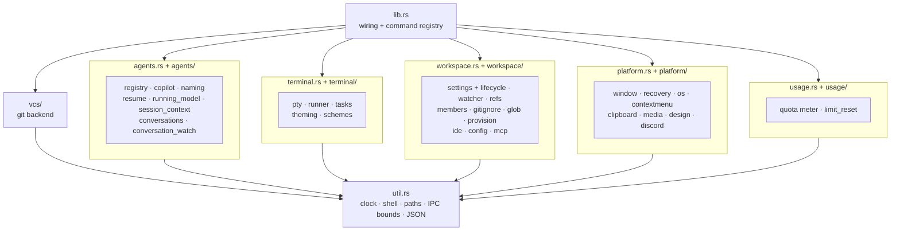

The folders talk across a few seams only: `terminal::pty` spawns what the
`agents` registry resolves and themes it through `terminal::theming`;
`agents::running_model` types into a session through `terminal::pty`;
`workspace::watcher` hands videos to `platform::media`; `workspace` borrows
`agents::naming::sanitize` and `platform::window`'s open-project list; and
`workspace::config` reads the calling window's project from
`platform::window`. Everything else they share comes from `util`.

### Shared helpers

| Module | Responsibility |
| --- | --- |
| `util.rs` | Cross-cutting helpers, one home each. Executable resolution (`search_directories`, `find_in`, `resolve`, `is_on_path`); `command` (windowless child processes) and `shell_command` (a command line through the platform shell - `COMMAND_SHELL` / `COMMAND_SHELL_RUN_FLAG`, `cmd /C` on Windows so `.cmd` shims resolve, `sh -c` elsewhere - read by the task runner, the package-manager reinstall after a move, the IDE launcher and the junction maker); `spawn_detached` (a fully detached GUI-app launch - Windows job/console breakaway with a no-breakaway fallback - so a spawned editor outlives PADE); `succeeds_within` / `exits_successfully_within` (a child waited on under a hard deadline, killed and reaped on overrun). The clock: `now_milliseconds`, `milliseconds_since_unix_epoch` and `since_unix_epoch` are what every timestamp, nonce, stamped file name and modified-time comparison reads. Path equality: `comparable_path` / `same_path` (separator- and trailing-slash-blind, case-blind on Windows), read by the window registry, the workspace pins and open-project checks, the Codex resume lookup and the search-path de-dupe. `json_string_field` (one flat string field off a JSON line without a full parse, for the Codex rollout meta line and Claude's transcript). The IPC bounds `MAXIMUM_SESSION_ID_BYTES` / `MAXIMUM_PATH_BYTES`, shared by `terminal::pty` and `terminal::runner` so an id one accepts the other never rejects. Also `home_directory`, `pade_data_directory`, `read_json` / `read_jsonc`, `newest_in_tail`, `write_if_stale`, `encode_project`, `percent_encode`, `owner_access`, and `SKIPPED_DIRECTORIES` / `is_noise_directory` - the one list of build-output and dependency directories both project walks prune (`agents::naming`'s file census, `terminal::tasks`'s manifest scan) |
| `test_support.rs` | Test-only (`#[cfg(test)]`): shared assertions, `assert_empty` / `assert_not_empty`, which print what a collection held on failure (Rust 1.99's `assert_is_empty` lint rejects a bare `assert!(x.is_empty())`) |
| `process-priority/` | Tiny Windows FFI workspace crate behind a safe `lower_current_process` API. `lib.rs` calls it before WebView2 or PTY creation, so PADE, agents, and agent-launched tools inherit below-normal scheduling and yield CPU to other applications |

### Agents (`agents.rs` + `agents/`)

| Module | Responsibility |
| --- | --- |
| `agents.rs` | Agent registry + detection (Claude Code, Codex, OpenCode, Copilot CLI, Grok CLI, Muse Code, Qwen Code, Antigravity CLI, Cursor CLI, aider), one-shot headless invocations, the environment each agent is spawned with, and each interactive session's skip-permission arguments. It is also the single source for theme preparation: a `ThemeConfig` selects per-scheme environment, launch arguments, a PADE-owned TUI config, or - for the one agent with a live channel - a PADE-owned theme *definition* selected per session (`SpawnSelectedLiveTheme`: Claude launches on `--settings '{"theme":"custom:pade"}'`, and rewriting `~/.claude/themes/pade.json` re-themes it where it stands). Future agents declare their mechanism in one registry entry without new theming control flow. `program()` resolves agent executables, `session_id_flag` declares targeted conversation resume, and `codex_home` (`$CODEX_HOME`, else `~/.codex`) is the one lookup every module reading Codex's files goes through - resume, the model watch, the move-reference rewriter and the usage auth probe - so a relocated Codex home is honoured everywhere. `DEFAULT_SHELL` is the one spelling of the shell fallback. Fullscreen-capable agents are pinned to the alternate screen where supported. Parent of the agent-facing submodules below |
| `agents/naming.rs` | Temp-workspace auto-naming (agent CLI → heuristic, shared sanitizer) and live-session naming from the terminal transcript. The transcript is first collapsed to its distinct content lines (`readable_transcript`) so a fullscreen agent's repeated screen repaints - spinner, status bar, key hints - can't drown the actual conversation. Session naming tries `copilot` first, then the session's own agent CLI. A headless agent run's reply drains on a reader thread while `util::exits_successfully_within` bounds the wait, so a reply bigger than the pipe buffer can never stall until the timeout |
| `agents/summary.rs` | `session_summarize`: a sentence or two on what a live session has done and is doing now, for the agents dashboard. Reads the same collapsed transcript naming reads and asks Copilot first (`copilot::run_chat`, the same chat naming uses), then every installed headless agent CLI, the session's own first (`naming::first_agent_reply` over `agents::headless_agents`) - Copilot's 50-a-day allowance can run out on a busy dashboard, and a spent one parks it for an hour - then tidies the reply into one capped line: one short sentence of inline Markdown (bold, code, links - the dashboard renders them), cut at the last whole sentence when it runs long. The prompt carries the web addresses the session has worked with (`session_context::session_links`), newest first, and asks the model to link anything the summary mentions that one of them points to - a pull request, an issue, a CI run, a page - with that exact address, never a made-up one. Nothing is looked up. Summaries are only asked for while the dashboard is open, so no transcript leaves the machine for one otherwise. Only the owning window may ask |
| `agents/copilot.rs` | Copilot (`copilot.com`) as the preferred session-name source and dashboard summarizer (`run_chat`), as the personal Microsoft account Windows is signed in to. A token comes silently from `msalruntime.dll` (Git for Windows ships it) through a PowerShell helper (`copilot_token.ps1`, because the crate forbids `unsafe`) and is cached for 20 minutes; the chat is the SignalR socket on `substrate.office.com` that the copilot.com page opens (handshake, one `chat` call, the reply in its result). The free allowance is 50 messages a day, so a spent one parks Copilot for an hour; each call leaves a chat in the account's Copilot history. Best-effort: any failure returns `None`, so `naming` falls back to the agent CLI. Runs on the naming worker thread, so its blocking calls never touch the UI thread |
| `agents/conversations.rs` | `agent_conversations`: every conversation the agents recorded for a project, newest first and capped - Claude's transcripts under `~/.claude/projects/<encoded project>` (titled by the newest `custom-title`/`ai-title` record in the tail, else the first prompt the person typed - Claude's own user records (meta-flagged, command caveats and output, tool results, task notices, interruptions) skipped, a slash or `!` command only when nothing was typed; headless `sdk` runs skipped), Codex's interactive rollouts for the folder (titled from `session_index.jsonl`, resumed with `codex resume <id>`) and Copilot's `session-state/*/workspace.yaml` by `cwd` and `summary` (a block summary by its first line). Claude and Copilot reopen through the id pinned at spawn. Reads bounded heads/tails and only the newest files, under `spawn_blocking`. Each call remembers the project it was asked about for `conversation_watch` |
| `agents/conversation_watch.rs` | Keeps the left rail's recorded conversations live: one app-wide notify watch on Claude's `~/.claude/projects` (`agents::claude_projects_directory`), Codex's `sessions` tree and `session_index.jsonl` under `codex_home`, and Copilot's session-state folders and `workspace.yaml`, emitting `agent-conversations://changed` with `{ project }`. A Claude change names its project by matching the encoded folder against the projects `agent_conversations` was asked about (subagent transcripts are ignored); Codex and Copilot paths name none, so they emit `project: null` for every listed project. A transcript grows on every token batch, so a dedicated thread throttles per project: the first change goes out at once, further ones within `EMISSION_INTERVAL` (1 s) fold into one trailing emit at its end |
| `agents/resume.rs` | Resume arguments for agents whose CLI can reopen a recorded conversation but gives ADE no way to pick the id at spawn: `agent_resume_args` resolves Codex's newest *interactive* rollout (`sessions/**/rollout-*.jsonl` under `codex_home`, first-line `session_meta`; oneshot `exec` rollouts skipped) whose recorded `cwd` is the session's (`util::same_path`), yielding `["resume", "<uuid>"]`, and opencode's newest recorded session for the directory (queried through `opencode db` - stdin nulled, wait capped, child killed on overrun - so a wedged lookup can never hang a spawn), yielding `["--session", "<ses_…>"]` or no flag when nothing is recorded (a blind `--continue` walks opencode's legacy history and throws its #28486 server error) - how a scheme-flip restart (`stores/agent/agentRetheme`) respawns either agent on the new theme without losing its conversation. Claude needs none of this: its conversation is pinned at spawn via `--session-id` |
| `agents/session_context.rs` | How full a session's context window is, read off disk instead of scraped off the terminal - the terminal is not a reliable source, since Claude Code renders no percentage until the last ~3% of the window. `agent_session_context` answers both halves from Claude's own per-conversation log - the transcript its hooks last named (`running_model::reported_transcript`; a resumed session logs under Claude's new id), else `~/.claude/projects/*/<conversationId>.jsonl`: USED from the newest turn's `usage` block (input + cache read + cache write + output, i.e. everything the next request re-sends), found by a backwards tail scan that widens 64 KB → 1 MB → 8 MB rather than parsing a growing multi-megabyte transcript; and the WINDOW from the `"model"` the same log records, sized by the live **models.dev** catalog (`api.json`, public, flattened to model→largest `limit.context`, fetched once per run behind a 6h TTL). Nothing about model→window is hardcoded. Only Claude is resolved on purpose: Codex writes no per-turn accounting and its only on-screen counts are tool output, so a window would re-arm the false handoff `context.svelte.ts` guards against. The pane's `session-readings` re-reads it at every idle → `observeSessionLog` (the window never overriding a live banner reading). `logged_claude_turn` exposes the newest real logged turn's model and effort (skipping Claude's `<synthetic>` placeholder) as `running_model`'s fallback for a session launched before the hooks. Tail scans go through `util::newest_in_tail`, field reads through `util::json_string_field` `session_links` collects the web addresses a conversation worked with from the same logs: only the conversation's own entries (messages, tool output, Claude's `pr-link` records - not tool schemas or system text), its own log first and then the project's earlier logs on the same branch (a resumed session continues in a fresh log), each log read once per change |
| `agents/running_model.rs` (+ `agents/running_model/{claude,codex,copilot,opencode}.rs`) | The model and effort each agent session runs, learned from the agent itself - never its terminal. `attach` (called by `terminal::pty::build_command`) gives every launch `PADE_CONVERSATION_ID` plus its adapter's arguments/environment; `agent_running_model` reads through the adapter. **Claude**: `SessionStart` / `PostModelSwitch` / `Stop` hooks merged into the ONE `--settings` JSON PADE passes for the live theme (Claude honours only the last `--settings`); effort is the newer of the last `Stop` report and the last `/effort` the session's own transcript logs ("Set effort level to …"); the shared `~/.claude/settings.json` `modelSettings.<model>.effortLevel` only stands in before either and from a model switch on, never dated by the file's last write (every session, and PADE's own default-restore, rewrites it). A settings write is announced again a second later, once the transcript has caught up. **Codex**: the same three hooks passed with `-c`, trusted by Codex's own fingerprint (sha256 of the sorted-key hook JSON) in a second `-c hooks.state=…` - never the bypass flag; it runs hooks in PowerShell, hence `HookShell`. Its settings folder is `agents::codex_home`. Effort comes from the rollout's newest `turn_context`; `/model` writes `config.toml` at once, which also covers the time before the first prompt (Codex opens its session lazily). **Copilot**: pinned with `--resume=<id>` (`agents::SessionIdFlag::Joined`); reads `~/.copilot/session-state/<id>/events.jsonl` `session.model_change`. **OpenCode**: `OPENCODE_CONFIG_CONTENT` adds a PADE plugin for that launch alone, writing to `PADE_MODEL_STATE_FILE` on each prompt; the configured model stands in before. Hooks run `pade.exe --agent-hook-sink`, which `lib::run` short-circuits into: fold the report into `%LOCALAPPDATA%\pade\agent-model\<conversationId>.json` (stamped with `util::now_milliseconds`) and exit. A notify watch on that folder, the shared settings files and Copilot's session folders emits `agent-model://changed` (`sessionId`, or null for a shared settings change); state files older than 14 days are pruned at start. `agent_model_options` reads each agent's own model catalog: Claude's cached `/model` picker catalog (`~/.claude/cache/model-catalog/*-cc.json` - names, labelled effort options, the Recommended badge), Codex's `models_cache.json` (listed models, supported reasoning levels, default), OpenCode's picker favourites/recents described by its cached models.dev catalog, and the models Copilot's recent sessions ran (its `--effort` choices are fixed). **Switching** (`agent_apply_model`, driven by `stores/modelSwitch` from the tab's `ModelTag` → `ModelMenu` = `ModelPicker` + `EffortPicker`): Claude switches in place, even mid-turn - Ctrl+S stashes the draft, `/model` then `/effort` are typed via `terminal::pty::write_input`, each confirmed by Claude saving it to `settings.json` (never by the screen; a one-shot `.switch-permission` file lets the sync `PreModelSwitch` hook skip the confirmation for PADE's own switch), then the saved default is restored so only that session changes. Every other agent answers `NeedsRestart`: the choice is remembered on `AgentSession.modelChoice`, and once the session is idle with no background work it relaunches on its own conversation (`resume_arguments` - the agent session id its hooks/plugin reported) with `attach`'s per-agent launch flags (`--model/--effort`, `-c model=…`, `-m`), which never persist. The handoff scan holds back while a switch applies; a pick made during a handoff goes to the successor (`choiceForSuccessor`). **Ultracode**: `agent_running_model` returns a `SessionModel` (the running model + `ultracode`); for Claude it is on when the newest `ultra_effort_enter` / `ultra_effort_exit` attachment in the session transcript is an enter (Claude writes them only as a prompt is sent, so a `UserPromptSubmit` hook makes the tab re-read right then). `ModelTag` marks it with a bolt beside the tinted name. Grok, Antigravity, Cursor and aider expose no per-session source without editing the user's global config, so they report nothing |

### Terminal (`terminal.rs` + `terminal/`)

| Module | Responsibility |
| --- | --- |
| `terminal.rs` | Parent only: declares the submodules below, everything that runs inside or paints a terminal pane |
| `terminal/pty.rs` | PTY host - runs agent CLIs (and console editors) unmodified in pseudo-terminals (portable-pty), applying the registry's per-agent spawn environment (plus `theming`'s per-scheme theme environment for the caller's scheme), and - on **Windows + a light scheme**, for an agent whose composer box follows the *detected* terminal background (`agents::needs_light_console_fix`, i.e. Codex) - prefixing the launch with `cmd /c color F0 & …` so the ConPTY console buffer reads light before the agent probes it (the only lever: ConPTY hard-codes a BLACK buffer that no environment/argument/config/OSC channel can change; each token stays a separate argv entry so portable-pty quotes the path cmd-compatibly); and, for an agent that supports it, binding the session to a caller-chosen **conversation id** (`agents::session_id_flag` → `claude --session-id <uuid>`, so a restart resumes that exact conversation). Every session records its owner window: lists expose only that owner's sessions, commands reject foreign callers, and events use `emit_to`; a matching label still permits same-window reload re-adoption. The owner is shared with the session's output pump (`SessionOwner`), so `transfer_sessions` moves live sessions to another window - all or nothing, the processes untouched - and their very next chunk streams there; `kill_owned` ends every session of a window that closed for good. Per-window session, dimension, argument, and input caps bound resource use (the id and path bounds come from `util`). The host keeps each session's replayable history so a terminal can attach to a conversation in flight; dropping a session kills **and reaps** its child, and `kill_all` leaves nothing behind on app exit; `session_task_stop` / `session_task_running` reach a task the agent started **itself** (which PADE never spawned) by walking that session's OS process tree and matching the task command - agent-agnostic, no per-agent output parsing - so the Tasks dock can stop it and reflect its liveness. The tree-walk + command match are pure (`task_processes`, `command_matches`, unit-tested); the snapshot is one CIM query (no `wmic`) |
| `terminal/runner.rs` | Window-owned task-runner execution: each command runs through `util::shell_command` with owner-targeted streamed output and per-window process/command caps (the id and path bounds shared with `pty` via `util`) |
| `terminal/tasks.rs` | Discover runnable tasks from project manifests. One registry (`MANIFESTS`) is the sole authority: each entry says how its file is recognised - an exact name (`package.json`, `Cargo.toml`, `Makefile`, `pyproject.toml`, `CMakeLists.txt`, `CMakePresets.json`, `meson.build`, `build.ninja`, `MODULE.bazel`/`WORKSPACE`, `xmake.lua`, `premake5.lua`, `SConstruct`, `go.mod`, `build.gradle[.kts]`, `pom.xml`) or an extension, since C++ and C# name the manifest after the project (`.sln`/`.slnx`/`.csproj`/`.fsproj`/`.vbproj` → `dotnet`, `.vcxproj` → `msbuild`, `.pro` → `qmake`) - plus its family and how to read its tasks. A solution is claimed by whichever family its projects belong to (it is read for a `.vcxproj` reference); a `CMakeLists.txt` or `meson.build` only counts where it declares its own `project()` (an `add_subdirectory`/`subdir()` child builds with its parent) and a `.pro` only where it assigns a qmake variable, since the extension is common outside Qt; `CMakePresets.json` contributes the project's own named configurations (hidden presets are inherited building blocks, not choices); Gradle and Maven run the repo's committed wrapper when there is one; and where a toolchain has two configurations worth a button, both are offered - CMake gets Release twice because a single-config generator takes the build type at configure time and a multi-config one at build time. Commands are written to run unattended: `xmake -y`, `dotnet watch --non-interactive`, `msbuild -restore`, and `ctest -C Debug` on Windows, where a Visual Studio tree finds no tests without a named configuration. A .NET project's **own entry-point targets** are listed after the standard verbs (`dotnet build <project> -t:<name>`), scanned tag-wise out of the project file only - never out of an `<Import>`, since the registry decides what the frontend watches and an imported `.targets` file is not watched, so its targets would never refresh; internal (`_…`), hooked (`BeforeTargets`/`AfterTargets`) and standard-verb names are skipped. `tasks_descriptors` derives the frontend's watched tokens and empty-state list from that same registry, tagged `name` or `extension` so the catalog matches a changed path the way the backend matches a directory entry. On the wire a group's directory stays `dir` |
| `terminal/theming.rs` | Forces each installed agent's own UI theme to ADE's resolved scheme, because Windows ConPTY consumes the agent's OSC 11 background query in both directions. Every mechanism is registry data (`ThemeConfig::SpawnEnvironment`, `SpawnArguments`, `SpawnTuiConfig`, `SpawnSelectedLiveTheme`). **Claude is re-themed live**: it launches on a PADE-owned theme definition (`--settings '{"theme":"custom:pade"}'`, never a settings file of the user's) and `publish_live_themes` rewrites `~/.claude/themes/pade.json` on every flip - Claude watches that directory and repaints, so a conversation in flight follows the app's appearance without being restarted (`agent_theme_publish` is the frontend's call; `pty` publishes before each spawn so the first frame is already right). The scheme lives in the file's contents, not the argv, which is precisely why it can reach a running process. Everyone else is spawn-themed and read once at launch: Codex uses `-c tui.theme=…`; OpenCode uses `OPENCODE_TUI_CONFIG` to select a per-scheme PADE theme (`pade-light` / `pade-dark`, plain-string so its ConPTY-answered probe can't spoil the render); Cursor/aider use environment variables. Because those are read at spawn, the scheme the frontend hands `pty_spawn` must already be the real one: `prefs.svelte` seeds it from the native `window_theme` before mount rather than from WebView2's media query. The scheme it hands over is the **terminal's**, not the app chrome's (`appearance.terminalScheme`) - with a Windows Terminal scheme chosen the two genuinely differ (a Solarized Light terminal inside a dark app), and the agent paints into the terminal. Copilot follows the OS itself, Grok inherits the terminal palette, and Antigravity has no verified safe override, so PADE does not guess settings. For the spawn-themed pair a flip is followed the only way it can be: `stores/agent/agentRetheme` respawns the **idle** ones, each resuming its own conversation; a session that is *busy* keeps its spawn scheme until it next restarts. Claude must never join that set - its `--session-id` respawn wedged live sessions twice - and no longer needs to |
| `terminal/schemes.rs` | The Windows Terminal colour schemes PADE can paint its terminal with (the `terminal_schemes` command): the ones Windows Terminal ships - vendored as an asset, since its `defaults.json` lives inside an app package that may not be installed or readable - merged with a short curated asset (the light schemes that vendored file lacks: Selenized Light, Catppuccin Latte), then with the ones the user wrote into their own `settings.json` (Store, Preview, and unpackaged builds). Later sources win by name, so the user's beat curated and curated beat shipped, exactly as Windows Terminal resolves a user override. The curated list is a separate asset so regenerating the vendored one from an installed Windows Terminal can never drop it. Read through `util::read_jsonc`, because that file is one a human edits and the vendor's own template ships with comments. On the wire the palette is an ANSI-indexed array, not Windows Terminal's twenty named fields: index *is* the SGR colour, which is the order `ANSI_COLOR_TOKENS` maps onto the design tokens. One half-typed scheme costs only itself |

### Workspace (`workspace.rs` + `workspace/`)

| Module | Responsibility |
| --- | --- |
| `workspace.rs` | Settings, roots, temp workspaces, labels, move/rename/delete; parent of the project modules below. Move, temp promotion and `workspace_rename_folder` (any project's folder, renamed where it stands) share `relocate_folder`: it releases PADE's own watch on the folder (`watcher::release_watches_under`), renames with retries, re-points external references (`refs`) and re-keys every path-keyed setting, announcing each step as it starts on **`relocate://progress`** (`RelocateStep`, keyed by the source folder) so `RenameFolderDialog`'s busy button names the step instead of one "Renaming…" that reads as stuck (`retarget`: recents, pins, owned, labels, last-used, per-project agents, editor picks and the per-project model/naming prefs). `workspace_set_label` takes a `LabelSource`: an `auto` name is kebab-cased (`agents::naming::sanitize`) and lands only on an unlabelled workspace, a `manual` one is kept as typed (`manual_label`: one line, ≤ 60 chars) and always wins - the check-and-set runs under the settings lock, so an auto-name finishing after the user relabelled can't overwrite them. One mutex-protected settings repository serializes every in-process load-modify-save and writes through a same-directory temporary file; preference writes patch fields (null removes an optional key) instead of replacing all prefs. `launch_directory` is the one home for "which directory this instance launched into" (an explicit `pade <dir>` argument, else the process cwd) - read by both `launch_context` (what the frontend boots into) and `webview_data_directory`, which keys this instance's **WebView2 user-data folder** by that project (a stable digest of the canonical path under `%LOCALAPPDATA%\pade\webview2\`) so two projects open in parallel run in **separate browser + GPU process trees** instead of sharing one; `lib.rs` sets `WEBVIEW2_USER_DATA_FOLDER` to it before any window is built (the shared default lets one instance's GPU load and the ~16 WebGL-context cap compound into the other and trip a DWM reset). Adding a root goes through `workspace_add_root` (existing dir → added; missing → created only when the picker asks; a file → rejected) with `workspace_probe_path` feeding the add-row's live check (is-dir / is-file / parent-exists) and its directory autocomplete (child dirs matching the typed prefix, capped, plus the `completion` every match agrees on, read off the uncapped listing for Ctrl+Space) - existence checks in place of a path regex. Deleting first steps the process out of the folder (opening a project chdirs into it, and Windows won't delete the directory a process stands in), then retries briefly while the OS closes the killed agents' handles; an already-absent folder counts as deleted, so a stale Recent row can always be cleared. **Saving a temp workspace** goes through `workspace_save_migrate`, not a rename: on Windows PADE's own recursive watcher holds the temp directory open, so `rename`/move fails with a sharing violation (os error 32), but reads are unaffected - so it **copies** the workspace into the chosen root (skipping `provision` dependency directories), returns the detected install command, and leaves the temp for the frontend to delete once it has opened the copy and resumed the agent there. An empty workspace (saved before any prompting) is the same path - it copies nothing and yields a valid empty project. Because settings are process-wide but each webview holds its own copy, the repository's `update` reports whether the mutation actually moved anything and `update_settings` - the one choke point every mutation passes - then broadcasts payload-free **`settings://changed`** app-wide, so a project deleted, renamed or pinned in one window stops being listed in the others (every window re-reads through its own `settings_get`, keeping one adoption path). A mutation that changes nothing (the picker's recurring prune) neither writes nor announces, so two windows can never refresh off each other's announcements forever |
| `workspace/watcher.rs` | Filesystem watchers (notify): the recursive one feeding the Change Feed - armed on the workspace path the frontend passes `watch_start` (the open project's root, threaded from the shell's `windowServices`, **not** the process cwd - so a cwd that has drifted from the displayed workspace never points the feed at the wrong tree) and re-rooted on a project switch (a call for a new root drops the old watcher and its per-file bookkeeping and re-arms). `watch_start` asks git everything it needs - the ignore policy and where the live git state lives (`GitStatePlan`) - **before** it takes the watch lock, so the synchronous `watch_status` never waits on a git process; a per-window arm ticket (`latest_arm_request`) lets only the newest request arm, so a slow request for the project just left can never win a quick switch. **All watch state is per window** (`WatcherState.windows`, keyed by window label): every PADE window opens its own workspace but all share one backend process, so a single global watcher slot could arm only one project at a time - a second window's `watch_start` tore down the first's watch (its edits never surfaced) and the one live watcher broadcast into every window's feed. Each window's watcher (and its git-state and picker `dirs` watch, and their per-file bookkeeping - line counts, baselines, ignore policy, MCP baseline) lives under its label, and every event it produces is routed back to that window alone with `emit_to(<label>, …)` (never `emit`, which broadcasts to all) so two windows on different projects never cross-contaminate; the frontend's `onMessage` correspondingly listens **scoped to its own window label**, so an app-wide `emit` still reaches it but a sibling's targeted emit does not. Closed windows have no teardown hook, so `watch_start`/`watch_dirs` prune the entries of windows no longer live (dropping their watchers and retiring the paired coalescer threads). It also excludes what the project itself would ignore, via a **live ignore policy**: in a git work tree it defers to git's own rules (`git -C <root> check-ignore`, memoized per path, so nested `.gitignore`, `.git/info/exclude`, `core.excludesFile`, and negations all count); with no git it falls back to a set of directory names inferred from the manifests at the root (`package.json`→`node_modules`…, `Cargo.toml`→`target`, …) unioned with the always-on `IGNORED` baseline **plus the root `.gitignore`'s own rules** (`gitignore` - a scaffolded project knows what it will generate before `git init` runs) - that cheap baseline pre-filter runs first in both modes, so a giant dir never reaches git. The policy is **recomputed** whenever the rules could have changed - any `.gitignore` edited, created, or deleted under the root (the recursive watch already sees both the existing file changing and one appearing), and a mid-session `git init` (piggybacked on the git-state coalescer's re-arm) - and each recompute announces payload-free **`feed://ignore-changed`**, on which the frontend's feed store re-asks `feed_ignored` about the events it already shows and drops the now-ignored ones - and `watch_dirs` - the picker's, watching the *parents* of the rows it shows (watching a row would hold a handle on it and block its deletion) and emitting `directories://changed` when one gains or loses a child; and the **live-git-state watch**, re-armed with every `watch_start` re-root: a deliberately tiny **non-recursive** watch of only the dir(s) holding `.git/HEAD` (branch switches) and `.git/config` (remotes) - never the `.git` tree, whose `objects/` churn is an event firehose; a linked worktree's `.git` *file* resolves its real git dir + common dir via `git rev-parse --path-format=absolute`. Touches of those two files are coalesced per burst on a paired thread (a checkout rewrites `HEAD` several times; the emit waits for quiet) into one payload-free **`git://state`** event - listeners re-fetch what they display, so the event can't carry stale data. A workspace with no repo yet gets a non-recursive sentinel watch of its root that only looks for a `.git` entry appearing, then re-arms onto the real state files - so a `git init` run after the project opened gains the watch without polling. It also detects a change to the project's **MCP servers**: on any touch of a config file `config` marks MCP-kind (`.mcp.json`), it re-reads the server-name set (`mcp`) and - only when a name was added or removed, never on a value-only edit - emits **`mcp://changed`** (agents governed + added/removed names) so the frontend restarts and resumes those sessions; the per-file baseline is seeded on `watch_start` so opening a project that already declares servers doesn't restart. Also owns the Change Feed's **git-free preview**: a per-watch-session, lazily-captured **first-touch baseline** map (path → the content it held the first time it changed this session - empty for a creation, the current text for a pre-existing file; binary/over-cap files aren't snapshotted), cleared on re-root, that `feed_diff` diffs against the file's current content so a card previews the agent's *this-session* changes to any file - tracked, untracked, or ignored - without consulting git. A window can also **ask what its watch is doing** - **`watch_status`** reports the armed root, when it armed, and how many changes have been surfaced versus dropped as ignored since (both counters reset on a re-arm), so the frontend's empty feed can say which of "nothing changed yet", "armed on another project", and "not watching at all" it is looking at instead of wording all three as "waiting for edits". Three companions serve the feed's rich previews, all gated on the same baseline (`was_surfaced`) and confined to the canonical watch root (`authorize_path`) so only a path this window's watch surfaced is ever read: **`feed_image`** returns an image change's bytes as a base64 data URL (extension→MIME via `IMAGE_MIME_TYPES`, capped at 5 MB), **`feed_video`** hands the authorized path to `platform::media` on a blocking thread and returns the transcoded clip as a data URL (or `noTranscoder`), and **`feed_text`** returns a file's current UTF-8 text (NUL-rejected, size-capped) for the markdown/HTML Code-or-Preview toggle. On the wire a change's timestamp stays `ts`. The feed's ignore policy and its memoized `check-ignore` answers live together in `IgnoreRules`, the one ignore filter the language watch reuses. Also `watch_languages`: per window, one notify watcher over the projects the window follows plus the rows on screen, re-aimed folder by folder (`rearm_language_watch`; folders that stay keep their watch and memoized rules, and a feed re-root re-decides coverage). The window's own project rides the Change Feed's recursive watch - every change the feed keeps also reports it - so it needs only a non-recursive watch on its git folders (their own and their submodules', via `vcs::tracked_set_indexes`) for `index`/`HEAD`; any other project gets one recursive watch on its root, filtered by the always-ignored baseline (`.git`, `node_modules`, `target`…) and its own `IgnoreRules` (built on its first event, rebuilt when a `.gitignore` changes). A working-tree change bumps the project's generation (`ide::note_working_tree_change`) and both kinds emit `languages://changed` (the project path); `release_watches_under` lets go of them before a rename or delete |
| `workspace/gitignore.rs` | A small `.gitignore` matcher for workspaces git can't answer for (no repo yet - e.g. a freshly scaffolded temp workspace): parses the ROOT `.gitignore` only and matches the documented core of the syntax (comments/blanks, `!` negation with last-match-wins, trailing-`/` directory-only, leading-or-inner-`/` anchoring, `*`/`?` per segment, `**` across segments - matched through `glob` - and git's no-re-include-below-an-excluded-directory rule). `watcher`'s static ignore policy consults it; git mode never does - git itself is authoritative there |
| `workspace/glob.rs` | The one segment-aware glob matcher (`segments_match`, `segment_matches`): `**` spans any number of `/`-separated segments, `*` and `?` stay within one, walked by character boundary so the watcher's per-event check allocates nothing. Shared by `gitignore` and `members`, whose workspace tools use the same semantics |
| `workspace/members.rs` | Workspace member discovery (`members_list`) - what the workspace is made of, and the ground truth behind the top bar's member switcher, the branch pill and the Change Feed's grouping. A member is either a **package** (IFF the folder holds its own manifest, never because of its name) or a **repository** (IFF it holds its own `.git` - a nested checkout, submodule or worktree, which no workspace file declares anywhere, so the marker alone confirms it and no include pattern has to claim it; each member reports `repository` so the frontend shows git chrome only where there is git). One census walk records every directory holding a real manifest (`package.json`/`Cargo.toml`/`go.mod`/`pyproject.toml`; `node_modules`/`target`/`dist`/`build`/`vendor`/dot-dirs pruned); the root's workspace-defining files contribute include/exclude member patterns through one parser-per-file seam (`pnpm-workspace.yaml` `packages:` list, `package.json` `"workspaces"` array/object, `Cargo.toml` `[workspace]` `members`/`exclude`, `go.work` `use` directives, `pyproject.toml` `[tool.uv.workspace]`) - all hand-parsed (line scans + a quote-aware mini-TOML reader; serde_json for JSON), no yaml/toml dependency; a census directory becomes a member only when a segment-aware glob (`glob`) includes it (`*`/`?` within one segment, `**` recursive, excludes subtract **after** all includes) and the root is always a member, each carrying its manifest's declared name and ecosystem |
| `workspace/refs.rs` | After a move: re-point every agent's memory (`refs/agents.rs`), IDE recents, symlinks, package-manager installs (the reinstall runs through `util::shell_command`). Stale absolute links are gathered in one walk and recreated together: on Windows every junction comes from one generated `mklink /J` script run by a single shell - a shell per link cost a process start each, minutes for a pnpm tree of thousands. One rewriter, `rebase_paths_in`, re-points a folder's raw, JSON-escaped, forward-slash and file-URI forms ASCII-case-insensitively and folder-bounded (a sibling `pade-effort` is never touched when `pade` moves); `moved_path` is its single-path form, which `workspace::retarget` and the link re-pointer (`moved_link_target`, absolute targets only) reuse - so a link into `C:\old\proj-effort` stays put when `C:\old\proj` moves |
| `workspace/refs/agents.rs` | Each agent's memory of a moved folder: Claude's `~/.claude/projects/<encoded cwd>` folders for the workspace and every folder inside it (which one a folder speaks for is read from its transcripts' `cwd`; `util::encode_project` matches Claude's own encoding, long-path hash included) plus `~/.claude.json`; Codex's `state_*.sqlite` threads and project roots plus its `config.toml` trust (under `agents::codex_home`); Copilot's session `workspace.yaml`s and trusted folders; `OpenCode`'s database; Gemini's trusted folders |
| `workspace/provision.rs` | The one authoritative table pairing each ecosystem's re-downloadable **dependency directories** (`node_modules`, `.venv`, `vendor`, …) with the **install command** that restores them (`is_dependency_directory` / `detect_install`, chosen from the project's lockfile→manifest order). `workspace_save_migrate` reads both halves so they can't drift - the copy skips exactly what the reinstall will bring back - covering npm/pnpm/yarn/bun, uv/poetry/pipenv/pip, composer, bundler, go |
| `workspace/ide.rs` | Editor detection + user-added editors, per-kind suggestion rules, an explicit per-project editor choice (`ide_choose_editor`, persisted under the canonical project path) that leads every `ide_suggest` ranking, open-at-line (`ide_open_file` opens the file *inside its project workspace* wherever the family's CLI has a folder+file form - VS Code `<dir> -g file:line`, JetBrains `<dir> --line n file`, Zed/Sublime `<dir> file:line`; families without one get the bare file). Every GUI editor launch is **spawned fully detached** (`util::spawn_detached`, a `.cmd` launcher through `util::COMMAND_SHELL`) so closing PADE never tears down the editor it launched, and the bare `<launcher> <folder>` form (no `-r`/`-n`) lets the IDE focus its existing window on that workspace or open a new window for it. `ProjectKind` is the single typed source-language registry (ecosystem markers, extensions, Linguist language names, UI label via `ide_kinds`) and each registered editor declares its language coverage separately. Declarations are probed in the root and one level down; markerless web projects are recognized by `index.html` or a browser manifest's intrinsic `manifest_version` field. A bounded per-file census profiles source below the active workspace folder (Git paths are safely rooted, binary/generated content excluded) while Git resolves the project's `.gitattributes` `linguist-*` exclusions and language overrides. Each declaration owns source not claimed by a nested declaration, selects its representative source branch (`src`, then root-level, then strongest native branch), and requires every language co-located there; separate scripts/tools branches remain ancillary. With no declarations, all observed source kinds are required; with no recognized source at all, only general-purpose editors are eligible and the configured fallback leads. This stays free of dominant-language cutoffs and framework-name rules: WebStorm can lead an all-web monorepo but not a web/Rust application. `family()` also flags console editors that run in a terminal tab. The switcher's badge takes the kind most project roots declare (`primary_declared_kind`, ties to registry order), the same kind the editor-rules lookup uses; `LANGUAGE_REGISTRY` is the one home for extension → Linguist language → kind (editor coverage reads kinds, the language bar languages); `ide_project_languages` turns the census - git's tracked files (submodules included) then its untracked, not ignored ones, so an agent's new file counts before anyone stages it - into each project's language shares (slivers under 3% dropped), cached against a `CensusStamp`: the newest of its own and its submodules' index stamps plus a per-project working-tree generation the language watch bumps on every kept edit, so a re-check of an unchanged project costs one `stat` and two map lookups while a recount after an edit is never served stale |
| `workspace/config.rs` | Surface (read-only) the config files each agent CLI uses - the one registry of "which file, which agent, which kind/parser". Reads resolve from the calling window's registered project (`platform::window::WindowProjects`), never process-global cwd. `mcp_configs()` exposes Claude/Copilot JSON, OpenCode JSON, Codex TOML, and Cursor JSON entries (each by its `relative_path`, `rel` on the wire) so `watcher`/`mcp` watch and parse the right file without parallel lists |
| `workspace/mcp.rs` | Parses a registered agent project config into an existence/content/server-name snapshot: JSON object maps (`mcpServers` or OpenCode's `mcp`) and Codex TOML `mcp_servers` tables share one typed seam. A half-written file reads as `None`, so the watcher skips transient saves rather than treating every server as removed |

### Platform (`platform.rs` + `platform/`)

| Module | Responsibility |
| --- | --- |
| `platform.rs` | Parent only: declares the submodules below, PADE's reach into the desktop around it |
| `platform/window.rs` | Spawn additional app windows (painted with the themed M3 surface so they open in-theme, no white flash) - an empty, throwaway or project window under the next `w-{n}` label, or the one agents dashboard under its fixed `dashboard` label, which a repeat request focuses instead of opening twice; track each window's project and focus/list/**reorder**/cycle between them (`window_focus_project`, `window_list`, `window_focus_label`, `window_focus_relative`, `window_reorder`) - powering the switcher's Open-windows section and the Ctrl+Alt+[ / ] cycle. A project is matched across windows by `util::comparable_path`. A user-defined explicit label order (drag-grip reorder in the switcher, session-scoped in `WindowProjects`) is the one source both `window_list` and `window_focus_relative` sort by, so the drag order drives the list and the cycle alike; a window absent from it appends in creation order. Also answers **`window_theme`** - the window's OS theme, which the frontend seeds its scheme from at startup: WebView2's `prefers-color-scheme` can report light in an already-dark window (it resolves after the first script runs) and only a genuine flip would ever correct it, so a session spawned in that gap themed its agent for the wrong scheme permanently. `scheme_for` is the one theme→`"light"`/`"dark"` mapping, shared by this command and the `theme://changed` flip event. A `handoff` window (`w=handoff&path=…`) takes the calling window's sessions and the payload describing them before it is built (`window_handoff::hand_off`), handed back if the build fails. A destroyed window ends every PTY it still owned (`pty::kill_owned`) unless it is being rebuilt after a webview crash, and always broadcasts `windows://changed` |
| `platform/window_handoff.rs` | Handing sessions from one window to another: `hand_off` moves the live PTYs (`pty::transfer_sessions`, all or nothing) and parks an opaque, size-bounded payload for the receiving window, which takes it with `window_take_handoffs` (on boot, or on the `window://handoff` event `window_hand_off` sends a running window, which it also focuses). Backs shift-click "open in a new window" and "merge this window into another" |
| `platform/recovery.rs` | `WebView2` crash auto-recovery, armed on every app window (`main` at setup, each `window_create` spawn, and every window it itself rebuilds). Subscribes the webview to `WebView2`'s `ProcessFailed` event through the `webview-recovery` workspace crate (the COM registration is `unsafe`, and `pade` forbids unsafe code - same split as `contextmenu-handler`): a dead/hung **renderer** process is `Reload()`ed in place there, while a dead **browser** process - the window survives but renders a permanent black void, every COM object defunct - escalates here, which destroys the window (`destroy()`, not `close()`: a dead webview can never answer the frontend's close-confirm) and rebuilds it off the event-loop thread with the **same label and URL** at the old placement, so `terminal::pty`'s label-keyed sessions re-adopt exactly as on a manual reload. A pending-rebuild counter lets `lib.rs`'s `ExitRequested` handler veto the app exit the destroy of a last window would otherwise trigger |
| `platform/os.rs` | Reveal in file manager / terminal (a file is shown selected, never opened - the Change Feed's route for binaries), open URLs, and request a normal app restart so launch-only preferences take effect through the regular PTY teardown path |
| `platform/contextmenu.rs` (+ `platform/contextmenu/modern.rs`) | Windows Explorer "Open in PADE" registration, **one menu per Windows version** so it's never duplicated: on Win11 (build 22000+) only the modern menu via the `modern` submodule (sparse MSIX package - see below); on Win10/older only the legacy registry keys inline. Version detected from the registry build number. On Win11 the package is registered once and the toggle thereafter only flips a show/hide flag (the package stays registered); on Win10 the toggle adds/removes the keys directly |
| `platform/clipboard.rs` | Clipboard **image** paste for terminal sessions: `clipboard_image_save` reads the OS clipboard bitmap (the clipboard-manager plugin's Rust API - a TUI in a PTY can't reach the OS image clipboard itself), encodes it to PNG (`png` crate - already in the dependency tree via the plugin's arboard) under `%TEMP%\pade-paste\` (named by `util::now_milliseconds`), prunes stale saves, and returns the path - which the terminal's Ctrl+V (`terminal-keys`) pastes into the agent's composer so it attaches the file; no image on the clipboard falls back to the text paste |
| `platform/media.rs` | Video previews for the Change Feed: the one backend home of the previewable video extensions (`VIDEO_EXTENSIONS`, mirrored by `lib/preview`) and `preview_clip`, which runs the user's own `ffmpeg` (resolved via `util::resolve`, spawned windowless via `util::command` - an optional external tool, never bundled) to transcode a video's first 15 s into a ≤640px-wide H.264/AAC fragmented MP4 streamed over stdout. Bounded: output capped at 16 MB, killed after 30 s. Reports `NoTranscoder` vs `Failed` so the card can say which. The webview's CSP allows `media-src data:` for these clips |
| `platform/design.rs` | Quick-launch AI design/UI tools by registry id; the backend resolves the HTTPS URL so renderer input cannot navigate the companion webview to another origin |
| `platform/discord.rs` | Discord Rich Presence: talks the Discord desktop client's local IPC socket directly (Windows named pipe / Unix domain socket) in pure `std` - no crate - to report "Playing PADE" with an optional project line and the project's **language** as a small overlay icon + status line (VS-Code style; the frontend reads the shared project-kind cache and maps its value to an art-asset key). The socket I/O is **blocking** and Tauri runs sync commands on the UI thread, so the state owns a **dedicated worker thread**: `discord_set_activity`/`discord_clear_activity` only enqueue onto a channel and return at once, and the worker holds the connection and applies updates serially off the UI thread (a stalled read can never freeze the window). Lazily connects, reconnects when Discord restarts, and holds the run's start timestamp steady so the elapsed timer doesn't reset per project switch. Best-effort (a closed Discord is a quiet error). Ships one public `APPLICATION_ID` (the VS-Code-extension model - registered once, zero per-user setup) |

### Usage (`usage.rs` + `usage/`)

| Module | Responsibility |
| --- | --- |
| `update.rs` | Self-update from GitHub releases (`docs/releasing.md`). A published exe (release build, not under a checkout's `target`) reads `docs/updates.json` from `main` at start and every six hours unless `prefs.autoUpdate` is false; a newer version's exe is downloaded to `%LOCALAPPDATA%\pade\updates`, checked against the manifest's SHA-256, and announced on `update://ready`. `apply_pending` swaps it in by renaming the running exe aside (`lib.rs` calls it on `RunEvent::Exit`; `update_restart` calls it, then restarts); the next start deletes what was set aside. Commands: `update_status`, `update_check`, `update_restart` |
| `update/winget.rs` | A copy under `…\WinGet\Packages\` updates through winget, keeping winget's record true: the newest version is read from `microsoft/winget-pkgs` (GitHub API listing of `manifests/a/avi12/PADE`), and applying it spawns a hidden PowerShell that waits for this process to end, runs `winget upgrade --id avi12.PADE`, and - for **Restart to update** - starts `pade` again |
| `usage.rs` | Per-agent usage / quota meter: for each running agent, the live rate-limit windows its own vendor exposes, read WITHOUT spending quota. Claude → `api.anthropic.com/api/oauth/usage` (`~/.claude/.credentials.json`), Codex → `chatgpt.com/backend-api/wham/usage` (`auth.json` in `agents::codex_home`), Copilot → GitHub `api.github.com/copilot_internal/user` (plan + premium-request quota, from the CLI's OAuth store). Antigravity/Cursor show a local plan label when logged in (their usage endpoints are private/fragile/inaccurate - deliberately not polled); Grok/Aider run on the user's own pay-as-you-go key, so an honest "-" (opencode has no usage source wired, so likewise "-"). Claude's response also yields a `CreditsState` (off / available / unavailable) from its `extra_usage` object, which auto-resume reads to continue a limit-stopped session once credits can carry it; its spend cap is classified as the `credits` window kind, and while credits are on the organization's prepaid balance (`/organizations/{uuid}/prepaid/credits`, uuid from `~/.claude.json`) rides along as `credit_balance`. With no monthly cap there is no spend-cap window at all, so the month's spend (`used_credits` scaled by `decimal_places`) rides along as `uncapped_spend` and `usage-groups` gives the extra-usage row that money reading in place of a percentage. One `UsageAgent` enum + `from_id`, a per-agent 3-min cache, and `usage_get`/`usage_account_agent` dispatching by agent; the meter may explicitly bypass that cache once at an advertised reset boundary so an expired utilization cannot survive another cache cycle. The cache (`AccountReadings`) stamps every ask, failed or not, and keeps the last real reading for up to an hour: a refused ask (the endpoint answers bursts with a 429 and a multi-minute `retry-after`), an expired token or a dropped network keeps the last reading on screen instead of blanking every window's meter, and is not retried until the cache period passes. A per-agent fetch gate coalesces concurrent misses - every open window polls, and all of them force a refresh at the same reset boundary - into one request. The token always rides a curl `--config` file on stdin (out of argv) and is charset-validated. Never fabricates - a missing token or a non-usage/error body yields `None` (an honest "-"), with a local tier label as the offline fallback |
| `usage/limit_reset.rs` | Claude's free usage-limit resets (the `cedar_ember` program - a grant such as a launch promotion that clears the session and weekly limits once). `limit_reset_offer` reads the grant the server names as next from `api/oauth/usage?cedar_ember=1`, which answers only a caller naming itself as a current Claude Code (`claude-cli/<version>`, the version from `~/.claude.json`); `limit_reset_claim` spends it with `POST api/organizations/{uuid}/reset_rate_limits` (`program`, `grant_id`, a fresh `request_id`). The same calls Claude Code makes; token, organization and curl transport come from the parent `usage` (read through `super`) |

### Git (`vcs/`)

| Module | Responsibility |
| --- | --- |
| `vcs/` | Git backend, one concern per submodule: `mod.rs` (shared git runner, status-kind vocabulary, and hex object-id validation), `status` (a rename **or copy** record drops the original-path field that follows it), `log`, `inspect`, `remote`, `branches` (the HEAD branch, the local list, the branches only a remote has yet, and the `git switch` between them - `--end-of-options` keeps a branch named like a flag an argument, and git's refusal travels back verbatim), `pull`, `worktree`, `restore`, `clone`. Clone accepts authenticated HTTPS/SSH transports and a single validated destination name; optional passwords travel through a short-lived askpass environment, never argv or the saved remote, which is sanitized and verified before success |
| `vcs::head_file_text` | Bounded committed-text fallback for the one preview case where no live first-touch snapshot is possible: a tracked path whose first watcher event is deletion (read by `workspace::watcher::feed_diff`). Normal Change Feed previews remain session-baseline driven and Git-independent |

### Load-bearing IPC contracts (Hyrum's Law)

Beyond the zod schemas, the frontend depends on these *observable behaviors* of
the Rust commands. They are contracts - a refactor that changes one silently
breaks a consumer with no type error:

- **The alternate-screen wire constant is duplicated across the boundary.**
  `terminal/pty.rs` detects `\x1b[?1049h/l` to set `History.alternate`;
  `lib/terminal/session/terminalSession` writes the same sequence
  (`terminal-sequences` `ENTER_ALTERNATE_SCREEN`) before replaying an
  alternate history. The two spellings must change together (each side carries a comment
  pointing at the other).
- **`seq` invariants** (`terminal/pty.rs` `History`; `sequence` in Rust,
  serialized as `seq`): 1-based, +1 per *emitted* chunk
  (empty decodes don't count), `0` means "empty or unknown session", and
  `history.data` is the byte-trimmed but seq-complete concatenation of chunks
  `1..=seq`. `lib/terminal/pty/pty-stream`'s splice (`chunk.seq > seq`) relies on
  all four.
- **The emitted PTY `data` is never transformed** - escape codes and all; only
  the transcript is ANSI-stripped. xterm reconstructs state from the raw
  stream.
- **Repo-scoped VCS commands reject outside a git repo** (never resolve with an
  empty array). That rejection is `VcsPanel`'s only repo-presence signal; a
  "lenient" `Ok(vec![])` would render a clean-repo view in a non-repo. The
  `vcs::clone` commands are the deliberate exception - they run from the picker
  before any repo exists.
- **`ide_suggest`'s array order is the contract** - consumers treat `ides[0]`
  as *the* editor for reveal/open actions. An explicit per-project pick
  (`ide_choose_editor`) always leads that order - and is flagged `chosen` in
  the payload, so the UI badges it as the user's pick rather than the
  auto-detected best fit - so a choice made on one surface wins on every
  other.
- **`vcs_remote_url` returns a host root**; `repository-links.ts` is the one
  frontend authority that maps that root to provider-specific branch and commit
  routes. Unknown providers never receive a fabricated commit route.
- **Paths cross the boundary verbatim, never canonicalized**, with mixed
  separators by origin: git output uses `/`, watcher/workspace paths are
  native (`\` on Windows). The frontend's `normalizePath` (separators + case +
  trailing) is therefore the *entire* recents/dedup contract, and helpers
  split on `[\\/]`. The picker guesses the display separator from the user
  agent - a latent coupling if PADE ships beyond Windows.
- **`ChangeEvent.id` is globally unique by construction** (timestamp +
  process-global counter) and is used as a Svelte keyed-each and cache key -
  repeated edits to the same path must keep distinct ids.
- Error-string *wording* is **not** load-bearing: the frontend never matches
  on message content, so Rust `Err(...)` strings may be reworded freely.
- The context-percent regexes are couplings to the **agent CLI's** observable
  output (documented at their definitions) - a deliberate, accepted Hyrum
  dependency, not a stable PADE contract.

### Windows 11 modern context menu (`src-tauri/contextmenu-handler/`)

Windows 11's first-shown right-click menu only loads a context-menu handler that
has **package identity**; a plain registry verb (the legacy menu) never reaches it.
So the modern "Open in PADE" is a second, separate **workspace-member crate** - an
in-process COM server (`cdylib` → `contextmenu_handler.dll`) implementing
`IExplorerCommand` - registered through a **sparse, external-location MSIX
manifest** (`AppxManifest.xml`). Deployment model: dev-mode, **unsigned**,
per-user; the manifest points its external location at the folder where `pade.exe`
already lives, so the DLL sits next to the exe (shared `target/` dir). The crate is
**not** a dependency of `pade` - build it explicitly with
`cargo build -p contextmenu-handler`. Full runbook:
`docs/handoff-windows11-context-menu.md`.

The CLSID `{C6FD5832-8BA5-4FDE-A5CC-A74C36AD27AC}` is authoritative in the handler
crate's `lib.rs` and mirrored (braceless) in `AppxManifest.xml`.

**Toggling without an Explorer restart** - Explorer caches a packaged handler once
loaded, so *unregistering* the package alone leaves the cached menu entry showing
until sign-in. Like PowerToys' File Locksmith / PowerRename, PADE **registers the
package once and never unregisters it on toggle**; the handler instead **hides
itself**: its `IExplorerCommand::GetState` reads `HKCU\Software\PADE` `ContextMenu`
(a DWORD the app writes: `0` = hidden, `1`/absent = shown) fresh on every menu build,
so flipping the flag shows/hides the item immediately. Turning the toggle **off** sets
the flag to `0` (the cached handler stops showing at once) and leaves the package
registered; **on** re-registers only if needed, then sets the flag to `1`. No
`explorer.exe` restart, and re-enabling never redeploys. Full package removal is
reserved for a future uninstall path (`modern::unregister`).

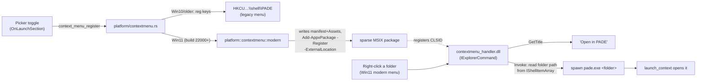

The register step needs **Developer Mode ON**; when it is off `Add-AppxPackage`
fails with `0x80073CFF`, which `modern::interpret` turns into a clear message
surfaced by the picker (the legacy menu is still applied).

## Tests

`pnpm test` runs both sides: `test:js` (vitest, colocated `*.test.ts` next to
each pure module) and `test:rust` (`cargo test`, colocated `#[cfg(test)]`
modules). The pure logic extracted from components -
`tab-fit`, `diff`, `paths`, `colors`, `format`, `reorder`, `usage-groups`, `validate`,
`highlight`, `errors`, the context store's percent parsing,
`auto-name`'s signal detection, `workspace-relocate`'s path remapping, `handoff`'s
slug, `tab-shortcuts`'s chord + tab-number matching, `pane-nav`'s pane cycling +
`pane-shortcuts`'s chord matching, `choice-prompt`'s
multiple-choice detection, `ansi` stripping, `task-detect`'s invocation matching,
`change-groups`' project bucketing, `file-type`'s badge mapping, and the pieces
split out of the large components (`pty-stream`'s replay splice, `pty-writer`'s
write merging, `pane-grid`, `terminal-output-scheduler`, `card-view`,
`type-filter`, `usage-meter`, `switcher-rows`, `sidebar-sections`, `window-route`, `root-path`,
`new-project`) - is where
new tests belong first: they run in milliseconds and need no window.

Above the unit layer, `pnpm test:e2e` (`scripts/smoke.mjs`) is a focused
boot-and-render gate over the real app via the WebView2 CDP port - see the
script's header for its deliberate scope limits and current scenarios.
